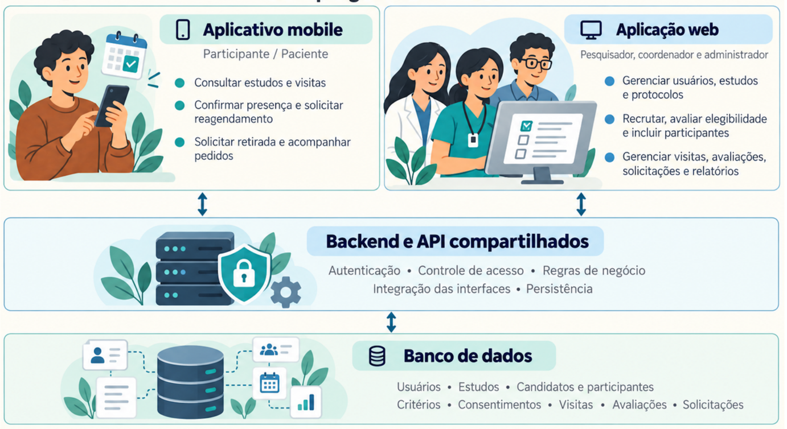

# ClinicalStudyPB


>Projeto acadêmico desenvolvido na disciplina de Engenharia de Software II da UEPB, no período 2026.2.

O ClinicalStudyPB é um sistema de gestão de estudos clínicos com dados fictícios. A proposta reúne uma aplicação web para a equipe responsável pelos estudos, um aplicativo para os participantes e uma API compartilhada entre essas interfaces.

## Sobre o sistema

O sistema permitirá gerenciar usuários, cadastrar estudos, organizar o recrutamento e acompanhar participantes e visitas. A aplicação web concentrará as atividades administrativas e de pesquisa, enquanto o aplicativo permitirá ao participante consultar informações sobre sua participação e realizar as ações previstas para seu perfil.

O desenvolvimento será dividido em três releases e seis sprints. As funcionalidades serão entregues gradualmente, seguindo os requisitos da disciplina e o planejamento registrado no Azure DevOps.

Como se trata de um projeto acadêmico, serão utilizados dados fictícios. O sistema não realiza diagnósticos nem decisões clínicas automatizadas.

## Arquitetura e tecnologias



A aplicação web e o aplicativo se comunicam com o mesmo backend por meio de uma API REST. O backend concentra as regras de negócio, o controle de acesso e a comunicação com o banco de dados.

// Colocar diagrama aqui
```text
Web — React ─────────────┐
                         ├── API REST — Spring Boot ── PostgreSQL
Mobile — React Native ───┘
```

As interfaces não acessam diretamente o banco. Dessa forma, as regras e os dados permanecem centralizados, mesmo quando são utilizados em telas diferentes.

| Componente | Tecnologias definidas |
|---|---|
| Backend | Java 21, Spring Boot e Maven Wrapper |
| Aplicação web | React, TypeScript e Vite |
| Aplicativo mobile | React Native, TypeScript e Expo |
| Banco de dados | PostgreSQL, com migrações Flyway |
| Documentação da API | OpenAPI e Swagger UI |
| Ambiente local | Docker e Docker Compose |
| Integração contínua | GitHub Actions |
| Planejamento e acompanhamento | Azure DevOps |

Essas escolhas representam a estrutura prevista para o projeto. A configuração de cada ferramenta será incorporada ao repositório nas atividades correspondentes, respeitando as versões definidas no Kickoff.

## Organização do repositório

```text
backend/             API Java + Spring Boot ⟶ Georis e Luiz
web/                 Interface React ⟶ Suelle e Sinddy
mobile/              Aplicativo React Native + Expo ⟶ Horlan
docs/                Decisões e orientações para a equipe
docs/diagramas/      Diagramas editáveis e imagens
releases/release1/   Evidências da primeira release
releases/release2/   Evidências da segunda release
releases/release3/   Evidências da terceira release
```

Gabriela apoia os testes integrados e prepara o ambiente com Docker Compose e a automação com GitHub Actions. Cada integrante também é responsável por testar e documentar o que implementa.

As pastas ainda sem implementação contêm apenas `.gitkeep`, um marcador vazio que permite registrá-las no Git. Sua existência organiza o trabalho, mas não significa que o componente esteja concluído.


## Executar o projeto

Cada componente terá suas próprias instruções de instalação e execução. Por enquanto, o procedimento disponível é o da base do backend.

### Backend

É necessário um **JDK 21 completo**, incluindo os executáveis `java` e `javac`.

Para iniciar a API, também é necessário PostgreSQL **17.11** disponível. Configure
`SPRING_DATASOURCE_URL`, `SPRING_DATASOURCE_USERNAME` e `SPRING_DATASOURCE_PASSWORD`
no terminal ou na IDE, conforme o banco preparado pela equipe. Os nomes estão em
`.env.example`, que serve como referência e não é carregado automaticamente.

O Maven Wrapper utiliza o Maven **3.9.16** e faz seu download na primeira execução. Nesse momento, também é necessário acesso à internet para obter as dependências.

#### Linux/macOS 🐧🍎

A partir da raiz do repositório:

```bash
cd backend
java -version
javac -version
./mvnw --version
./mvnw verify
./mvnw spring-boot:run
```

Se o terminal estiver utilizando outra versão do Java, configure `JAVA_HOME` e `PATH` para apontar para seu JDK 21 antes de continuar.

Ter apenas o executável `java` não garante que o compilador `javac` também esteja instalado.

#### Windows 🪟

Com `JAVA_HOME` apontando para seu JDK 21:

```powershell
cd backend
java -version
javac -version
.\mvnw.cmd --version
.\mvnw.cmd verify
.\mvnw.cmd spring-boot:run
```

O comando `verify` compila o projeto, executa os testes e gera o pacote da aplicação. Já `spring-boot:run` inicia o servidor.

O backend utiliza `http://localhost:8080`. A mensagem `Started ClinicalStudyPbApplication` confirma sua inicialização. Para encerrar, pressione `Ctrl+C` no terminal.

#### Conferir a proteção de acesso

Com o servidor ligado, execute em outro terminal:

```bash
curl -i -H 'Accept: application/json' http://localhost:8080/auth/sessao
```

No PowerShell, utilize `curl.exe` no lugar de `curl`.

Sem realizar login, a resposta esperada é **HTTP 401**, com o seguinte conteúdo:

```json
{
  "codigo": "AUTENTICACAO_NECESSARIA",
  "mensagem": "Entre no sistema para realizar esta operação."
}
```

Esse exemplo confere se o servidor responde e exige autenticação. O fluxo completo
de login, CSRF, consulta da sessão e logout está no [guia de autenticação](docs/autenticacao.md),
junto das orientações para integrar a web e preparar os dados de teste.

### Aplicação web, aplicativo e banco de dados

As instruções de execução serão acrescentadas conforme as bases forem disponibilizadas:

| Componente | Informações que serão documentadas |
|---|---|
| Web | Instalação das dependências, execução com Vite, endereço da API e testes |
| Mobile | Instalação das dependências, execução com Expo, configuração do Android e testes |
| Banco de dados | Inicialização com Docker Compose, variáveis de ambiente e aplicação das migrações |

O backend já utiliza PostgreSQL, JPA e Flyway. O Compose será disponibilizado na
task de ambiente; até lá, a execução depende de uma instância PostgreSQL configurada.
Os testes de segurança usam um repositório simulado e não exigem o banco, mas isso
não substitui a validação das migrações e da persistência no ambiente real.


## Autores

<table>
  <tr>
    <td align="center">
      <a href="https://github.com/gabiandradeal">
        <br />
        <sub><b>Gabriela Andrade</b></sub>
      </a>
    </td>
    <td align="center">
      <a href="https://github.com/georiSamuel">
        <br />
        <sub><b>Georis Samuel</b></sub>
      </a>
    </td>
    <td align="center">
      <a href="https://github.com/Horlanlacerda">
        <br />
        <sub><b>Horlan Lacerda</b></sub>
      </a>
    </td>
    <td align="center">
      <a href="https://github.com/SuelleMaciel">
        <br />
        <sub><b>Suelle Maciel</b></sub>
      </a>
    </td>
    <td align="center">
      <a href="https://github.com/Sinddylnn">
        <br />
        <sub><b>Sinddy Lorranny</b></sub>
      </a>
    </td>
    <td align="center">
      <a href="https://github.com/luizmouradc">
        <br />
        <sub><b>Luiz Moura</b></sub>
      </a>
    </td>
  </tr>
</table>
