# ClinicalStudyPB


>Projeto acadêmico desenvolvido na disciplina de Engenharia de Software II da UEPB, no período 2026.2.

O ClinicalStudyPB é um sistema de gestão de estudos clínicos com dados fictícios. A proposta reúne uma aplicação web para a equipe responsável pelos estudos, um aplicativo para os participantes e uma API compartilhada entre essas interfaces.

## Sobre o sistema

O sistema permite gerenciar usuários, cadastrar estudos, organizar o recrutamento e acompanhar participantes e visitas. A aplicação web concentra as atividades administrativas e de pesquisa, enquanto o aplicativo permite ao participante consultar informações sobre sua participação e realizar as ações previstas para seu perfil.

| Perfil | Responsabilidade |
|---|---|
| Administrador | Gerencia as contas de usuário. |
| Pesquisador | Cadastra estudos, configura protocolos e gerencia seus estudos. |
| Coordenador | Atua nos estudos aos quais está vinculado e conduz o recrutamento. |
| Participante | Representa a pessoa incluída no estudo. O aplicativo mobile ainda é um protótipo. |

O desenvolvimento está organizado em três releases e seis sprints. As funcionalidades serão entregues gradualmente, seguindo os requisitos da disciplina e o planejamento registrado no Azure DevOps.

Como se trata de um projeto acadêmico, serão utilizados dados fictícios. O sistema não realiza diagnósticos nem decisões clínicas automatizadas.

### Equipe

A equipe é formada por seis integrantes. Optamos 
por manter fixos os papéis disponíveis até o final do projeto, a única alternância é do PO que varia a cada Sprint, conforme definido pela professora.

| Integrante | Papel | 
|------------|-------|
| Georis Samuel | Tech Leader / Gerente | 
| Luiz Inácio| Desenvolvedor Backend |
| Suelle Maciel | Desenvolvedora Web (Web 1) |
| Sinddy Nóbrega | Desenvolvedor Web (Web 2) |
| Horlan Lacerda | Desenvolvedor Mobile |
| Gabriela Almeida | QA / DevOps | 

---

## Arquitetura


<div align="center">
  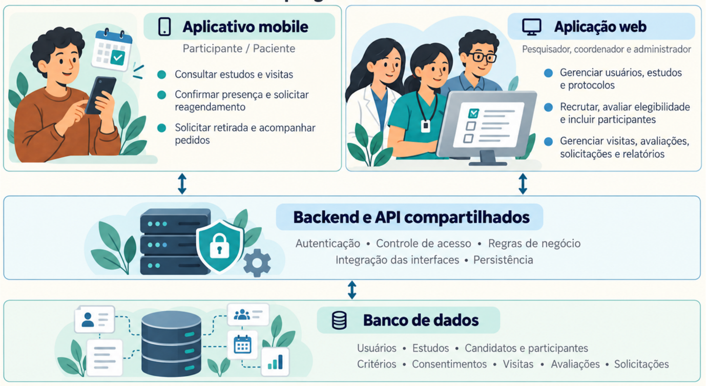
</div>

A aplicação web e o aplicativo se comunicam com o mesmo backend por meio de uma API REST. O backend concentra as regras de negócio, o controle de acesso e a comunicação com o banco de dados.


<p align="center">
  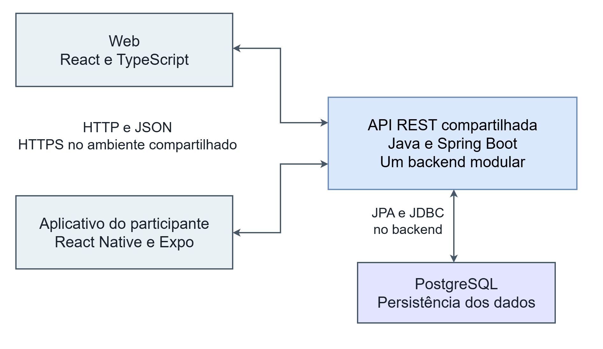
</p>

<table>
  <tr>
    <td width="50%" align="center">
      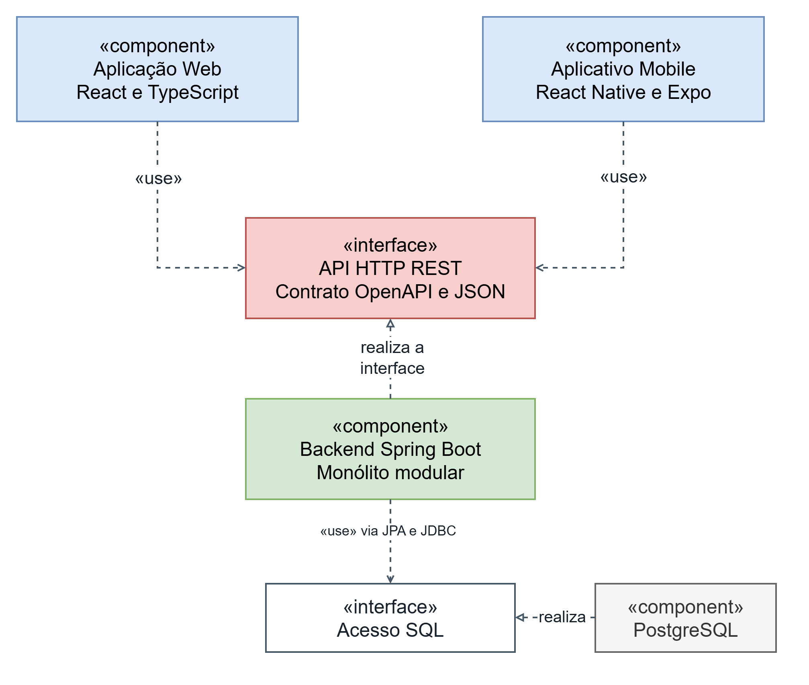<br>
      <sub>Componentes</sub>
    </td>
    <td width="50%" align="center">
      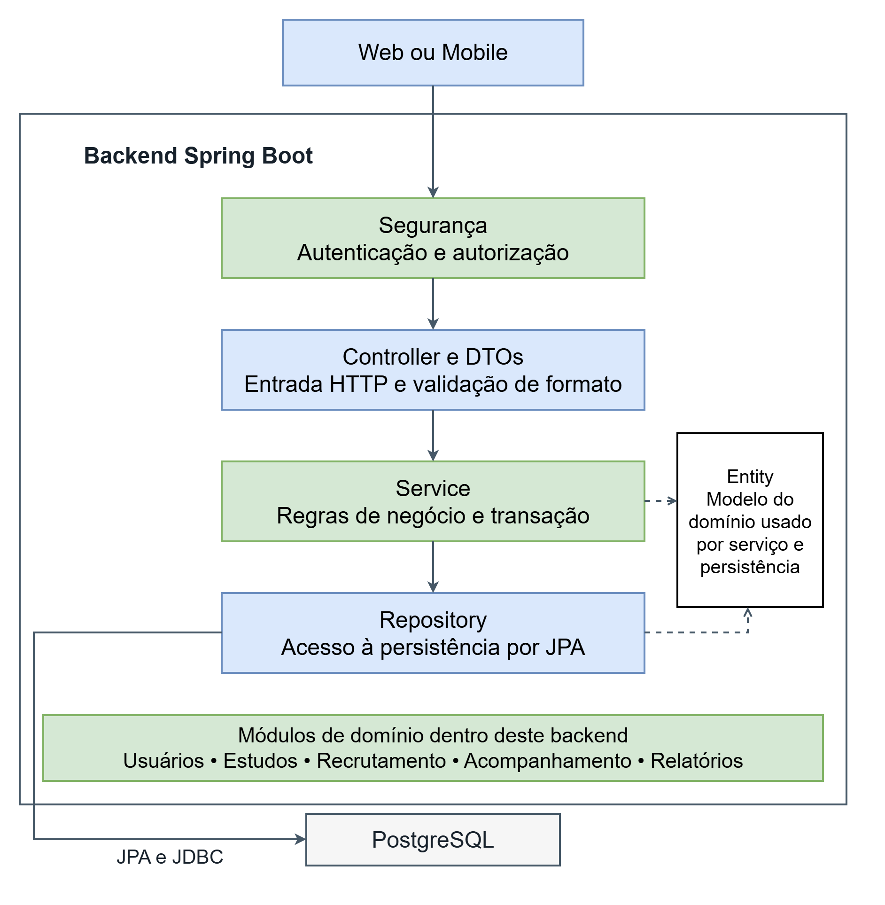<br>
      <sub>Camadas do backend</sub>
    </td>
  </tr>
</table>

<br>

As interfaces não acessam diretamente o banco. Dessa forma, as regras e os dados permanecem centralizados, mesmo quando são utilizados em telas diferentes.


### Casos de uso

<table>
  <tr>
    <td width="50%" align="center">
      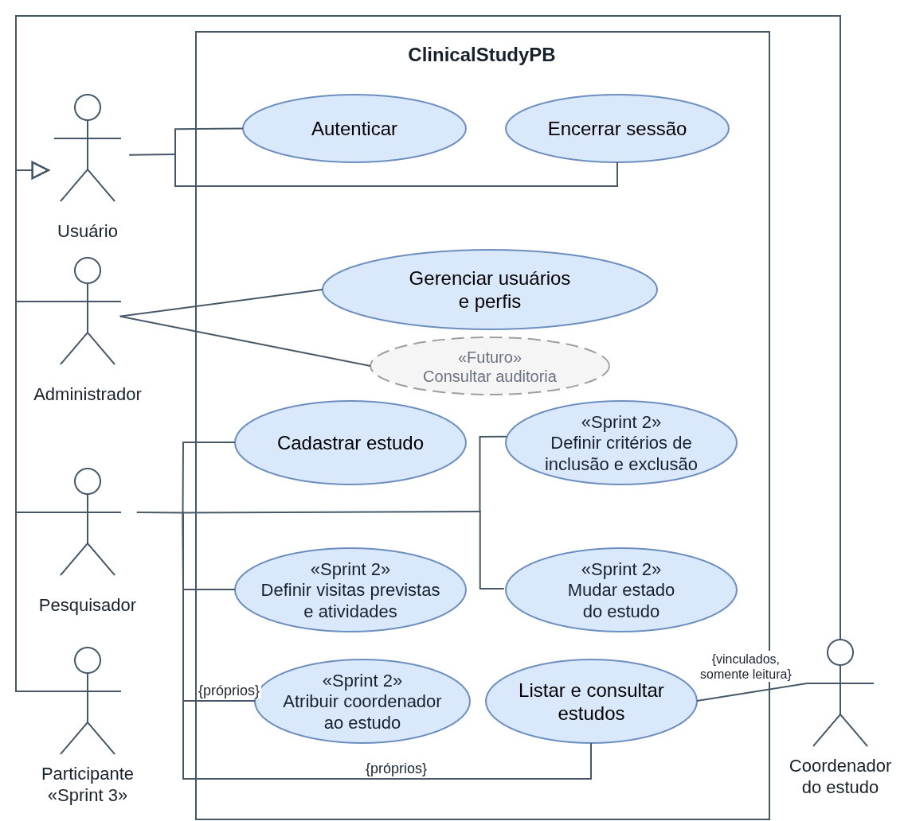<br>
      <sub>Acesso e estudos</sub>
    </td>
    <td width="50%" align="center">
      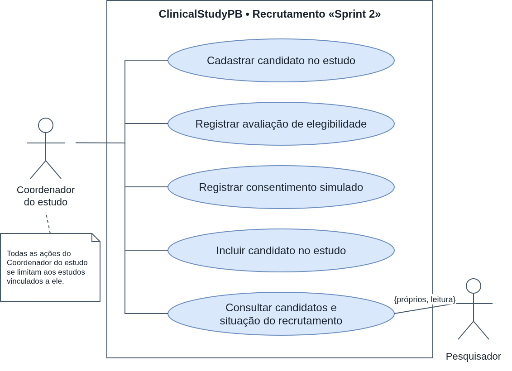<br>
      <sub>Recrutamento</sub>
    </td>
  </tr>
  <tr>
    <td width="50%" align="center">
      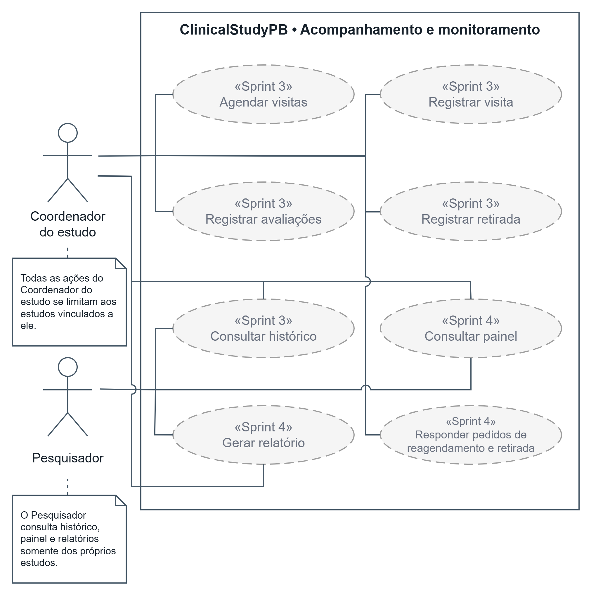<br>
      <sub>Acompanhamento</sub>
    </td>
    <td width="50%" align="center">
      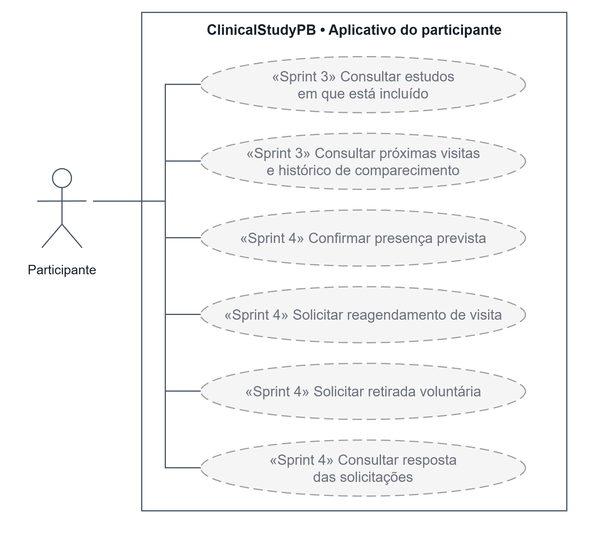<br>
      <sub>Participante</sub>
    </td>
  </tr>
</table>

<br>

### Modelos de domínio
Os modelos estão separados para tornar legíveis dois conjuntos relacionados do domínio, sem representar dois sistemas independentes
<p align="center">
  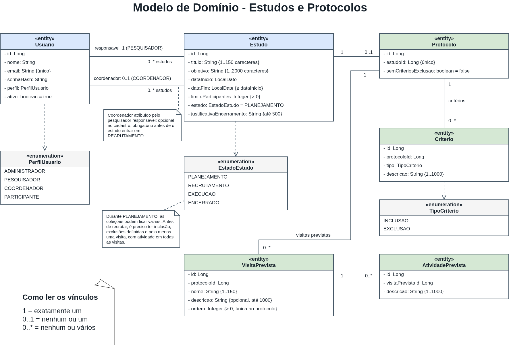
</p>

<p align="center">
  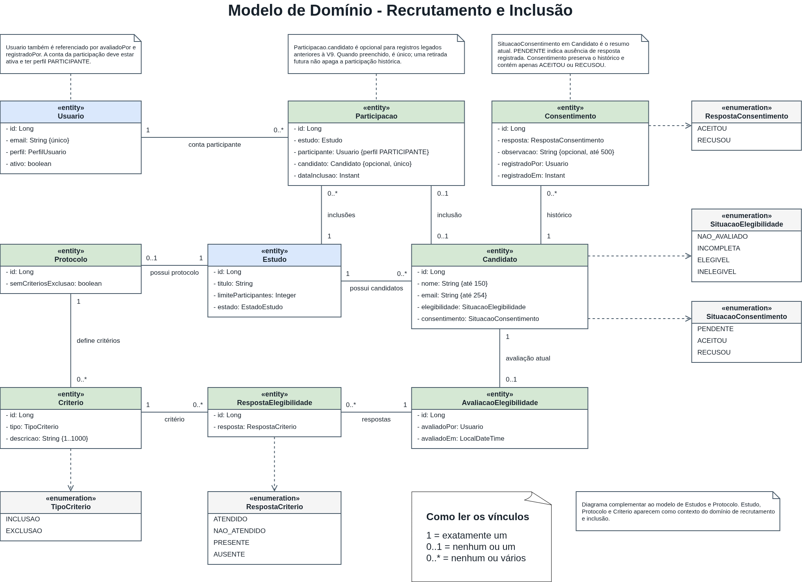<br>
</p>

<br>

### Sequência do fluxo principal

<p align="center">
  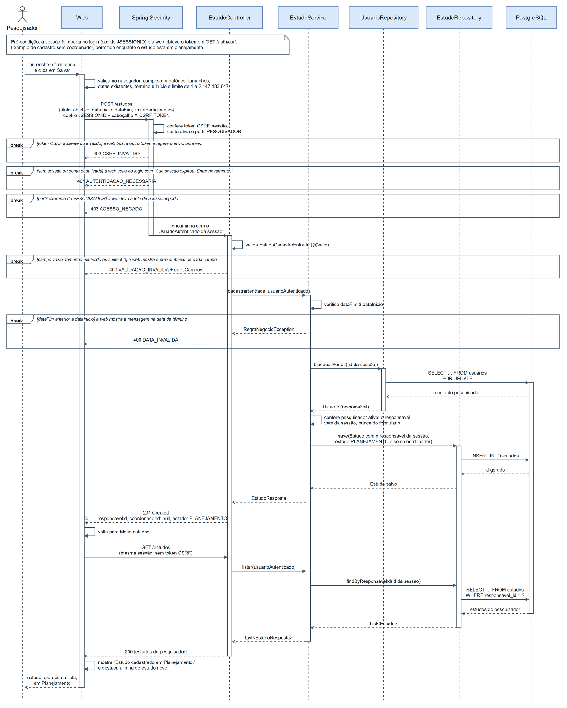
</p>

<br>

---

## Funcionalidades desenvolvidas

A tabela resume os requisitos da Release 1. As capturas e descrições detalhadas estão organizadas na pasta de evidências e no [README da Release 1](releases/release1/README.md).

| RF | Comportamento | Situação na Release 1 | Evidências web |
|---|---|---|---|
| RF01 | Cadastrar, listar, editar, desativar e reativar usuários, com validação de e-mail e proteção do último administrador ativo. | Concluído | [Usuário cadastrado](releases/release1/evidencias/web/04-usuario-cadastrado.png), [e-mail duplicado](releases/release1/evidencias/web/12-email-duplicado.png), [bloqueio do último administrador](releases/release1/evidencias/web/13-ultimo-administrador.png). |
| RF02 | Autenticar usuários e encerrar a sessão. | Concluído | [Login realizado](releases/release1/evidencias/web/01-login-sucesso-admin.png), [credenciais inválidas](releases/release1/evidencias/web/10-credenciais-invalidas.png), [sessão encerrada](releases/release1/evidencias/web/09-logout-sessao-encerrada.png), [sessão expirada](releases/release1/evidencias/web/15-sessao-expirada.png). |
| RF03 | Restringir funcionalidades conforme o perfil e o vínculo com o estudo. | Concluído | [Início do pesquisador](releases/release1/evidencias/web/02-inicio-pesquisador.png), [acesso negado](releases/release1/evidencias/web/14-acesso-negado.png). |
| RF04 | Cadastrar e listar estudos, com validações e persistência. | Concluído | [Lista de estudos](releases/release1/evidencias/web/44-estudos-lista.png), [estudo cadastrado](releases/release1/evidencias/web/45-estudo-cadastrado.png), [datas inválidas](releases/release1/evidencias/web/46-estudo-datas-invalidas.png). |
| RF05 | Definir critérios de inclusão e exclusão. | Concluído | [Critérios cadastrados](releases/release1/evidencias/web/19-rf05-criterios-sucesso.png), [erro de validação](releases/release1/evidencias/web/20-rf05-criterios-erro.png). |
| RF06 | Definir visitas previstas e atividades. | Concluído | [Visitas e atividades](releases/release1/evidencias/web/21-rf06-visitas-sucesso.png), [erro de validação](releases/release1/evidencias/web/22-rf06-visitas-erro.png). |
| RF07 | Gerenciar os estados do estudo conforme as regras de transição. | Concluído | [Transição bloqueada por pendências](releases/release1/evidencias/web/23-rf07-estado-erro.png), [confirmação da transição](releases/release1/evidencias/web/24-rf07-estado-confirmacao.png), [recrutamento iniciado](releases/release1/evidencias/web/25-rf07-estado-sucesso.png). |
| RF08 | Cadastrar e listar candidatos vinculados ao estudo. | Concluído | [Lista de candidatos](releases/release1/evidencias/web/28-recrutamento-lista-candidatos.png), [candidato cadastrado](releases/release1/evidencias/web/29-candidato-cadastrado.png), [campos inválidos](releases/release1/evidencias/web/34-candidato-campos-invalidos.png), [e-mail repetido](releases/release1/evidencias/web/35-candidato-email-repetido.png), [estudo fora do recrutamento](releases/release1/evidencias/web/36-candidato-estudo-fora-recrutamento.png). |
| RF09 | Avaliar a elegibilidade dos candidatos com base nos critérios do estudo. | Concluído | [Elegibilidade confirmada](releases/release1/evidencias/web/30-elegibilidade-elegivel.png), [candidato inelegível](releases/release1/evidencias/web/38-elegibilidade-inelegivel.png), [avaliação sem resposta](releases/release1/evidencias/web/37-elegibilidade-sem-resposta.png). |
| RF10 | Registrar consentimento simulado, com aceite ou recusa. | Concluído | [Consentimento registrado](releases/release1/evidencias/web/31-consentimento-registrado.png), [sem resposta de avaliação](releases/release1/evidencias/web/39-consentimento-sem-resposta.png), [sem avaliação](releases/release1/evidencias/web/40-consentimento-sem-avaliacao.png). |
| RF11 | Incluir candidatos elegíveis, respeitando o consentimento e o limite de vagas. | Concluído | [Condições de inclusão atendidas](releases/release1/evidencias/web/32-inclusao-condicoes-atendidas.png), [participante incluído](releases/release1/evidencias/web/33-participante-incluido.png), [consentimento recusado](releases/release1/evidencias/web/41-inclusao-consentimento-recusado.png), [candidato inelegível](releases/release1/evidencias/web/42-inclusao-candidato-inelegivel.png), [e-mail da conta diferente](releases/release1/evidencias/web/43-inclusao-email-diferente.png). |


### Protótipo mobile (Expo)

Na Release 1, foi preparada uma versão navegável do aplicativo mobile com Expo. Vale ressaltar que as telas abaixo registram a estrutura inicial e servem de protótipo para as funcionalidades mobile previstas para as próximas sprints.
Nesta entrega, o aplicativo ainda não consome a API, por isso, as capturas demonstram a execução e a navegação entre telas.

| Tela ou evidência | Captura |
|---|---|
| Tela inicial no emulador Android | [Ver captura](releases/release1/evidencias/mobile/Release1_Mobile_Emulador_Pixel4a_Tela_Inicio.png) |
| Navegação do protótipo | [Ver captura](releases/release1/evidencias/mobile/02-navegacao.png) |
| Aba Estudos | [Ver captura](releases/release1/evidencias/mobile/Release1_Mobile_Emulador_Pixel4a_Aba_Estudos.png) |
| Aba Visitas | [Ver captura](releases/release1/evidencias/mobile/Release1_Mobile_Emulador_Pixel4a_Aba_Visitas.png) |
| Aba Perfil | [Ver captura](releases/release1/evidencias/mobile/Release1_Mobile_Emulador_Pixel4a_Aba_Perfil.png) |
| Tela inicial em dispositivo físico com Expo Go | [Ver captura](releases/release1/evidencias/mobile/Release1_Mobile_Celular_S24_Android16_Tela_Inicio.jpeg) |


---
## Stack tecnológico e pré-requisitos

| Componente | Tecnologia e versão |
|---|---|
| Backend | Java 21, Spring Boot 4.1.1, Maven Wrapper 3.9.16 |
| Web | React 19.2.3, TypeScript 6.0.3, Vite 8.3.5, Node.js 24.22.0 |
| Testes web | Vitest 5.0.5 e Testing Library |
| Mobile | React Native 0.88.0, Expo 58.0.17, React 19.3.0, TypeScript 6.0.3, Node.js 24.11.1 |
| Testes mobile | Jest 30.5.2, Jest Expo 58.0.12 e React Native Testing Library 14.1.0 |
| Banco de dados | PostgreSQL 17.11 e Flyway |
| Ambiente local | Docker e Docker Compose v2.20 ou superior |
| API | OpenAPI e Swagger UI |

**Pré-Requisitos**
- Para executar o backend fora do Docker, é necessário JDK 21 completo, incluindo `java` e `javac`.
- Para o mobile, é necessário Android Studio com emulador ou um dispositivo com Expo Go.

**Observações:**
- As versões de Node registradas para web e mobile são diferentes devido à compatibilidade entre as frameworks e android emulator.
- A arquitetura e o stack definidos no nosso documento de Kickoff estão configurados no repositório, porém, o estado funcional de cada componente varia por release: consulte a documentação da entrega para distinguir módulos implementados, interfaces prototipadas e integrações ainda pendentes

---

## Organização do repositório

```text
🔎 ClinicalStudyPB/
│
├── 📁 backend/               API Java + Spring Boot ⟶ Georis e Luiz
├── 📁 web/                   Interface React ⟶ Suelle e Sinddy
├── 📁 mobile/                Aplicativo React Native + Expo ⟶ Horlan
├── 📁 docs/                  Decisões, diagramas e guias técnicos (autenticação, OpenAPI, Docker, modelagem, Postman)
├── 📁 assets/                Arquivos avulsos úteis
│
└── 📁 releases/              Documentação e evidências de cada release
    │
    ├── 📁 release1/          
    │   ├── 📁 evidencias/    Capturas e relatórios (web, mobile, backend)
    │   └── 📁 sprints/       Planning, review e burndown de cada sprint
    │
    ├── 📁 release2/          
    │
    └── 📁 release3/       
```

Gabriela apoia os testes integrados e prepara o ambiente com Docker Compose e a automação com GitHub Actions. Cada integrante também é responsável por testar e documentar o que implementa.


---

## Executar o projeto

### Executar banco, backend e web com Docker (caminho recomendado) 🐳

Na raiz do repositório, com o Docker em execução:

```bash
docker compose --profile web up -d --build --wait
```

Acesse a web em <http://localhost:5173> e o Swagger em <http://localhost:8080/swagger-ui.html>. O Compose fornece as variáveis de ambiente. Para personalizar portas ou credenciais, copie `.env.example` para `.env` antes de iniciar os serviços. Use apenas credenciais fictícias no ambiente local.

A configuração do Compose define `VITE_ESTUDOS_API=real`. Protocolo e recrutamento têm seletores próprios e podem permanecer simulados.

### Credenciais fictícias para demonstração

| Perfil | E-mail | Senha |
|---|---|---|
| Administrador | `admin@clinicalstudypb.test` | `Demo@123` |
| Pesquisador | `pesquisador@clinicalstudypb.test` | `Demo@123` |
| Coordenador | `coordenador@clinicalstudypb.test` | `Demo@123` |
| Participante | `participante@clinicalstudypb.test` | `Demo@123` |

Essas contas são exclusivas para demonstração local. A migração V4 cria os dados iniciais. A senha de login é diferente da senha de conexão com o PostgreSQL.

> As subseções seguintes descrevem como executar cada componente fora do Docker. No Linux, acrescente `sudo` aos comandos Docker se sua instalação exigir isso.

### Executar os componentes separadamente


#### BD
Para iniciar somente o banco via Docker, na raiz do repositório:

```bash
docker compose up -d --wait db
```

#### Backend
Para executar o backend fora do Docker, configure as variáveis de conexão. Em Linux/macOS, na raiz do repositório:

```bash
export SPRING_DATASOURCE_URL=jdbc:postgresql://localhost:5432/clinicalstudypb
export SPRING_DATASOURCE_USERNAME=clinicalstudypb
export SPRING_DATASOURCE_PASSWORD='clinicalstudypb_dev'
cd backend
./mvnw spring-boot:run
```

No PowerShell, defina as mesmas variáveis com `$env:NOME_DA_VARIAVEL="valor"` e execute `.\mvnw.cmd spring-boot:run` dentro de `backend/`.


#### Web
Para executar a web fora do Docker, em outro terminal:

```bash
cd web
npm ci
npm run dev
```

Acesse <http://localhost:5173>. O backend precisa estar ativo para autenticação e para os serviços configurados para usar a API real.


#### Mobile
Para executar o protótipo mobile, abra um emulador Android ou conecte um celular com Expo Go:

```bash
cd mobile
npm ci
npx expo start --android
```

Em um dispositivo físico, use `npx expo start` e leia o QR code com Expo Go. O mobile ainda não consome a API. Consulte o [guia de execução com Docker](docs/execucao/execucao-docker.md) para detalhes de configuração, logs e solução de problemas.

---

## Testes, cobertura e evidências


Os resultados abaixo são os registrados nas evidências da Release 1. É importante ressaltar que são execuções distintas e não devem ser somadas como se fossem uma única rodada de testes.

| Módulo | Resultado registrado | Evidência |
|---|---|---|
| Backend | 272 testes na validação de 05/11/2026, sem falhas, erros ou testes ignorados. | [Execução dos testes](releases/release1/evidencias/backend/testes-backend.png) |
| Backend | 97% de cobertura geral de linhas JaCoCo. Os serviços de recrutamento alcançaram 95% e os de estudos, 96%, acima do mínimo de 80% exigido para o código de negócio. | [Relatório de cobertura JaCoCo](releases/release1/evidencias/backend/jacoco/cobertura-jacoco.png) |
| Web | 414 testes em 28 arquivos, com 99,23% de cobertura, medidos na branch web antes do PR #39. | [Execução](releases/release1/evidencias/web/26-rf05-07-testes.png) e [cobertura](releases/release1/evidencias/web/27-rf05-07-cobertura.png) |
| Mobile | 6 testes Jest passando; a aplicação também foi executada e navegada no emulador Android. | [Testes Jest](releases/release1/evidencias/mobile/Release1_Mobile_Jest_6_Testes_Passando.png) e [relatório de execução](releases/release1/evidencias/mobile/teste-mobile-sprint2.md) |
| API | Coleção Postman com 102 testes e zero falhas, conforme relatório da Release 1. | [Relatório Postman](releases/release1/evidencias/backend/postman/relatorio-execucao.md) |

A meta de cobertura do backend é de no mínimo 80% das linhas do código de negócio. Para executar a suíte padrão e verificar a cobertura JaCoCo, use JDK 21 dentro da pasta `backend/`:

```bash
cd backend
./mvnw -B verify
```

Os testes de persistência `*IT` usam PostgreSQL exclusivo para testes. Para executá-los, inicie o banco descartável a partir da raiz:

```bash
docker compose --profile test up -d --wait db-test
```

Configure `CLINICALSTUDYPB_TEST_DB_URL`, `CLINICALSTUDYPB_TEST_DB_USER` e `CLINICALSTUDYPB_TEST_DB_PASSWORD` para o banco `clinicalstudypb_test`, disponível por padrão na porta `5433`. Depois, em `backend/`, execute:

```bash
./mvnw -B clean '-Dtest=*Test,*IT' verify
```

Ao terminar, pare o banco de testes:

```bash
docker compose --profile test stop db-test
```

Não use o banco de desenvolvimento para testes de persistência. As instruções detalhadas estão nos guias de [configuração do protocolo](docs/api/configuracao-protocolo.md) e [consentimento e inclusão](docs/api/consentimento-inclusao.md).

O GitHub Actions está configurado para backend e web. Na entrega da release 1, tivemos um problema: os jobs não foram iniciados pelo GitHub devido a um problema de cobrança da conta. Os resultados listados acima foram verificados antes desse impedimento. 

---

## Documentação da API

Com o backend em execução:

- [Swagger UI](http://localhost:8080/swagger-ui.html)
- [Contrato OpenAPI em JSON](http://localhost:8080/v3/api-docs)
- [Contrato OpenAPI em YAML](http://localhost:8080/v3/api-docs.yaml)

O Swagger documenta as operações disponíveis no backend. Para instruções sobre autenticação, CSRF e permissões, consulte o [guia OpenAPI](docs/api/openapi.md).

---

## Releases

| Release | Sprints | Documentação |
|---|---|---|
| Release 1 | 1 e 2 | [README da Release 1](releases/release1/README.md) |
| Release 2 | 3 e 4 | [README da Release 2](releases/release2/README.md) |
| Release 3 | 5 e 6 | [README da Release 3](releases/release3/README.md) |

Cada `README` de release registra o objetivo, os requisitos, o estado de implementação daquela entrega, suas evidências, os resultados de testes e o processo de desenvolvimento.

---

## Autores

<table>
  <tr>
    <td align="center">
      <a href="https://github.com/gabiandradeal">
        <br />
        <sub><b>Gabriela Andrade</b></sub>
      </a>
    </td>
    <td align="center">
      <a href="https://github.com/georiSamuel">
        <br />
        <sub><b>Georis Samuel</b></sub>
      </a>
    </td>
    <td align="center">
      <a href="https://github.com/Horlanlacerda">
        <br />
        <sub><b>Horlan Lacerda</b></sub>
      </a>
    </td>
    <td align="center">
      <a href="https://github.com/SuelleMaciel">
        <br />
        <sub><b>Suelle Maciel</b></sub>
      </a>
    </td>
    <td align="center">
      <a href="https://github.com/Sinddylnn">
        <br />
        <sub><b>Sinddy Lorranny</b></sub>
      </a>
    </td>
    <td align="center">
      <a href="https://github.com/luizmouradc">
        <br />
        <sub><b>Luiz Moura</b></sub>
      </a>
    </td>
  </tr>
</table>
