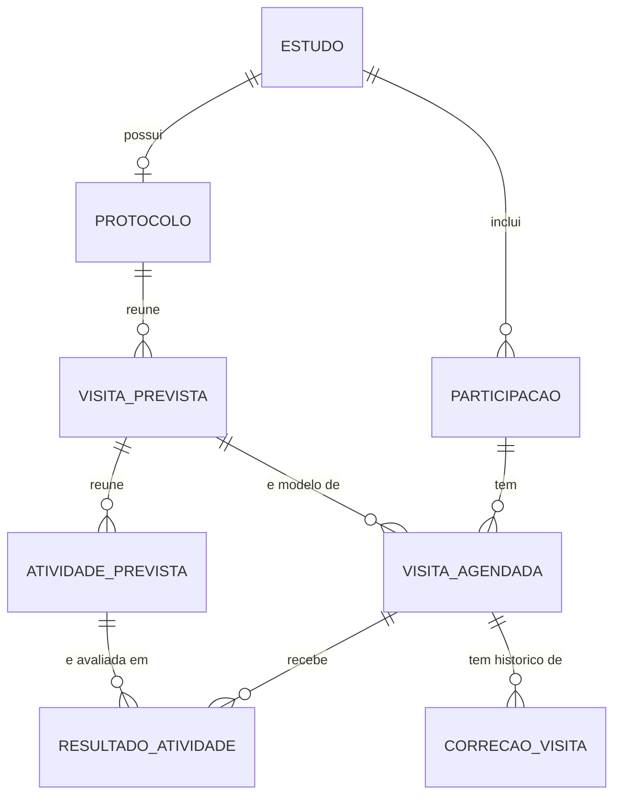
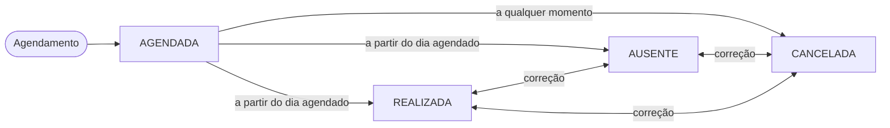
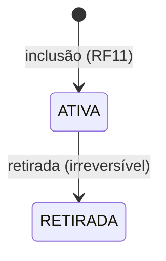
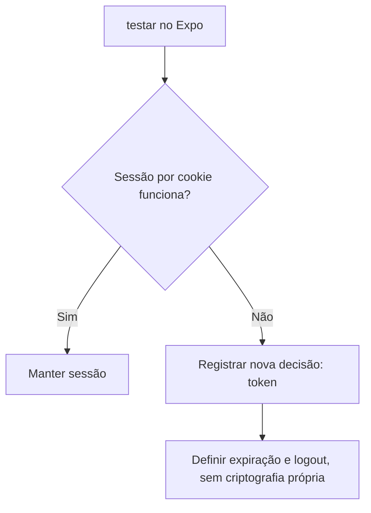

# Modelagem do acompanhamento e do app do participante (RF12 a RF18)

>Este documento registra a modelagem das visitas agendadas, resultados, histórico, retirada e consultas do aplicativo, definida por Georis em 10/11/2026. O objetivo é orientar o backend, a web e o mobile com os mesmos campos, vínculos e regras na Sprint 3.

O ponto de partida é o Kickoff (seções 5.2, 8.1, 8.4 e 8.5, decisões D04, D05, D10 e D12) e a modelagem dos RF05 a RF07. Este material completa o que já estava combinado e resolve os itens marcados como "a combinar" no planejamento da Sprint 3. Quando uma regra vem do Kickoff, isso é indicado.

## Rastreabilidade das tasks

Os códigos T são os identificadores do planejamento da Sprint; os números Azure DevOps abaixo são os IDs reais mostrados nas capturas recebidas.

| Task no planejamento | ID Azure DevOps | Atividade |
|---|---:|---|
| T70 | 3951 | Consultas do participante: estudos incluídos, próximas visitas e histórico |
| T90 | 3952 | Tela de estudos do participante (RF17) |
| T91 | 3953 | Próximas visitas e histórico de comparecimento (RF18) |
| T68 | 3954 | Validar a sessão no aplicativo e ajustar a autenticação mobile |
| T88 | 3955 | Login e logout mobile integrados à API |
| T89 | 3956 | Restringir o aplicativo ao perfil participante e tratar sessão encerrada |
| T69 | 3957 | Registro de retirada de participante no backend |
| T74 | 3958 | Registro de resultados fictícios das avaliações |
| T75 | 3959 | Consulta do histórico de visitas e avaliações |
| T83 | 3960 | Registro de resultados fictícios das avaliações |
| T84 | 3961 | Tela de histórico de visitas e avaliações |
| T85 | 3962 | Registro de retirada do participante |
| T67 | 3963 | Modelar visita agendada, resultados e retirada; criar migrações |
| T72 | 3964 | Agendamento de visitas para participantes incluídos |
| T73 | 3965 | Registro de realização, ausência e cancelamento de visitas |
| T77 | 3966 | Lista de participantes incluídos e tela de agendamento |
| T78 | 3967 | Registro de realização, ausência e cancelamento de visitas |

O ID Azure DevOps de T71 não aparece nas capturas recebidas e, por isso, não é inferido aqui.

## 1. Como os registros se organizam

A visita **prevista** é o modelo do protocolo enquanto a visita **agendada** é uma ocorrência desse modelo para um participante, com data e hora. A **participação** é o registro criado pela inclusão (RF11, migração V9): ela liga o candidato à conta do participante e ao estudo. Ter conta com perfil participante não equivale a estar incluído; quem agenda visitas é a participação.

Já existem: Estudo, Protocolo, VisitaPrevista, AtividadePrevista e Participacao. Novos nesta sprint: `VisitaAgendada`, `ResultadoAtividade` e `CorrecaoVisita`, além de campos de retirada em `Participacao`.

| Relacionamento | Regra |
|---|---|
| Participação e visita agendada | Uma participação pode ter várias visitas agendadas. Cada visita agendada pertence a exatamente uma participação. |
| Visita prevista e visita agendada | Uma visita prevista pode originar várias visitas agendadas (de participantes diferentes ou em momentos diferentes). A visita prevista deve ser do protocolo do mesmo estudo da participação. |
| Visita agendada e resultados | Uma visita pode ter vários resultados, no máximo um por atividade prevista. |
| Visita agendada e correções | Uma visita pode ter várias correções. Cada correção pertence a exatamente uma visita. |

A `ordem` da visita prevista serve para apresentação. Ela **não** impõe sequência: o backend não exige que a visita 1 tenha sido realizada para agendar a visita 2.

## 2. Entidades e campos

### 2.1. Participacao (complemento)

| Campo | Tipo | Regra |
|---|---|---|
| `situacao` | Enum `SituacaoParticipacao` (novo nesta sprint) | `ATIVA` ou `RETIRADA`. Inicia `ATIVA` na inclusão. |
| `dataRetirada` | Data e hora | Preenchida pelo backend ao retirar. |
| `motivoRetirada` | Texto | Obrigatório na retirada, de 1 a 500 caracteres após retirar espaços das pontas. |
| `retiradaPorId` | Identificador de usuário | Coordenador que registrou, preenchido pelo backend. |

Conferência do código atual: a entidade existente se chama `Participacao` e está mapeada para a tabela `participacoes`. Ela contém os vínculos com estudo, conta de participante e candidato, além da data de inclusão. Não existe atualmente um enum `SituacaoParticipacao` nem campos de situação ou retirada. A V9 apenas acrescenta `candidato_id` com chave estrangeira e unicidade, e preenche vínculos legados quando encontra candidato correspondente; ela não define a situação da participação. Portanto, `SituacaoParticipacao` é uma proposta nova desta sprint, não um nome confirmado pela V9.

### 2.2. VisitaAgendada

| Campo | Tipo | Regra |
|---|---|---|
| `id` | Identificador inteiro (`Long`) | Gerado pelo backend. |
| `participacaoId` | Identificador de participação | Obrigatório. |
| `visitaPrevistaId` | Identificador de visita prevista | Obrigatório. |
| `dataHora` | Data e hora | Obrigatória. Regras na seção 3.1. |
| `situacao` | Enum `SituacaoVisita` | `AGENDADA`, `REALIZADA`, `AUSENTE` ou `CANCELADA`. Inicia `AGENDADA`. |
| `motivo` | Texto | Até 500 caracteres. Obrigatório para `CANCELADA`, opcional para `AUSENTE`, não se aplica a `REALIZADA`. |
| `registradoPorId` e `registradoEm` | Usuário e data e hora | Vazios enquanto `AGENDADA`. Preenchidos pelo backend a cada registro ou correção (o último prevalece). |

Só pode existir **uma visita `AGENDADA` por participação e visita prevista**. No PostgreSQL, usar índice único parcial (`WHERE situacao = 'AGENDADA'`) além da verificação no serviço, para que duas requisições simultâneas não gerem duplicidade.

### 2.3. CorrecaoVisita

Segue a ideia do histórico de correções do consentimento (RF10).

| Campo | Tipo | Regra |
|---|---|---|
| `id` | `Long` | Gerado pelo backend. |
| `visitaAgendadaId` | Identificador de visita | Obrigatório. |
| `situacaoAnterior` e `situacaoNova` | Enum `SituacaoVisita` | Obrigatórios e diferentes entre si. Nenhum dos dois pode ser `AGENDADA`. |
| `justificativa` | Texto | Obrigatória, de 1 a 500 caracteres após retirar espaços das pontas. |
| `corrigidaPorId` e `corrigidaEm` | Usuário e data e hora | Preenchidos pelo backend. |

### 2.4. ResultadoAtividade

| Campo | Tipo | Regra |
|---|---|---|
| `id` | `Long` | Gerado pelo backend. |
| `visitaAgendadaId` | Identificador de visita | Obrigatório. |
| `atividadePrevistaId` | Identificador de atividade prevista | Obrigatório. Deve pertencer à **visita prevista** da visita agendada. Única por visita. |
| `texto` | Texto | Obrigatório, de 1 a 1.000 caracteres após retirar espaços das pontas. Texto simples e fictício. |
| `registradoPorId` e `registradoEm` | Usuário e data e hora | Preenchidos na criação. |
| `atualizadoPorId` e `atualizadoEm` | Usuário e data e hora | Preenchidos em cada edição. |

### 2.5. Validações comuns

Valem as mesmas regras da seção 2.6 da modelagem RF05 a RF07: espaços das pontas retirados antes de validar, textos obrigatórios só com espaços rejeitados, identificadores gerados pelo backend e **vínculos verificados**. Exemplos: uma visita só é acessada pelo estudo e pela participação a que pertence; um resultado só aceita atividade da visita prevista correspondente; um coordenador só acessa estudos aos quais está vinculado (D04).

Toda alteração é registrada na auditoria (D12), na mesma transação, com valor anterior e novo para situação e data.

## 3. Regras por requisito

### 3.1. RF12: agendar visitas

O agendamento só é aceito quando **todas** as condições abaixo forem verdadeiras:

1. Quem agenda é o coordenador vinculado ao estudo.
2. O estudo está em `RECRUTAMENTO` ou `EXECUCAO`.
3. A participação existe naquele estudo e está `ATIVA`.
4. A visita prevista pertence ao protocolo do estudo.
5. A data não é anterior a hoje (comparação por dia, não por hora) e está dentro do período do estudo (`dataInicio` a `dataFim`, inclusive).
6. Não existe outra visita `AGENDADA` da mesma participação para a mesma visita prevista.

**Reagendar é editar a `dataHora` enquanto a visita estiver `AGENDADA`**, com as mesmas regras de data. Não cria outra visita. O valor anterior vai para a auditoria. Na Sprint 4, a mudança de data deverá limpar a confirmação de presença do RF19 (Kickoff 8.4).

Depois de `REALIZADA`, `AUSENTE` ou `CANCELADA`, é possível agendar novamente a mesma visita prevista, pois a regra 6 olha apenas visitas `AGENDADA`.

Para a tela de agendamento, a API deve listar as participações do estudo com sua situação (`ATIVA` e `RETIRADA`), se essa consulta ainda não existir. Participações retiradas aparecem identificadas e não permitem agendar.

Uma visita `AGENDADA` cuja data já passou continua pendente até ser registrada (Kickoff 8.5).

### 3.2. RF13: registrar a visita

| Situação | Regra |
|---|---|
| Registro | Só a partir de `AGENDADA`, pelo coordenador vinculado, com o estudo em `RECRUTAMENTO` ou `EXECUCAO` e a participação `ATIVA`. |
| `REALIZADA` e `AUSENTE` | Permitidas quando o dia da `dataHora` é hoje ou anterior. |
| `CANCELADA` | Permitida a qualquer momento, com motivo. |
| Correção | Troca uma situação final por outra, com justificativa. Cria um `CorrecaoVisita`. **Nunca volta para `AGENDADA`** (Kickoff 8.4). Para corrigir para `REALIZADA` ou `AUSENTE`, vale a regra de data acima. |
| Bloqueio da correção | Bloqueada se a visita já tiver resultados (RF14), se o estudo estiver `ENCERRADO` ou se a participação estiver `RETIRADA`. |

### 3.3. RF14: resultados fictícios

1. Só em visita `REALIZADA`, pelo coordenador vinculado, com o estudo em `RECRUTAMENTO` ou `EXECUCAO` e a participação `ATIVA`.
2. Um resultado por atividade prevista da visita prevista, com texto de 1 a 1.000 caracteres.
3. O registro pode ser **parcial**: não é obrigatório preencher todas as atividades, e resultados incompletos não bloqueiam nenhuma transição do estudo.
4. Resultados podem ser editados enquanto o estudo não estiver `ENCERRADO`. Não são removidos.
5. Depois do primeiro resultado, a situação da visita não pode ser corrigida.

### 3.4. RF15: histórico do participante

Consulta por participação, em ordem cronológica (da mais antiga para a mais recente), para o coordenador vinculado e para o pesquisador responsável.

| Item do histórico | Campos |
|---|---|
| Visita | Nome da visita prevista, `dataHora`, situação, motivo, quem registrou e quando, resultados por atividade (descrição da atividade e texto) e correções (situações, justificativa, quem e quando). |
| Retirada | Aparece como um item no ponto da linha do tempo correspondente à `dataRetirada`, com motivo e quem registrou. |

A consulta continua disponível com o estudo `ENCERRADO` e para participações `RETIRADA`.

### 3.5. RF16: retirada

Condições: coordenador vinculado, estudo em `RECRUTAMENTO` ou `EXECUCAO`, participação `ATIVA` e motivo válido. Na mesma transação, o backend:

1. marca a participação como `RETIRADA`, com data, motivo e responsável;
2. cancela as visitas `AGENDADA` da participação, com `motivo` automático "Retirada do participante";
3. cancela pedidos pendentes de reagendamento ligados a essas visitas (quando o RF19 existir, na Sprint 4);
4. preserva visitas e resultados anteriores.

Não exclui a conta, não afeta outros estudos e não permite novas ações no vínculo (agendar, registrar, corrigir ou lançar resultados). Por isso, resultados de uma visita realizada devem ser lançados antes da retirada.

**Perguntas em aberto do planejamento, respondidas pelo Kickoff:**

| Pergunta | Resposta |
|---|---|
| A vaga é liberada? | **Não.** O limite considera inclusões históricas (Kickoff 8.1 e 8.5). |
| Retirados contam nas regras de estado do estudo? | **Sim**, como inclusões históricas. Ver seção 4. |

A solicitação de retirada pelo app (RF20) é da Sprint 4 e não processa a retirada sozinha (Kickoff, seção 1.2). Quando existir, o coordenador a concluirá por esta mesma operação.

## 4. Impacto no RF07 (estados do estudo)

| Transição ou situação | Efeito desta sprint |
|---|---|
| `RECRUTAMENTO` → `EXECUCAO` | Sem mudança. Exige pelo menos um participante **incluído** (contagem histórica). Um estudo cujos incluídos já se retiraram ainda satisfaz a condição. |
| `EXECUCAO` → `ENCERRADO` | **Passa a consultar visitas reais:** bloquear se existir visita `AGENDADA` no estudo. Solicitações pendentes continuam fora, pois são da Sprint 4. A mensagem deve indicar a pendência (ex.: quantas visitas e de quais participantes). |
| Encerramento antecipado | Sem mudança. Quem já foi incluído, mesmo retirado, impede o encerramento a partir de planejamento ou recrutamento. |
| `ENCERRADO` | Todas as operações de escrita do RF12 a RF16 são bloqueadas. Consultas continuam, conforme o perfil. |

Todas as operações de escrita deste módulo devem **bloquear o registro do estudo** (o mesmo bloqueio pessimista usado nas mudanças de estado) e conferir o estado dentro da transação. Assim, um agendamento não é confirmado depois que o encerramento já foi validado, e o contrário também vale. Retirada e agendamento da mesma participação também devem ser serializados.

## 5. Permissões

Confirma a atribuição proposta no Kickoff (5.2 e D10): o coordenador vinculado concentra agendamento, registro, resultados e retirada.

| Operação | Admin | Pesquisador | Coordenador | Participante |
|---|---|---|---|---|
| Agendar e reagendar, RF12 | Não | Não | Vinculado, estudo em recrutamento ou execução | Não |
| Registrar e corrigir visitas, RF13 | Não | Não | Vinculado, estudo em recrutamento ou execução | Não |
| Resultados, RF14 | Não | Não | Vinculado, estudo em recrutamento ou execução | Não |
| Retirada, RF16 | Não | Não | Vinculado, estudo em recrutamento ou execução | Solicita pelo app (Sprint 4) |
| Histórico completo, RF15 | Não | Próprios, só leitura | Vinculado, leitura | Não |
| Estudos, visitas e comparecimento no app, RF17 e RF18 | Não | Não | Não | Próprios, sem resultados |

Perfil sem permissão recebe `403`. Estudo ou participação fora do alcance (outro pesquisador, coordenador não vinculado, outro participante) recebe `404`, conforme o contrato existente.

## 6. Aplicativo do participante

### 6.1. Login e logout (RF02 e RF03 no app)

O Kickoff (2.2 e D05) define sessão do Spring Security, com expiração de 30 minutos sem uso, e pede validar cookies no dispositivo antes de implementar. A validação é a T68, **até 12/11**.

| Teste da T68 | Resultado esperado |
|---|---|
| Login | Cookie de sessão guardado pelo app. |
| GET autenticado | Cookie reenviado automaticamente. |
| POST com CSRF | O app obtém o token CSRF sem `document.cookie` (por exemplo, por resposta da API) e o envia no cabeçalho. |
| Logout | Sessão invalidada no servidor: o GET seguinte retorna `401`. |
| Sessão expirada | `401` leva o app de volta ao login com aviso. |

Restrição ao perfil participante: o login é o mesmo da web. Após entrar, o app consulta o usuário atual; se o perfil não for participante, encerra a sessão e exibe o aviso "Este aplicativo é exclusivo para participantes". O backend não depende disso: as rotas do participante exigem esse perfil e retornam `403` para os demais.

### 6.2. Consultas (RF17 e RF18)

Os dados vêm da mesma API da web. As rotas são **baseadas na sessão, sem identificador de participante na URL**. Os caminhos abaixo são indicativos, a consolidar no OpenAPI.

| Consulta | Rota exemplo | Conteúdo |
|---|---|---|
| Estudos do participante (RF17) | `GET /participante/estudos` | Título, objetivo, estado, datas e situação da participação (Ativo ou Retirado). Inclui estudos dos quais se retirou, identificados como "Retirado" (Kickoff 8.4). |
| Próximas visitas (RF18) | `GET /participante/visitas/proximas` | Visitas `AGENDADA` com dia de hoje em diante, em ordem crescente: estudo, nome da visita e `dataHora`. |
| Histórico de comparecimento (RF18) | `GET /participante/visitas/historico` | Visitas `REALIZADA`, `AUSENTE` e `CANCELADA`, da mais recente para a mais antiga: estudo, nome da visita, `dataHora` e situação. |

Regras: as consultas de visitas aceitam `estudoId` opcional, validado contra as participações da sessão (`404` se não houver vínculo). O app **não** mostra resultados, motivos, justificativas nem quem registrou. Uma visita agendada na web aparece no app pela mesma API (Kickoff, seção 1.2). Confirmar presença (RF19) e solicitar reagendamento ou retirada (RF20) ficam para a Sprint 4.

## 7. Erros

Formato do Kickoff: `codigo`, `mensagem` e `errosCampos` quando houver erro em campo. Os códigos abaixo são sugestões, a consolidar no OpenAPI.

| Situação | HTTP | Código sugerido |
|---|---|---|
| Participação não existe no estudo ou está retirada | 400 | `PARTICIPACAO_INVALIDA` |
| Estudo fora de recrutamento ou execução | 400 | `ESTADO_ESTUDO_INVALIDO` |
| Data anterior a hoje ou fora do período do estudo | 400 | `DATA_VISITA_INVALIDA` |
| Já existe visita agendada para essa visita prevista | 409 | `VISITA_JA_AGENDADA` |
| Registro de visita que não está `AGENDADA`, ou antes do dia agendado | 400 | `TRANSICAO_VISITA_INVALIDA` |
| Correção bloqueada por resultados | 400 | `CORRECAO_BLOQUEADA` |
| Resultado em visita não realizada, ou atividade de outra visita | 400 | `RESULTADO_INVALIDO` |
| Motivo ou justificativa vazios ou acima do limite | 400 | campo em `errosCampos` |

## 8. Exemplos para conferir a implementação

| Situação | Resultado esperado |
|---|---|
| Agendar para uma conta com perfil participante que não foi incluída. | Rejeitar: não há participação. |
| Agendar com o estudo em planejamento ou encerrado. | Rejeitar. |
| Agendar para hoje, para uma data dentro do período, e para uma data de ontem. | Permitir os dois primeiros; rejeitar o terceiro. |
| Agendar duas vezes a mesma visita prevista para a mesma participação, ainda `AGENDADA`. | Rejeitar a segunda com `409`, inclusive em requisições simultâneas. |
| Agendar a mesma visita prevista para dois participantes diferentes. | Permitir. |
| Reagendar uma visita `AGENDADA` para outra data válida. | Permitir, na mesma visita. |
| Registrar `REALIZADA` ou `AUSENTE` para uma visita de data futura. | Rejeitar. |
| Cancelar uma visita de data futura, com motivo. | Permitir. |
| Corrigir `AUSENTE` para `REALIZADA` com justificativa, sem resultados. | Permitir e criar a correção. |
| Corrigir uma visita `REALIZADA` que já tem resultados. | Rejeitar. |
| Tentar voltar uma visita final para `AGENDADA`. | Rejeitar. |
| Lançar resultado em visita `AUSENTE`. | Rejeitar. |
| Lançar resultados em apenas parte das atividades. | Permitir. |
| Retirar um participante com duas visitas `AGENDADA` e uma `REALIZADA`. | As duas viram `CANCELADA`; a realizada e seus resultados são preservados; nova vaga não é liberada. |
| Tentar agendar ou lançar resultado para participação `RETIRADA`. | Rejeitar. |
| Encerrar a execução com uma visita `AGENDADA` no estudo. | Bloquear e identificar a pendência. |
| Pesquisador responsável tenta agendar uma visita. | `403`. |
| Coordenador não vinculado consulta o histórico. | `404`. |
| Participante A consulta visitas com `estudoId` de um estudo em que não está incluído. | `404`. |
| Usuário com perfil de pesquisador entra no app. | Sessão encerrada com aviso. |
| Participante retirado abre o app. | Estudo listado como "Retirado" e sem próximas visitas. |

## Migração

Nova migração Flyway com: tabelas `visita_agendada`, `correcao_visita` e `resultado_atividade`; colunas de situação e retirada em `participacao` (registros existentes iniciam `ATIVA`); índice único parcial de visita `AGENDADA` por participação e visita prevista; e unicidade de `resultado_atividade` por visita e atividade.

## Referências

- **Kickoff.docx**: seção 1.2 (RF12 a RF20 e uso da mesma API); 2.2 e D05 (sessão); 5.1 e 5.2 (permissões); 8.1 (estados e vagas históricas); 8.4 (visitas, retirada e efeitos); 8.5 (visita pendente e auditoria); D04, D10 e D12.
- **Planejamento da Sprint 3**: detalhamentos dos RF e sugestões de decisão.
- **RF05-RF07.md**: validações comuns, estados do estudo e formato de erros.
