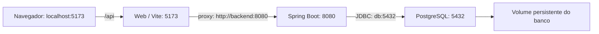

# Executar banco, backend e web com Docker

Este fluxo serve para desenvolvimento local e demonstração acadêmica. O Docker
instala as dependências dentro das imagens e o Compose inicia os serviços na ordem
necessária. Não é preciso instalar Java, Maven ou Node no computador para executar
esses três componentes por este guia.

O mobile continua fora do Docker: para ele, é necessário Node compatível com o
projeto e Expo Go no celular ou um emulador Android. As telas atuais do mobile são
protótipos; executar o Expo não significa que elas já consultam a API.

## 1. Preparar o computador

Instale Docker com Compose e inicie seu motor. No Windows/macOS, abra o Docker
Desktop; no Windows, utilize containers Linux. No Linux, se o Docker exigir
permissão, use `sudo` antes dos comandos `docker` abaixo.

Abra um terminal na **raiz do repositório**, onde está `docker-compose.yml`:

```text
docker compose version
```

Use Compose com suporte a `--wait` (v2.20 ou superior). Os comandos Docker deste
guia funcionam no PowerShell, Bash e terminal do macOS. A primeira construção
precisa de internet e pode demorar, pois baixa as imagens e dependências.

### Configuração opcional do .env

Sem `.env`, o Compose já usa as portas `5432`, `8080` e `5173`, usuário
`clinicalstudypb` e senha fictícia `clinicalstudypb_dev` para o banco. Esses valores
são destinados ao ambiente acadêmico local.

Para personalizar, copie `.env.example` para `.env` **somente se ainda não tiver um**:

```bash
# Linux/macOS
cp .env.example .env
```

```powershell
# PowerShell
Copy-Item .env.example .env
```

Edite o `.env` conforme sua máquina. Se o banco já contém dados, informe as mesmas
credenciais usadas na criação dele. Trocar a senha no `.env` não altera a senha
armazenada no PostgreSQL. O `.env` fica ignorado pelo Git.

Não é necessário executar `export` ou `$env:` para iniciar pelo Docker. O Compose
lê as configurações e fornece as variáveis de cada serviço. Ao executar o backend
pelo IntelliJ ou Maven **fora do Docker**, as variáveis continuam sendo configuradas
na IDE ou no terminal; o Spring Boot não passa a carregar `.env` sozinho.

## 2. Escolher o que iniciar

Execute um dos comandos abaixo na raiz do projeto:

| Quero executar | Comando |
|---|---|
| Banco + backend + web | `docker compose --profile web up -d --build --wait` |
| Banco + backend, sem web | `docker compose up -d --build --wait` |
| Somente banco, para programar o backend na IDE | `docker compose up -d --wait db` |
| Somente o banco descartável de testes | `docker compose --profile test up -d --wait db-test` |

`--build` constrói as imagens com o código atual, `-d` deixa os serviços rodando
em segundo plano e `--wait` aguarda os serviços ficarem saudáveis. O banco inicia
primeiro; depois, o backend; por último, a web, quando o profile `web` é escolhido.

Os profiles selecionam o que iniciar. Eles não encerram automaticamente um serviço
que já estava rodando: se iniciou a web e agora quer só a API, execute
`docker compose --profile web stop web`.

Confira o estado:

```text
docker compose --profile web ps
```

O profile `web` adiciona a interface à base de banco e backend. Não há profile
`mobile`: o Expo é iniciado separadamente. O profile `test` existente foi preservado;
especifique `db-test` como na tabela para não iniciar também os serviços da base.

## 3. Abrir e testar o sistema

Com as portas padrão:

| Serviço | Endereço |
|---|---|
| Web | http://localhost:5173 |
| Swagger | http://localhost:8080/swagger-ui.html |
| Contrato OpenAPI | http://localhost:8080/v3/api-docs |
| PostgreSQL no DBeaver | Host `localhost`, porta `5432`, banco `clinicalstudypb` |

A web no Docker usa `VITE_ESTUDOS_API=real`: cadastro e listagem consultam o backend.
A migração V4 prepara as contas fictícias abaixo ao ser aplicada:

| Perfil | E-mail | Senha fictícia |
|---|---|---|
| Administrador | `admin@clinicalstudypb.test` | `Demo@123` |
| Pesquisador | `pesquisador@clinicalstudypb.test` | `Demo@123` |
| Coordenador | `coordenador@clinicalstudypb.test` | `Demo@123` |
| Participante | `participante@clinicalstudypb.test` | `Demo@123` |

Senhas alteradas depois da migração não são restauradas ao reiniciar o sistema.
A senha de login da aplicação é diferente da senha de conexão com o PostgreSQL.

Para uma conferência rápida: entre como pesquisador, cadastre um estudo, atualize
a página e confira a listagem. Depois, faça logout e tente uma senha incorreta.
O guia [OpenAPI](openapi.md) explica como testar também sessão, CSRF e permissões.

## 4. Abrir o Expo em outro terminal (opcional)

Pode usar a API com ou sem a web. Primeiro execute um dos comandos da seção 2.
Depois abra **outro terminal** na pasta `mobile`:

```text
npm ci
npx expo start --go
```

No PowerShell, se os atalhos `.ps1` forem bloqueados, use:

```powershell
npm.cmd ci
npx.cmd expo start --go
```

Leia o QR code pelo Expo Go, mantendo celular e computador na mesma rede. Caso a
rede local impeça a conexão, encerre o Expo com `Ctrl+C` e tente:

```text
npx expo start --go --tunnel ngrok
```

No PowerShell, utilize `npx.cmd` se necessário. Mantenha esse terminal aberto.
`npm ci` é necessário na primeira execução e quando as dependências mudarem.

O túnel do Expo disponibiliza o servidor de desenvolvimento do aplicativo, não a
API Spring Boot. Quando houver integração mobile com a API, o endereço será
`http://10.0.2.2:8080` no emulador padrão do Android Studio ou o IP do computador na
rede local no celular físico, com a porta correspondente. O nome `backend` só
existe dentro da rede do Compose. Essa integração mobile não foi implementada nesta mudança.

## 5. Como os serviços se comunicam



Dentro de um container, `localhost` significa aquele próprio container. Por isso,
o backend acessa `db` e o proxy da web acessa `backend`. O navegador continua usando
`localhost`; não recebe esses nomes internos como endereço da API.

| Configuração | Papel |
|---|---|
| `SERVER_PORT` no `.env` | Porta publicada do backend no computador; internamente ele usa `8080` |
| `WEB_PORT` | Porta publicada da web; internamente o Vite usa `5173` |
| `POSTGRES_PORT` | Porta publicada do banco para DBeaver/Java local; internamente usa `5432` |
| `SPRING_DATASOURCE_USERNAME` e `SPRING_DATASOURCE_PASSWORD` | Credenciais fornecidas ao banco e ao backend |
| `SPRING_DATASOURCE_URL` no `.env.example` | Referência para Java fora do Docker; no container o Compose usa `db:5432` |
| `API_PROXY_TARGET` | Destino do proxy do Vite: `backend:8080` no Docker e `localhost:8080` fora dele |
| `VITE_API_URL` | Prefixo `/api` utilizado pelo navegador |

O Compose monta a origem web a partir de `WEB_PORT`, salvo se `WEB_ORIGINS` for
explicitamente configurado. Cookies de sessão e CSRF mantêm o contrato existente.

## 6. Alterações no código e testes

Esta primeira configuração usa o código **copiado para as imagens**. Não há montagem
da pasta local nem atualização automática após salvar um arquivo. Para incorporar
mudanças no backend ou na web, execute novamente:

```text
docker compose --profile web up -d --build --wait
```

O Docker reaproveita camadas e caches quando possível. Apenas `restart` não incorpora
código novo. Não é necessário apagar o banco para reconstruir as aplicações.

O Dockerfile do backend executa `./mvnw verify` durante a construção, incluindo os
testes que não exigem PostgreSQL externo. Os testes `*IT` com banco real continuam
com execução separada, conforme a documentação desses testes.

Com a web em execução, é possível verificar seu código sem instalar Node localmente:

```text
docker compose --profile web exec web npm test
docker compose --profile web exec web npm run lint
docker compose --profile web exec web npm run build
```

O servidor da web é o Vite de desenvolvimento, destinado a uso local e demonstração.
A configuração não define uma hospedagem de produção. Os healthchecks comprovam
que os serviços responderam; não substituem testes de login, cadastro e persistência.

Os resultados da verificação desta configuração estão no
[registro de validação Docker](../releases/release1/evidencias/docker/validacao.md).

## 7. Logs, Docker Desktop e encerramento

```text
docker compose --profile web logs -f backend web
docker compose logs --tail 100 db
```

`Ctrl+C` encerra o acompanhamento dos logs; os serviços iniciados com `-d` continuam
rodando. No Docker Desktop, eles aparecem no grupo `clinicalstudypb`; é possível
acompanhar logs, consumo de recursos e iniciar/parar containers já criados.

Para parar banco, backend e web, preservando os dados:

```text
docker compose --profile web stop
```

Para remover os containers e a rede, preservando o volume do banco:

```text
docker compose --profile web down
```

O comando `down -v` apaga também os volumes: não é necessário para atualizar código
ou corrigir credenciais. O volume existente `clinicalstudypb_clinicalstudypb-pgdata`
foi mantido. Os nomes dos containers passam a ser gerados pelo Compose, permitindo
projetos de teste separados com `-p`; isso não muda o volume do projeto padrão.

Encerre o Expo separadamente com `Ctrl+C`. Para parar somente o banco descartável
de testes, use `docker compose --profile test stop db-test`; os dados dele estão em
memória e são perdidos ao parar o container.

## Problemas comuns

- **Porta ocupada:** encerre o serviço local que usa a porta ou altere `SERVER_PORT`,
  `WEB_PORT` ou `POSTGRES_PORT` no `.env`. A comunicação interna permanece igual.
- **Banco recusa a senha:** use no `.env` as credenciais do volume já existente.
  Não apague o volume como primeira tentativa de correção.
- **Serviço fica unhealthy:** consulte `docker compose --profile web ps` e os logs.
  O backend precisa concluir as migrações antes de responder.
- **Alteração não apareceu:** reconstrua com `up -d --build --wait`; reiniciar o
  container não copia arquivos novos.
- **Containers não aparecem no Docker Desktop:** confirme se terminal e Desktop
  usam o mesmo motor/contexto (`docker context show`), especialmente no Linux.

Referências: [profiles](https://docs.docker.com/compose/how-tos/profiles/),
[ordem de inicialização](https://docs.docker.com/compose/how-tos/startup-order/) e
[rede do Compose](https://docs.docker.com/compose/how-tos/networking/).
