# Guia de execução da aplicação web

Este guia mostra como instalar, executar e testar a aplicação web do ClinicalStudyPB. Ele cobre a Release 1 (Sprints 1 e 2) e a Sprint 3 da Release 2. No fim, reúne as evidências da Release 1 e da Sprint 3.

## Visão geral

Na Release 1, a web entrega os requisitos RF01 a RF11. Na Sprint 3 da Release 2, entrega os requisitos RF12 a RF16:

| Requisito | Sprint | O que a web faz                                                                                       |
| --------- | ------ | ----------------------------------------------------------------------------------------------------- |
| RF01      | 1      | O administrador lista, cadastra, edita, desativa e reativa contas dos quatro perfis.                  |
| RF02      | 1      | Qualquer conta ativa entra com e-mail e senha e sai encerrando a sessão no servidor.                  |
| RF03      | 1      | Cada perfil vê apenas o que pode usar. Rotas de outro perfil levam ao acesso negado.                  |
| RF04      | 1      | O pesquisador cadastra estudos e vê a lista dos seus estudos.                                         |
| RF05      | 2      | O pesquisador define os critérios de inclusão e exclusão do estudo.                                   |
| RF06      | 2      | O pesquisador define as visitas previstas e as atividades de cada visita.                             |
| RF07      | 2      | O pesquisador altera o estado do estudo, respeitando as transições e os requisitos de cada uma.        |
| RF08      | 2      | O coordenador cadastra candidatos nos estudos vinculados a ele.                                       |
| RF09      | 2      | O coordenador avalia os critérios de elegibilidade de cada candidato.                                 |
| RF10      | 2      | O coordenador registra o consentimento simulado do candidato.                                         |
| RF11      | 2      | O coordenador inclui candidatos elegíveis com consentimento, respeitando o limite de participantes.    |
| RF12      | 3      | O coordenador vê os participantes incluídos e agenda ou reagenda as visitas previstas.                |
| RF13      | 3      | O coordenador registra a visita como realizada, ausente ou cancelada e corrige um registro com justificativa. |
| RF14      | 3      | O coordenador lança os resultados fictícios das atividades de uma visita realizada.                   |
| RF15      | 3      | O coordenador e o pesquisador consultam o histórico de visitas e avaliações do participante.          |
| RF16      | 3      | O coordenador registra a retirada do participante, com motivo.                                        |

Quem usa a web:

- **Administrador:** gerencia as contas.
- **Pesquisador:** cadastra estudos e configura critérios, visitas e o estado de cada estudo. Também consulta a lista de participantes e o histórico de cada um, só para leitura.
- **Coordenador:** consulta os estudos vinculados a ele, conduz o recrutamento e acompanha os participantes incluídos.

A segurança é garantida pelo backend. A web organiza a navegação e mostra as respostas da API.

## Pré-requisitos

| Ferramenta            | Versão                         | Uso                                  |
| --------------------- | ------------------------------ | ------------------------------------ |
| Node.js               | 24.22.0 (ver `web/.nvmrc`)     | Aplicação web                        |
| Docker com Compose v2 | —                              | Banco PostgreSQL e backend (opcional) |
| JDK                   | 21 completo (`java` e `javac`) | Backend fora do Docker               |

No Windows e no macOS, o Docker Desktop precisa estar aberto antes de subir o banco.

## Subir o banco e o backend

Todas as telas pedem login. Por isso, a web só funciona com o banco e o backend ligados. Há duas formas de subir os dois.

### Opção A: banco e backend no Docker (mais simples)

A partir da raiz do repositório:

```bash
docker compose up -d --build --wait
docker compose ps
```

O comando sobe o banco e o backend e espera os dois ficarem `healthy`. O backend fica em `http://localhost:8080`. Use `--build` sempre que o código do backend mudar. Os detalhes estão em [`execucao-docker.md`](execucao-docker.md).

Para subir também a web no Docker, use `docker compose --profile web up -d --build --wait`. Nesse modo, a web usa os estudos do backend (`VITE_ESTUDOS_API=real`). Para desenvolver ou testar os dados simulados, prefira rodar a web com `npm run dev`, como na seção "Rodar a web".

### Opção B: banco no Docker e backend pelo Maven

#### 1. Banco

A partir da raiz do repositório:

```bash
docker compose up -d db
docker compose ps
```

Espere o estado `healthy`. Sem o arquivo `.env` na raiz, a senha do banco é `clinicalstudypb_dev`. Os detalhes estão na seção "Banco de dados" do [README](../../README.md#banco-de-dados-postgresql-com-docker-compose).

Se `SPRING_DATASOURCE_USERNAME` e `SPRING_DATASOURCE_PASSWORD` já estiverem definidas no terminal, o Compose usa esses valores na criação do banco.

#### 2. Backend

O backend precisa destas variáveis, no mesmo terminal em que ele será iniciado:

| Variável                     | Valor local                                         |
| ---------------------------- | --------------------------------------------------- |
| `SPRING_DATASOURCE_URL`      | `jdbc:postgresql://localhost:5432/clinicalstudypb`  |
| `SPRING_DATASOURCE_USERNAME` | `clinicalstudypb`                                   |
| `SPRING_DATASOURCE_PASSWORD` | a senha do banco (`clinicalstudypb_dev` sem `.env`) |
| `WEB_ORIGINS`                | `http://localhost:5173`                             |

`WEB_ORIGINS` define a origem aceita para a web. Esse já é o valor padrão do backend, mas vale declarar.

Linux/macOS:

```bash
export SPRING_DATASOURCE_URL=jdbc:postgresql://localhost:5432/clinicalstudypb
export SPRING_DATASOURCE_USERNAME=clinicalstudypb
export SPRING_DATASOURCE_PASSWORD='SUBSTITUA_PELA_SENHA_DO_BANCO'
export WEB_ORIGINS=http://localhost:5173
cd backend
./mvnw spring-boot:run
```

Windows (PowerShell):

```powershell
$env:SPRING_DATASOURCE_URL="jdbc:postgresql://localhost:5432/clinicalstudypb"
$env:SPRING_DATASOURCE_USERNAME="clinicalstudypb"
$env:SPRING_DATASOURCE_PASSWORD="SUBSTITUA_PELA_SENHA_DO_BANCO"
$env:WEB_ORIGINS="http://localhost:5173"
cd backend
.\mvnw.cmd spring-boot:run
```

As variáveis valem só para o terminal aberto. Ao abrir um terminal novo, defina-as de novo.

O backend está pronto quando aparece `Started ClinicalStudyPbApplication`. Deixe esse terminal aberto. Os detalhes estão na seção "Backend" do [README](../../README.md#backend) e no [guia de autenticação](../api/autenticacao.md).

## Credenciais fictícias

> **Dados fictícios.** As contas, os e-mails e as senhas abaixo servem só para testes locais. Não use dados reais.

A migração de dados fictícios do backend cria uma conta de cada perfil e dois estudos de exemplo, já com o coordenador vinculado:

| Conta                               | Senha      | Perfil        | Para testar                                        |
| ----------------------------------- | ---------- | ------------- | -------------------------------------------------- |
| `admin@clinicalstudypb.test`        | `Demo@123` | ADMINISTRADOR | Gestão de usuários                                 |
| `pesquisador@clinicalstudypb.test`  | `Demo@123` | PESQUISADOR   | Estudos, critérios, visitas e estados              |
| `coordenador@clinicalstudypb.test`  | `Demo@123` | COORDENADOR   | Recrutamento nos estudos vinculados                |
| `participante@clinicalstudypb.test` | `Demo@123` | PARTICIPANTE  | Conta usada na inclusão (o perfil usa o app mobile) |

Outras contas podem ser criadas pela tela de usuários, com a conta de administrador.

Para voltar o banco ao estado inicial, com só os dados fictícios, rode `docker compose down -v` e suba de novo. **Isso apaga todos os dados do banco local.**

## Rodar a web

Em outro terminal:

```bash
cd web
npm ci
npm run dev
```

Abra **http://localhost:5173**.

- `npm ci` instala as versões exatas do `package-lock.json`. Só é preciso na primeira vez ou quando as dependências mudarem.
- As chamadas para `/api` vão ao backend em `http://localhost:8080` pelo proxy do Vite, sem o prefixo. Por exemplo, `/api/usuarios` chega ao backend como `/usuarios`. O proxy fica em `web/vite.config.ts`.

### Dados reais ou simulados

O login e os usuários sempre usam o backend. Estudos, protocolo, recrutamento e acompanhamento podem usar dados simulados ou a API, conforme quatro variáveis do `web/.env`:

| Variável                  | Telas                                                                                                         |
| ------------------------- | ------------------------------------------------------------------------------------------------------------- |
| `VITE_ESTUDOS_API`        | Lista e cadastro de estudos e mudança de estado                                                               |
| `VITE_PROTOCOLO_API`      | Critérios de inclusão e exclusão e visitas previstas com atividades                                           |
| `VITE_CANDIDATOS_API`     | Candidatos, elegibilidade, consentimento e inclusão                                                           |
| `VITE_ACOMPANHAMENTO_API` | Lista de participantes, agendamento, registro e correção de visitas, resultados, histórico e retirada         |

Cada uma aceita dois valores:

| Valor               | Comportamento                                                                      |
| ------------------- | ---------------------------------------------------------------------------------- |
| `simulado` (padrão) | Dados fictícios em memória, que voltam ao estado inicial ao recarregar a página.  |
| `real`              | Dados vindos do backend e gravados no banco.                                       |

Para trocar, copie `web/.env.example` para `web/.env`, ajuste os valores e **reinicie o `npm run dev`**: o Vite só lê o `.env` ao iniciar.

No modo `real`, a web só chama as rotas de acompanhamento que o backend já oferece. Uma parte que ainda não existe no backend fica oculta, e a tela mostra um aviso no lugar dela. Isso evita que a web chame uma rota inexistente e caia no acesso negado. O que fica disponível em cada modo é definido por `recursosAcompanhamento`, em `web/src/api/acompanhamento.ts`. Quando o backend entregar uma rota nova, basta ligar a chave correspondente nesse arquivo.

Combinações mais usadas:

- **Tudo `simulado`:** mostra os exemplos fictícios de cada tela, inclusive um estudo em Recrutamento com candidatos em todas as etapas. O mesmo estudo tem um participante incluído, com visitas em várias situações.
- **Tudo `real`:** usa só o backend; o que for cadastrado continua lá depois de recarregar.
- **`VITE_ESTUDOS_API=real` com os outros `simulado`:** o protocolo, os candidatos e o acompanhamento simulados começam vazios, para não misturar dados fictícios com estudos reais de mesmo id.

## Testar o acompanhamento (Sprint 3)

O roteiro abaixo usa o modo simulado: deixe as quatro variáveis como `simulado` (ou sem o `web/.env`). O login usa as contas fictícias do backend. Os dados simulados voltam ao estado inicial ao recarregar a página.

O estudo "Acompanhamento de hábitos" (id 3) está em Recrutamento e tem uma participante incluída, Maria Souza. As visitas dela estão em várias situações:

| Visita                     | Data e hora          | Situação  | Observação                                                 |
| -------------------------- | -------------------- | --------- | ---------------------------------------------------------- |
| Visita inicial             | 30/10/2026 às 09:00  | Realizada | Já tem resultado registrado.                               |
| Visita de acompanhamento   | 06/11/2026 às 09:00  | Ausente   | Motivo: "Participante não compareceu."                     |
| Visita de acompanhamento   | 11/11/2026 às 09:00  | Realizada | Ainda sem resultados.                                      |
| Visita de acompanhamento   | 16/11/2026 às 09:00  | Agendada  | Data já passada: aceita Realizada e Ausente.               |
| Visita final               | 10/12/2026 às 09:00  | Agendada  | Data futura: entre os registros, aceita só o cancelamento. |

As visitas realizadas e as ausentes só podem ser registradas a partir do dia agendado, no fuso de Recife. Por isso, os botões de cada visita dependem da data do dia do teste.

### Coordenador

Entre com `coordenador@clinicalstudypb.test` e a senha `Demo@123`.

1. No menu "Estudos", clique em "Acompanhamento de hábitos". A tela de recrutamento do estudo abre.
2. Clique em "Participantes incluídos". Confira a lista: Maria Souza aparece com a situação "Ativo" e as ações "Ver histórico", "Agendar visitas" e "Retirar".
3. Clique em "Agendar visitas". Na tela "Agendamento de visitas", escolha a "Visita inicial", uma data entre hoje e 20/12/2026 e uma hora. Clique em "Agendar visita". A notificação confirma o agendamento, e a visita aparece em "Visitas agendadas" como "Agendada".
4. Agende de novo a "Visita inicial". O campo da visita mostra "Já existe um agendamento pendente para essa visita.", porque só pode haver uma visita agendada para cada visita prevista.
5. Na "Visita de acompanhamento" de 16/11/2026, clique em "Ausente" e confirme em "Registrar ausência". O motivo é opcional. A visita passa a "Ausente".
6. Na "Visita final", clique em "Cancelar visita" e confirme sem preencher o motivo. O diálogo mostra "Informe o motivo do cancelamento.". Preencha o motivo e confirme de novo. A visita passa a "Cancelada".
7. Na visita de 16/11/2026, agora "Ausente", clique em "Corrigir". Escolha "Realizada", preencha a "Justificativa da correção (obrigatória)" e clique em "Salvar correção". A notificação informa a correção, e a visita passa a "Realizada".
8. Volte à lista e clique em "Ver histórico". A tela "Histórico do participante" mostra as visitas em ordem cronológica, com a situação, quem registrou, os resultados e as correções. A correção do passo 7 aparece em "Correções".
9. Na visita de 16/11/2026, clique em "Registrar resultados". Na tela "Resultados da visita", preencha a avaliação e clique em "Salvar resultados". A web volta ao histórico, já com o resultado.
10. Pela trilha, volte a "Participantes" e clique em "Agendar visitas". Na visita de 16/11/2026, o botão "Corrigir" sumiu e aparece "Correção bloqueada: a visita já tem resultados registrados.".
11. Volte à lista e clique em "Retirar". No diálogo "Retirar do estudo?", preencha o "Motivo da retirada (obrigatório)" e clique em "Retirar participante". Maria Souza passa a "Retirado", sem as ações "Agendar visitas" e "Retirar". A visita ainda agendada é cancelada com o motivo "Retirada do participante", e a retirada aparece no histórico.

A retirada também pode ser feita pelo botão "Retirar do estudo", na tela do histórico.

### Pesquisador

Entre com `pesquisador@clinicalstudypb.test` e a senha `Demo@123`.

1. Em "Meus estudos", clique em "Acompanhamento de hábitos". Na tela do estudo, clique em "Participantes incluídos", abaixo do título.
2. A lista mostra o aviso "Somente consulta. O agendamento de visitas é feito pelo coordenador do estudo.". A única ação é "Ver histórico", e o histórico também é só para consulta.
3. Abra o endereço `http://localhost:5173/estudos/3/participacoes/1/visitas`. A web mostra a tela "Acesso negado", porque o agendamento é exclusivo do coordenador.

## Testes e cobertura

Dentro de `web/`:

```bash
npm test                # testes com Vitest
npm run lint            # ESLint
npm run build           # verificação de tipos e build de produção
npm run test:coverage   # testes com cobertura (Istanbul)
```

O `npm run test:coverage` mostra a tabela no terminal e gera o relatório em **`web/coverage/index.html`**. Abra esse arquivo no navegador para ver as linhas cobertas de cada arquivo. A pasta `coverage/` não vai para o Git.

Os testes não precisam do backend nem do banco: as chamadas à API são simuladas, e os testes usam sempre os serviços simulados, seja qual for o `web/.env`.

## Problemas comuns

| Sintoma                                                                   | Causa                                                           | Solução                                                                                                                                                                                     |
| ------------------------------------------------------------------------- | --------------------------------------------------------------- | ------------------------------------------------------------------------------------------------------------------------------------------------------------------------------------------- |
| A web mostra só "Não foi possível verificar sua sessão. Tente novamente." | O backend está parado ou não conecta ao banco.                  | Suba o banco e o backend. Confira: `curl -i -H "Accept: application/json" http://localhost:5173/api/auth/sessao` deve responder **401** (ninguém logado). Um **502** indica backend parado. |
| O que foi cadastrado some ao recarregar a página                          | A tela está usando dados simulados.                             | Coloque a variável correspondente como `real` no `web/.env` e reinicie o `npm run dev`.                                                                                                     |
| No modo real, alguma parte do acompanhamento aparece oculta, com aviso    | O backend ainda não oferece essa rota.                          | Teste o fluxo completo com `VITE_ACOMPANHAMENTO_API=simulado` e reinicie o `npm run dev`.                                                                                                   |
| Mudei o `web/.env` e nada mudou                                           | O Vite só lê o `.env` ao iniciar.                               | Pare o `npm run dev` (`Ctrl+C`) e rode de novo.                                                                                                                                             |
| O backend não sobe: "url attribute is not specified"                      | As variáveis `SPRING_DATASOURCE_*` não foram definidas no terminal. | Defina as variáveis da seção "Backend" no mesmo terminal, ou use a opção A (Docker).                                                                                                        |
| A porta 5173 está ocupada                                                 | A web do Docker (perfil `web`) está rodando.                    | Rode `docker compose --profile web stop web` antes do `npm run dev`.                                                                                                                        |
| `Cannot find module` ao rodar a web ou os testes                          | Dependências não instaladas, ou comando fora de `web/`.         | Entre em `web/` e rode `npm ci`.                                                                                                                                                            |
| `npm ci` falha com `EPERM` no Windows                                     | O `npm run dev` está aberto e trava arquivos de `node_modules`. | Pare o `npm run dev` (`Ctrl+C`) e rode `npm ci` de novo.                                                                                                                                    |

No PowerShell, use `curl.exe` no lugar de `curl`.

## Evidências da Release 1

As capturas foram feitas com o banco PostgreSQL e o backend locais, usando contas e dados fictícios. Os arquivos estão em [`releases/release1/evidencias/web/`](../../releases/release1/evidencias/web/), e o resumo da entrega fica em [`releases/release1/README.md`](../../releases/release1/README.md).

## Sprint 1: acesso e usuários (RF01 a RF03)

As capturas da Sprint 1 foram feitas antes da migração de dados fictícios, com contas criadas manualmente (Ana Administradora e Paula Pesquisadora).

### Sucesso

#### 1. Login do administrador

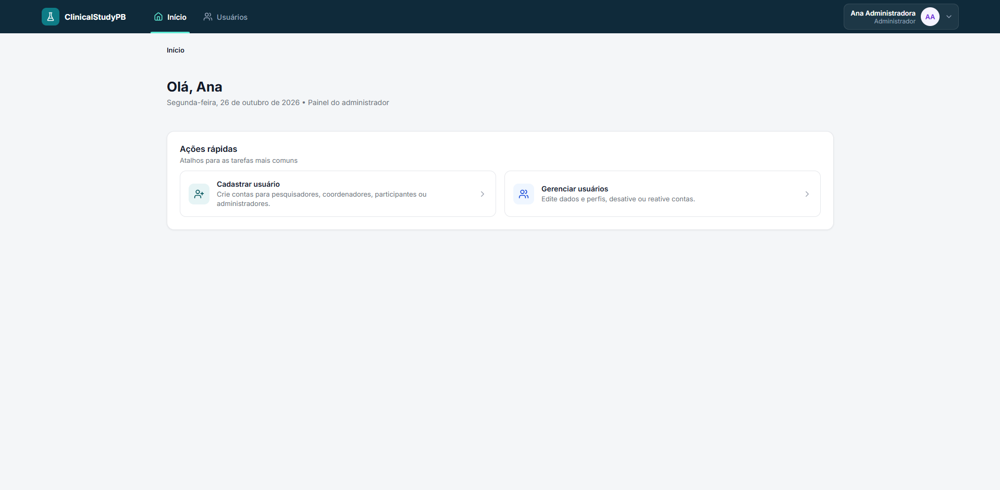

**Mostra:** a tela inicial da Ana Administradora logo após o login, com "Olá, Ana", o menu "Usuários" e os atalhos "Cadastrar usuário" e "Gerenciar usuários".
**Comprova:** RF02 (login com e-mail e senha) e RF03 (o administrador vê o menu de usuários).

#### 2. Início do pesquisador

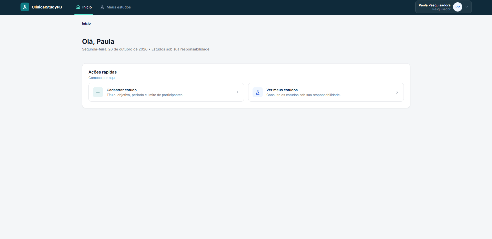

**Mostra:** a tela inicial da Paula Pesquisadora, com o menu "Meus estudos" e sem o menu "Usuários".
**Comprova:** RF03. O menu e os atalhos mudam conforme o perfil.

#### 3. Lista de usuários

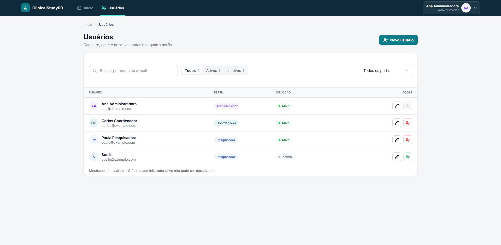

**Mostra:** a lista com nome, e-mail, perfil e situação; a busca; as abas Todos, Ativos e Inativos com contagem; e o filtro por perfil.
**Comprova:** RF01 (listagem). Contas ativas e inativas aparecem juntas, porque não há exclusão física (D01).

#### 4. Usuário cadastrado

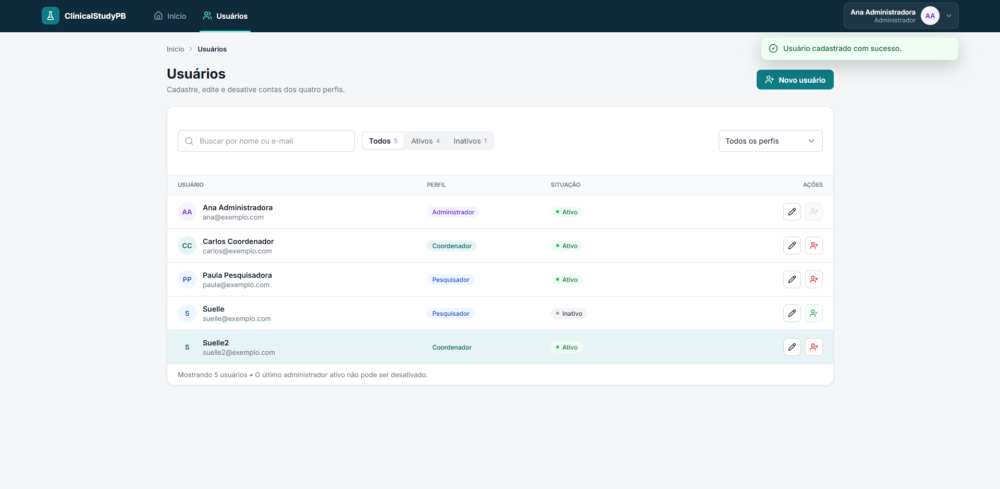

**Mostra:** a notificação "Usuário cadastrado com sucesso." e a nova conta destacada na lista, já como "Ativo".
**Comprova:** RF01. O cadastro gera uma conta que começa ativa.

#### 5. Edição de usuário

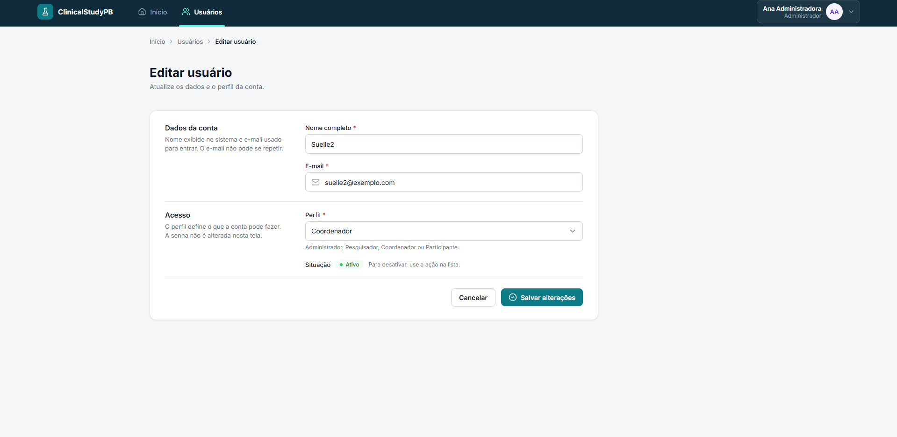

**Mostra:** o formulário com nome, e-mail e perfil. A senha não aparece, e a situação indica "Para desativar, use a ação na lista."
**Comprova:** RF01 (edição). A senha não é alterada nesta tela.

#### 6. Confirmação para desativar

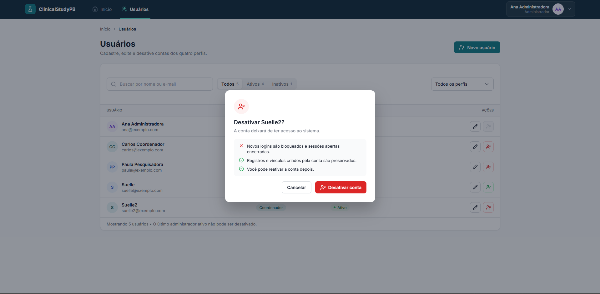

**Mostra:** o diálogo "Desativar …?", que explica que novos logins são bloqueados, as sessões abertas são encerradas, os registros são preservados e a conta pode ser reativada.
**Comprova:** D01 e a regra 5.3. Desativar não exclui a conta e bloqueia o acesso.

#### 7. Confirmação para reativar

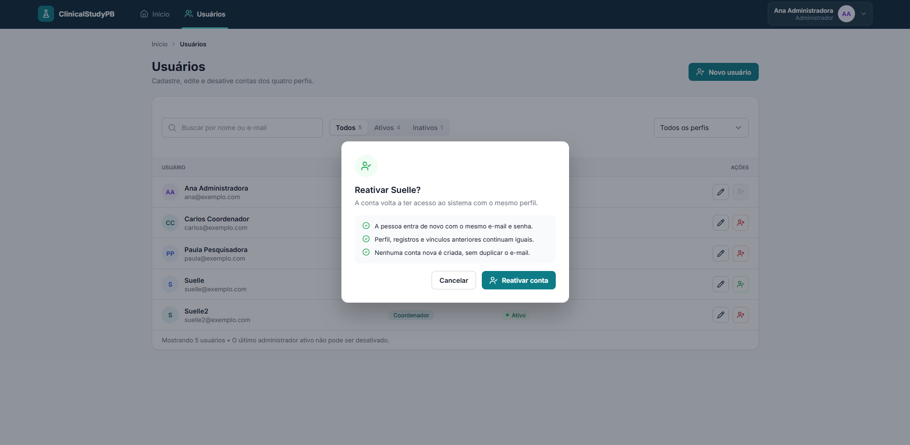

**Mostra:** o diálogo "Reativar …?" de uma conta inativa: a pessoa entra com o mesmo e-mail e senha, o perfil e os vínculos continuam iguais e nenhuma conta nova é criada.
**Comprova:** D01 e a regra 5.3. Reativar não duplica o e-mail.

#### 8. Menu da conta

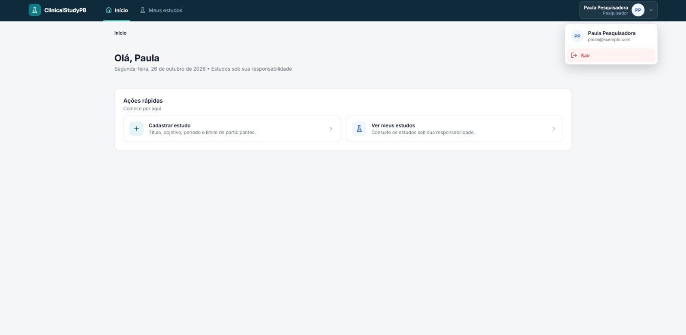

**Mostra:** o menu da conta aberto na barra, com nome, e-mail e a opção "Sair".
**Comprova:** RF02. O logout está disponível em todas as telas internas.

#### 9. Logout com sessão encerrada no servidor

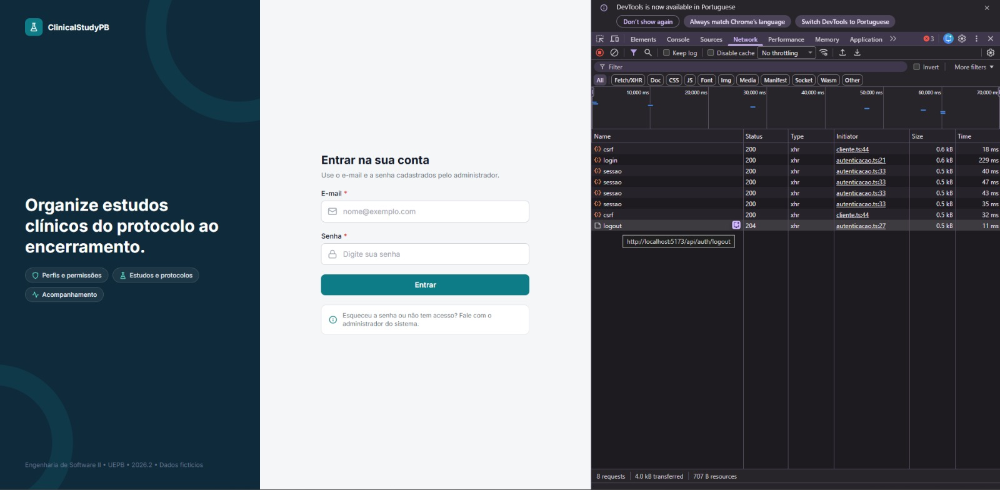

**Mostra:** a tela de login depois do Sair. No DevTools aparecem `GET /auth/csrf`, `POST /auth/login` (200), as consultas `GET /auth/sessao` (200), um novo `GET /auth/csrf` e **`POST /auth/logout` com 204**.
**Comprova:** RF02. O logout encerra a sessão no servidor, e não só na tela. Também mostra a proteção CSRF: o token é buscado antes do login e do logout, que são alterações.

### Erro e proteção

#### 10. Credenciais inválidas

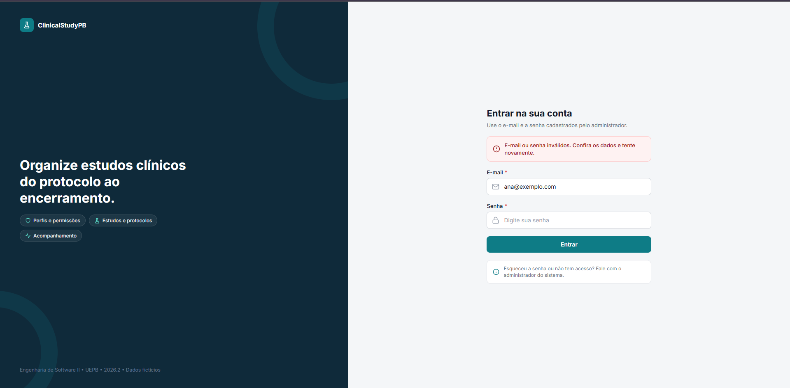

**Mostra:** a mensagem "E-mail ou senha inválidos. Confira os dados e tente novamente." O campo de senha é limpo.
**Comprova:** RF02. A mensagem é genérica e não revela se o e-mail existe.

#### 11. Cadastro com campos vazios

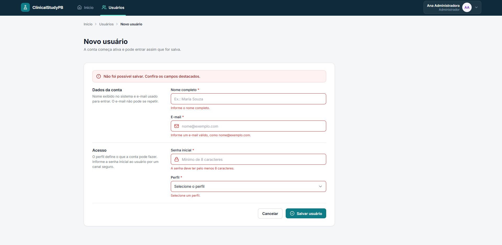

**Mostra:** a faixa "Não foi possível salvar. Confira os campos destacados." e o erro de cada campo: nome, e-mail, senha com pelo menos 8 caracteres e perfil.
**Comprova:** RF01. Nome, e-mail, senha inicial e perfil são obrigatórios: a web valida antes de enviar, e o backend valida de novo. A exceção é o mínimo de 8 caracteres da senha, que por enquanto só a web confere (pendência registrada para o backend).

#### 12. E-mail já cadastrado

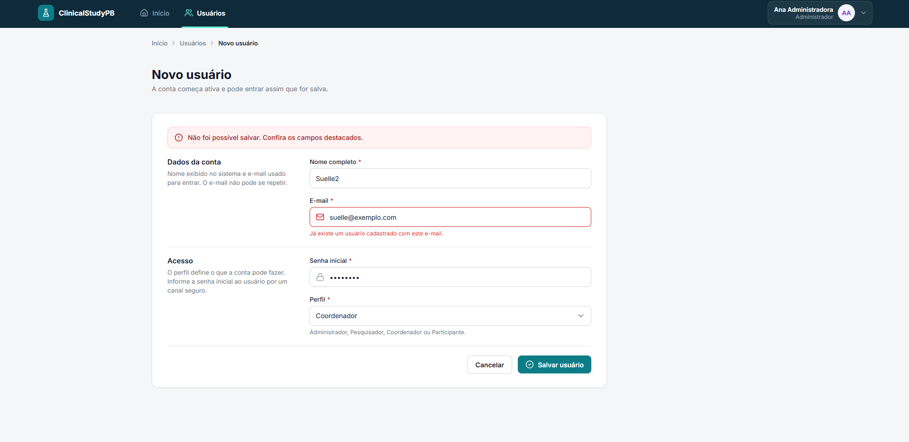

**Mostra:** a mensagem "Já existe um usuário cadastrado com este e-mail." no campo e-mail. O e-mail usado é o de uma conta **inativa**.
**Comprova:** RF01. O e-mail é único, inclusive entre contas desativadas (resposta 409 `EMAIL_JA_CADASTRADO`).

#### 13. Último administrador ativo

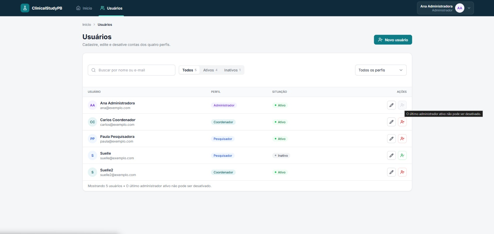

**Mostra:** o botão de desativar da única administradora ativa está desabilitado, com a dica "O último administrador ativo não pode ser desativado." A mesma nota aparece no rodapé da lista.
**Comprova:** a regra 5.3. O sistema nunca fica sem um administrador ativo. O backend também recusa a operação (`ULTIMO_ADMINISTRADOR`).

#### 14. Acesso negado por perfil

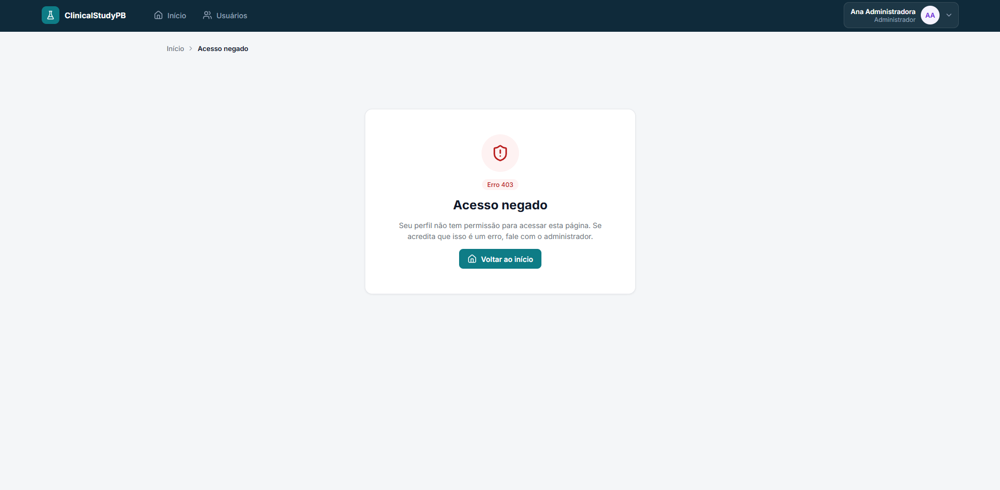

**Mostra:** a tela "Acesso negado" (Erro 403) para a administradora, ao abrir uma página de outro perfil, com o botão "Voltar ao início".
**Comprova:** RF03. Cada rota exige um perfil. O backend também responde 403 (`ACESSO_NEGADO`) quando o perfil não tem permissão.

#### 15. Sessão expirada

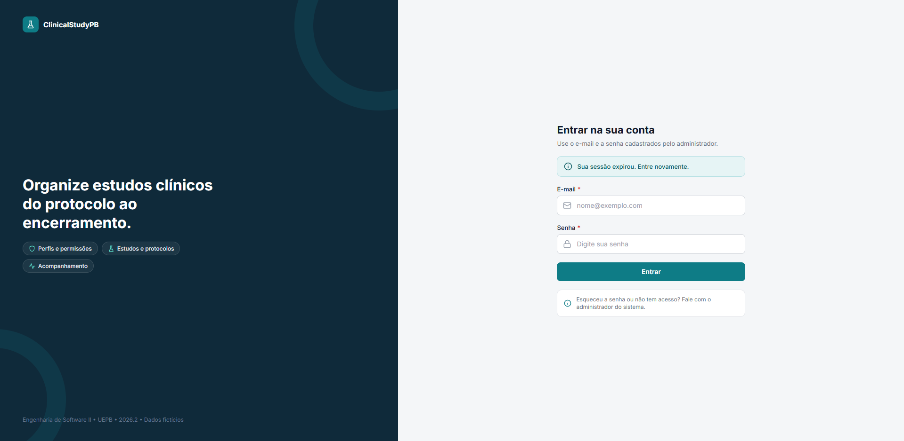

**Mostra:** a tela de login com o aviso "Sua sessão expirou. Entre novamente."
**Comprova:** RF02. Quando o backend responde 401 com alguém logado (sessão expirada, cookie apagado ou conta desativada), a web encerra a sessão na tela, avisa e, depois do novo login, volta à página de origem.

#### 16. Página não encontrada

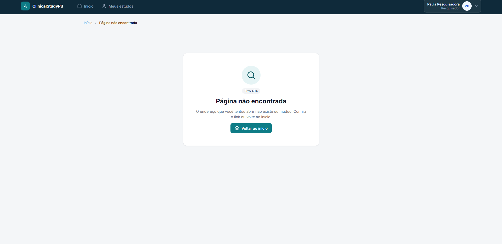

**Mostra:** a tela "Página não encontrada" (Erro 404) com a barra da pesquisadora e o botão "Voltar ao início".
**Comprova:** endereços inexistentes têm uma resposta clara, sem perder a sessão.

### Testes e cobertura da Sprint 1

#### 17. Testes

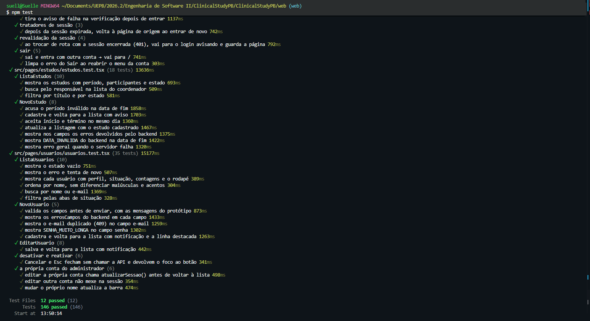

**Mostra:** o fim da execução do `npm test`: **12 arquivos e 146 testes passando**. Aparecem os grupos de sessão, revalidação, sair, estudos e usuários.
**Comprova:** os componentes de login e de usuários têm testes automatizados (Vitest e Testing Library).

#### 18. Cobertura

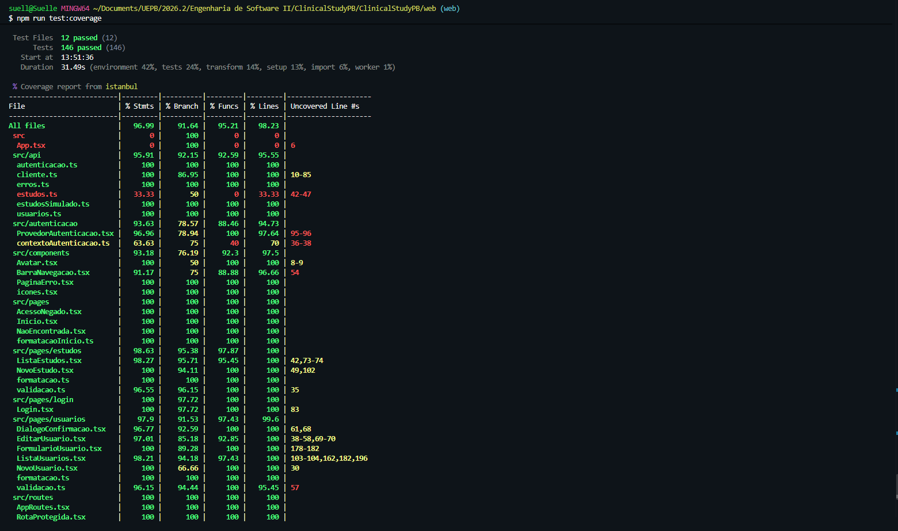

**Mostra:** a tabela do `npm run test:coverage`, gerada pelo Istanbul, ao fim da Sprint 1.
**Comprova:** a cobertura da web, prevista no kickoff:

| Escopo                                      | Linhas cobertas |
| ------------------------------------------- | --------------- |
| Toda a web (`src`)                          | **98,23%**      |
| Login (`src/pages/login`)                   | 100%            |
| Usuários (`src/pages/usuarios`)             | 99,6%           |
| Serviço de usuários (`src/api/usuarios.ts`) | 100%            |
| Autenticação (`src/autenticacao`)           | 94,73%          |

Dois arquivos aparecem em vermelho, e isso é esperado:

- **`App.tsx` (0%):** só junta o provedor de autenticação e as rotas. Os testes usam essas duas partes diretamente, cada uma com o seu cenário. Assim, este arquivo não é carregado nos testes.
- **`api/estudos.ts` (33%, na Sprint 1):** o serviço real de estudos ainda não era exercitado. Na Sprint 2, ele passou a ter testes próprios.

## Sprint 2: configuração do estudo (RF05 a RF07)

As capturas usam o pesquisador `pesquisador@clinicalstudypb.test`, com `VITE_ESTUDOS_API` e `VITE_PROTOCOLO_API` em `real`. O estudo é aberto pelo título em "Meus estudos" (`/estudos/:id`), em uma tela com as abas Resumo, Critérios e Visitas.

### Sucesso

#### 19. Critérios cadastrados

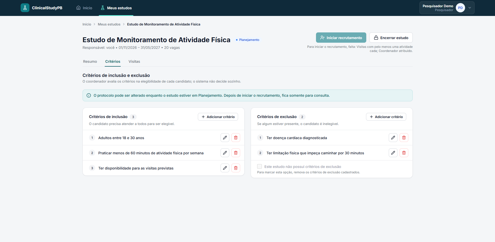

**Mostra:** a aba Critérios com três critérios de inclusão e dois de exclusão, cada um com as ações de editar e remover. A opção "Este estudo não possui critérios de exclusão" fica desativada, com a explicação "Para marcar esta opção, remova os critérios de exclusão cadastrados."
**Comprova:** RF05. Os critérios pertencem ao estudo, e a declaração de ausência de exclusões não convive com exclusões cadastradas.

#### 21. Visitas previstas e atividades

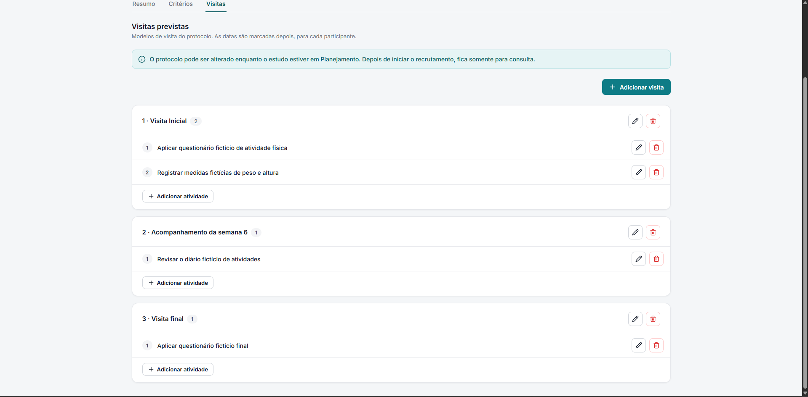

**Mostra:** a aba Visitas com três visitas em ordem ("1 · Visita Inicial", "2 · Acompanhamento da semana 6" e "3 · Visita final"), cada uma com as suas atividades e as ações de editar, remover e adicionar atividade.
**Comprova:** RF06. Cada visita prevista tem ordem própria e atividades vinculadas.

#### 24. Confirmação para iniciar o recrutamento

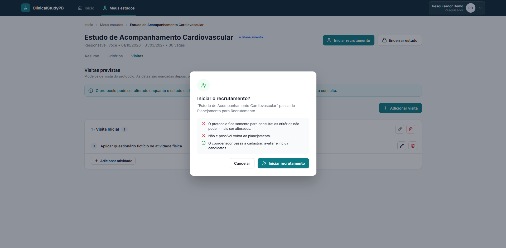

**Mostra:** o diálogo "Iniciar o recrutamento?", que explica que o protocolo fica somente para consulta, que não é possível voltar ao planejamento e que o coordenador passa a cadastrar, avaliar e incluir candidatos.
**Comprova:** RF07. A mudança de estado é confirmada e explica a consequência antes de acontecer.

#### 25. Recrutamento iniciado

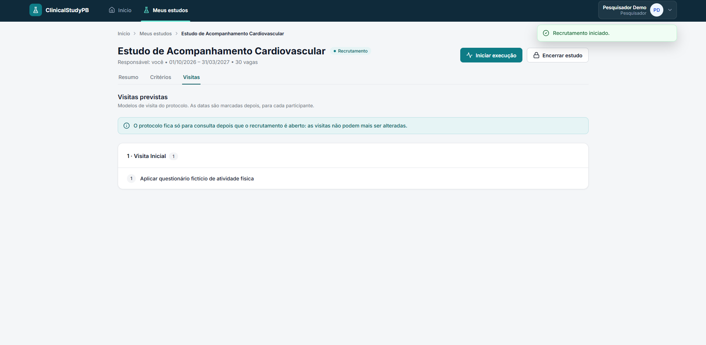

**Mostra:** a notificação "Recrutamento iniciado.", a etiqueta "Recrutamento" e as ações seguintes ("Iniciar execução" e "Encerrar estudo"). Na aba Visitas, o aviso informa que o protocolo ficou só para consulta, sem os botões de alteração.
**Comprova:** RF07. A transição Planejamento → Recrutamento foi gravada no backend, e o protocolo deixa de ser alterável.

### Erro e validação

#### 20. Critério sem descrição

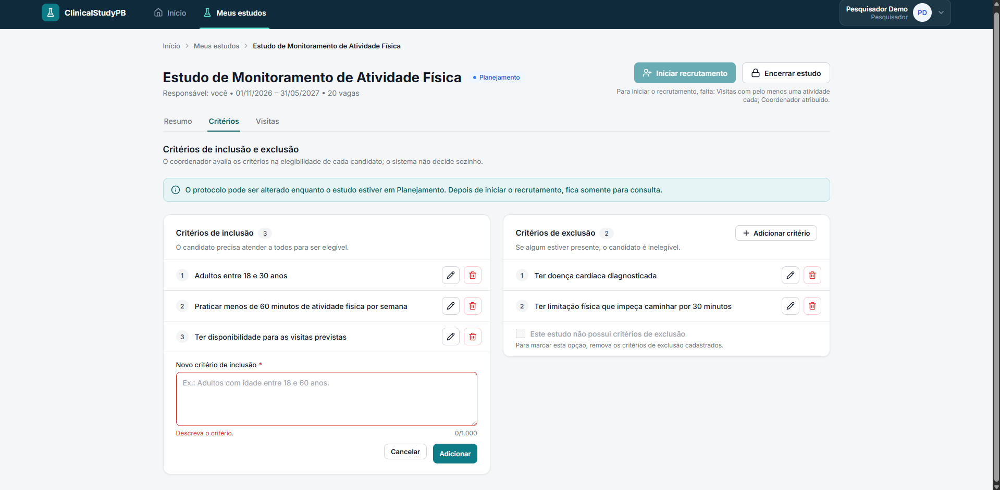

**Mostra:** o formulário "Novo critério de inclusão" com o campo destacado e a mensagem "Descreva o critério."
**Comprova:** RF05. A descrição é obrigatória: a web valida antes de enviar, e o backend valida de novo.

#### 22. Ordem de visita duplicada

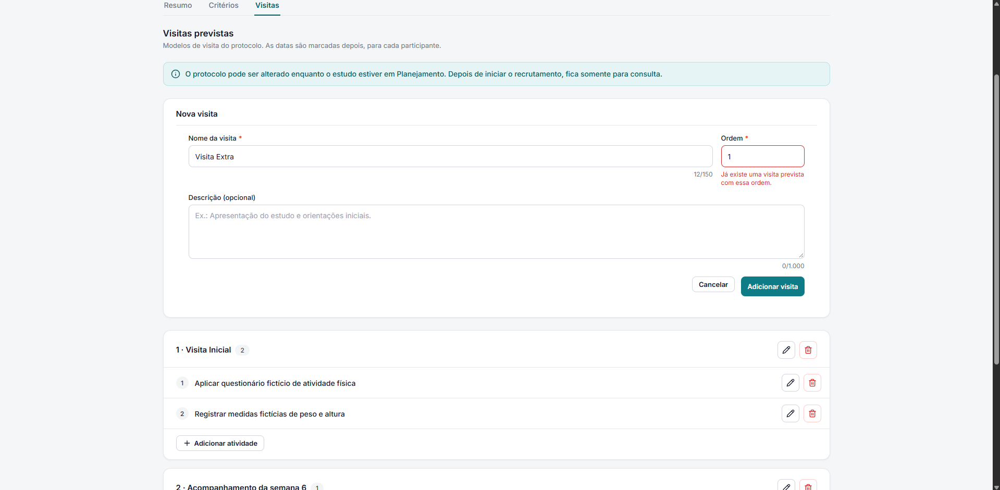

**Mostra:** o formulário "Nova visita" com a ordem 1, já usada pela "Visita Inicial", e a mensagem "Já existe uma visita prevista com essa ordem." no campo da ordem.
**Comprova:** RF06. A ordem é única no protocolo. A mensagem vem do backend (`ORDEM_VISITA_DUPLICADA`) e aparece no campo correspondente.

#### 23. Recrutamento bloqueado por pendências

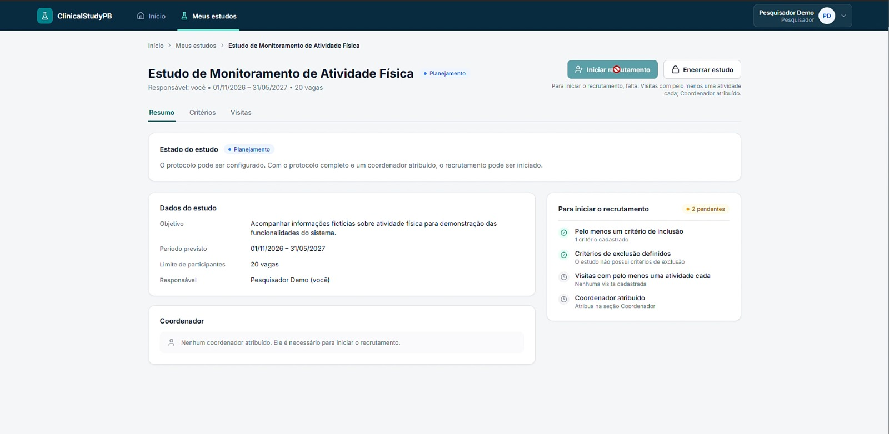

**Mostra:** o botão "Iniciar recrutamento" desativado, com a explicação do que falta, e o quadro "Para iniciar o recrutamento" na aba Resumo, com duas pendências: visitas com pelo menos uma atividade cada e coordenador atribuído.
**Comprova:** RF07. A web orienta e bloqueia a transição enquanto os requisitos não são cumpridos; o backend confere as mesmas condições.

### Testes e cobertura da Release 1

#### 26. Testes

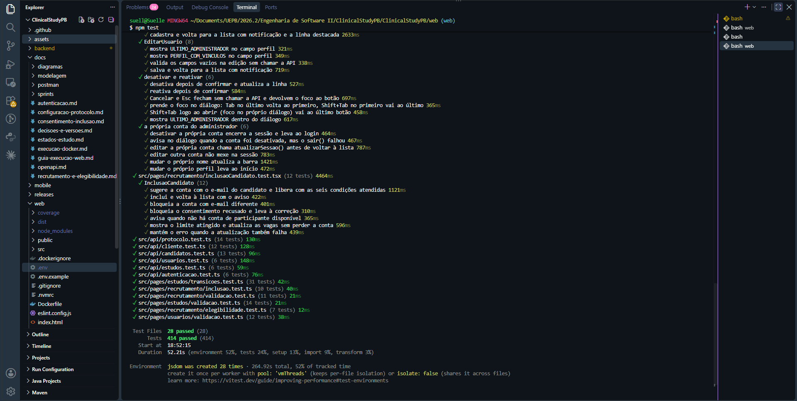

**Mostra:** o fim da execução do `npm test`: **28 arquivos e 414 testes passando**.
**Comprova:** as telas de critérios, visitas e estado do estudo, além das telas da Sprint 1 e do recrutamento, têm testes automatizados (Vitest e Testing Library).

#### 27. Cobertura

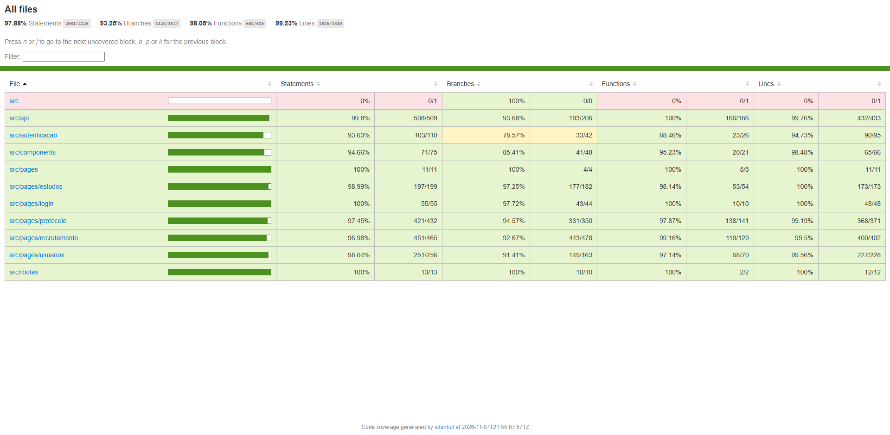

**Mostra:** o relatório em HTML do Istanbul (`web/coverage/index.html`), com o total e a cobertura de cada pasta.
**Comprova:** a cobertura da web ao fim da Release 1:

| Escopo                                        | Linhas cobertas |
| --------------------------------------------- | --------------- |
| Toda a web                                    | **99,23%**      |
| Configuração do estudo (`src/pages/protocolo`) | 99,19%          |
| Estudos (`src/pages/estudos`)                 | 100%            |
| Recrutamento (`src/pages/recrutamento`)       | 99,5%           |
| Serviços da API (`src/api`)                   | 99,76%          |

A única pasta em vermelho é `src`, por causa do `App.tsx`, explicado na evidência 18.

Para reproduzir, rode `npm test` e `npm run test:coverage` dentro de `web/`.

## Evidências da Sprint 3

As capturas do RF12, do RF13 e do pesquisador foram feitas com o serviço de acompanhamento simulado (`VITE_ACOMPANHAMENTO_API=simulado`), com o login pelo backend local e só dados fictícios. As do RF14, do RF15 e do RF16 usam a API real, como explicado na seção de cada um. Os arquivos estão em [`releases/release2/evidencias/web/`](../../releases/release2/evidencias/web/).

A barra superior mostra a conta do backend ("Coordenador Demo"). Já o histórico mostra "Carlos Coordenador" como responsável pelos registros, porque esse é o nome fixo do serviço simulado.

## RF12: lista e agendamento

### Sucesso

#### 1. Lista de participantes

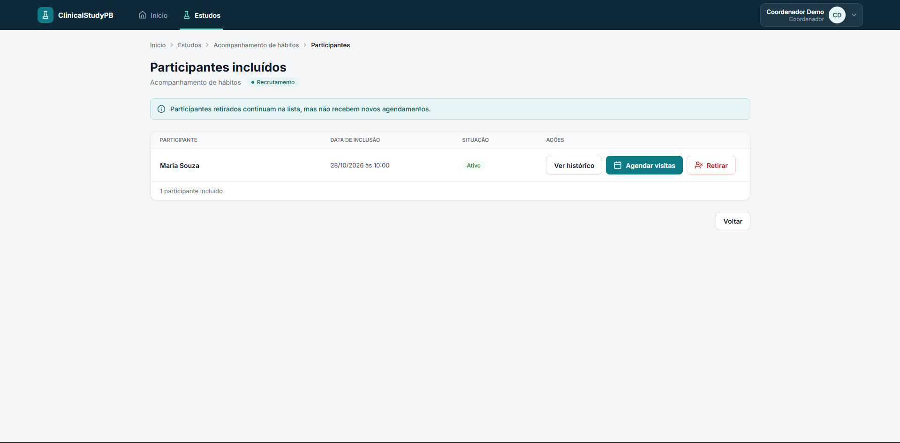

**Mostra:** a tela "Participantes incluídos" do coordenador, no estudo "Acompanhamento de hábitos". Maria Souza aparece com a data de inclusão, a situação "Ativo" e as ações "Ver histórico", "Agendar visitas" e "Retirar". O aviso informa que participantes retirados continuam na lista.
**Comprova:** RF12. O coordenador vinculado vê os participantes incluídos e chega ao agendamento a partir da lista.

#### 4. Visita agendada

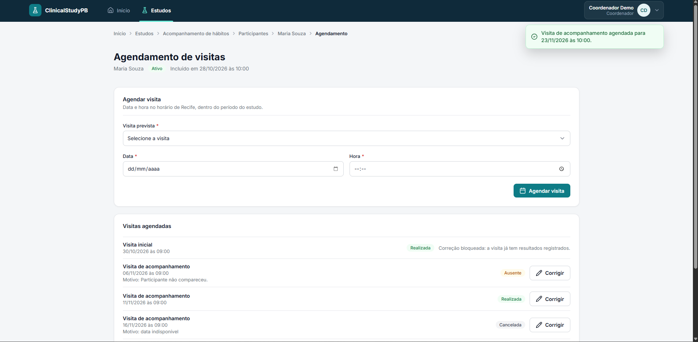

**Mostra:** a notificação "Visita de acompanhamento agendada para 23/11/2026 às 10:00." Na lista, as visitas anteriores da mesma visita prevista já estão como "Ausente", "Realizada" e "Cancelada".
**Comprova:** RF12. Depois de uma situação final, a mesma visita prevista pode ser agendada de novo. A visita nova aparece na lista da evidência 7.

#### 6. Visita reagendada

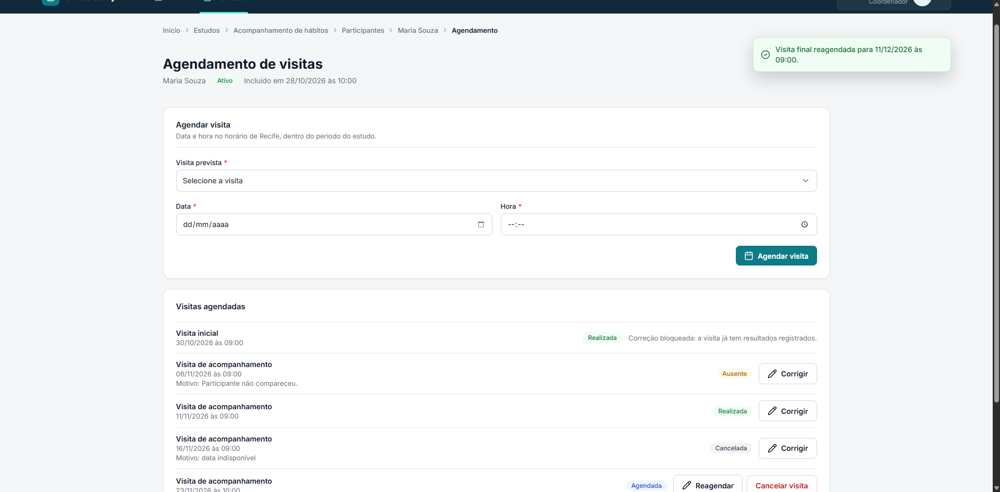

**Mostra:** a notificação "Visita final reagendada para 11/12/2026 às 09:00."
**Comprova:** RF12. Reagendar altera a data de uma visita agendada, sem criar outra visita. A nova data aparece na lista da evidência 7.

### Erro e validação

#### 2. Agendamento com campos vazios

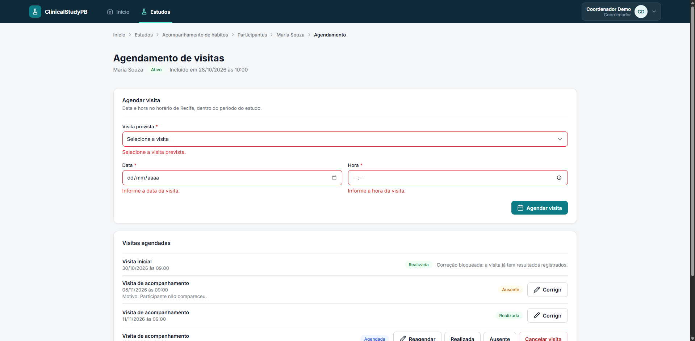

**Mostra:** o formulário "Agendar visita" enviado vazio, com os erros "Selecione a visita prevista.", "Informe a data da visita." e "Informe a hora da visita.".
**Comprova:** RF12. Visita prevista, data e hora são obrigatórias, e a web valida antes de enviar.

#### 3. Data anterior a hoje

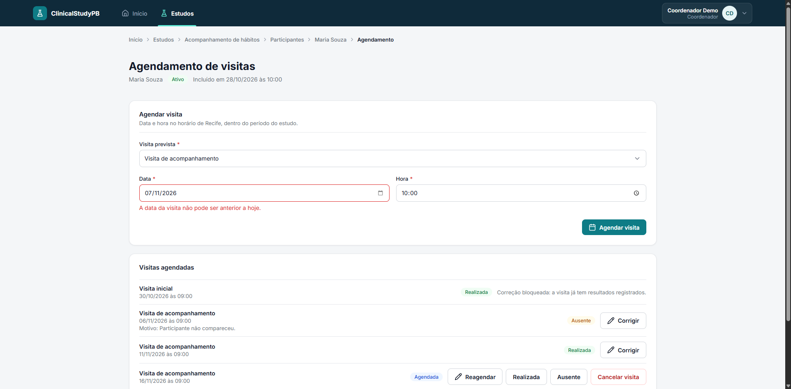

**Mostra:** a data 07/11/2026 no campo destacado, com a mensagem "A data da visita não pode ser anterior a hoje.".
**Comprova:** RF12. A data não pode ser anterior a hoje, no fuso de Recife.

#### 5. Visita prevista já agendada

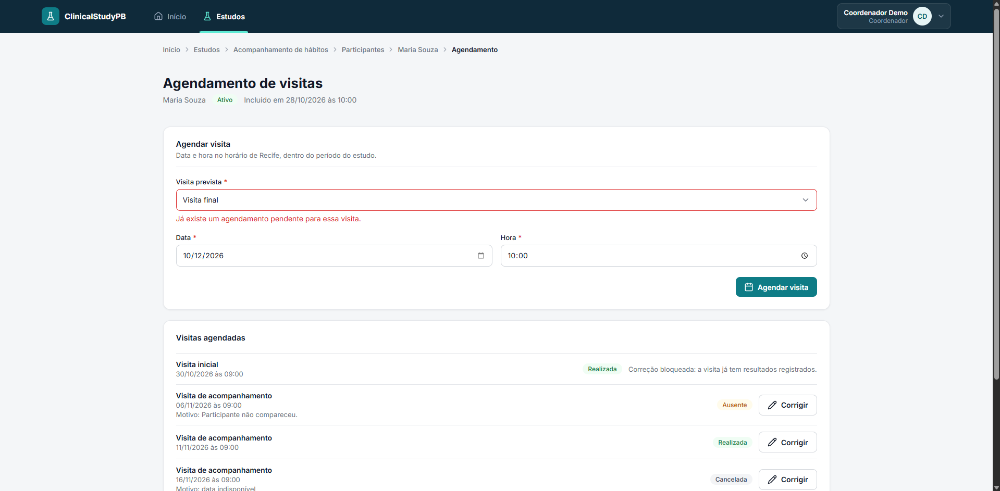

**Mostra:** a "Visita final" escolhida de novo, com a mensagem "Já existe um agendamento pendente para essa visita." no campo da visita.
**Comprova:** RF12. Só pode haver uma visita agendada para cada visita prevista da participação (`VISITA_JA_AGENDADA`).

## RF13: registro e correção

### Sucesso

#### 7. Ações conforme a situação e a data

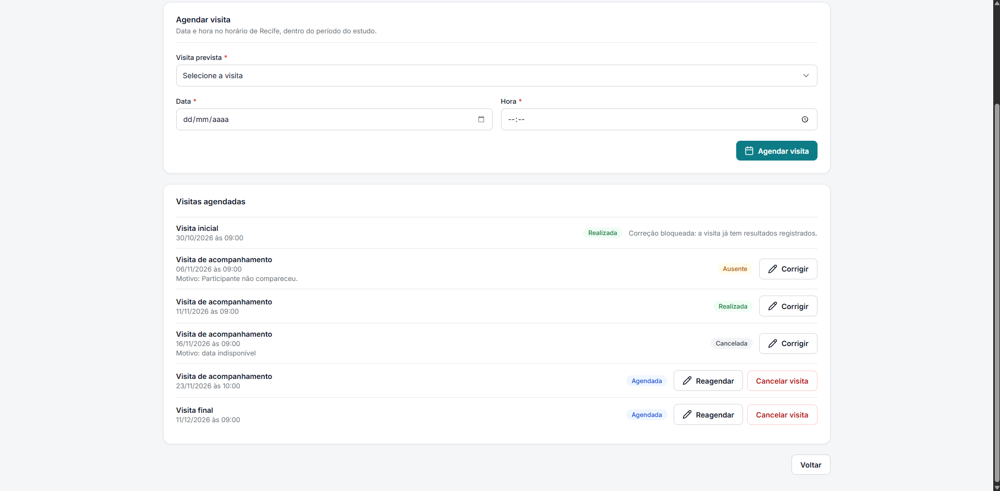

**Mostra:** a lista "Visitas agendadas" completa. As visitas futuras (23/11/2026 e 11/12/2026), ainda agendadas, têm só "Reagendar" e "Cancelar visita". As visitas já registradas têm só "Corrigir". A "Visita inicial", que tem resultado, mostra "Correção bloqueada: a visita já tem resultados registrados.".
**Comprova:** RF13. "Realizada" e "Ausente" só aparecem a partir do dia agendado, e uma visita registrada não volta a ficar agendada. Também mostra a correção bloqueada quando a visita tem resultados (RF14), no lugar do botão "Corrigir". A visita de 16/11/2026, ainda agendada e com data passada, aparece no rodapé da evidência 2 com "Realizada", "Ausente" e "Cancelar visita".

#### 9. Visita cancelada

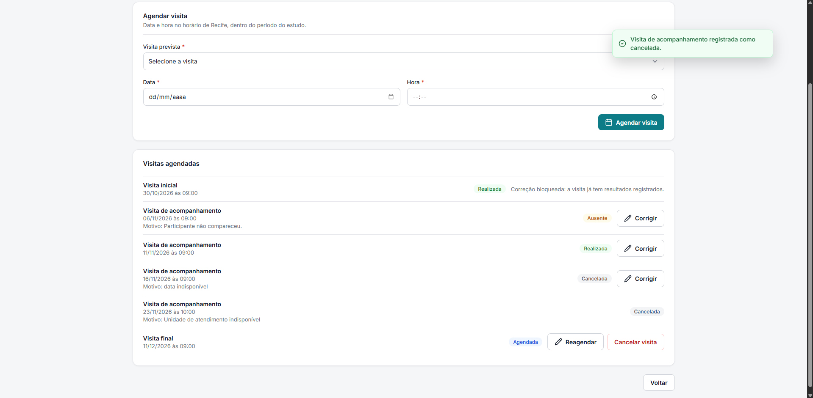

**Mostra:** a notificação "Visita de acompanhamento registrada como cancelada." e a visita de 23/11/2026 como "Cancelada", com o motivo "Unidade de atendimento indisponível".
**Comprova:** RF13. O cancelamento é aceito a qualquer momento, com motivo, e o motivo aparece na lista. A visita fica sem ações, porque uma visita cancelada antes do dia agendado ainda não tem para onde ser corrigida.

#### 10. Correção de cancelada para ausente

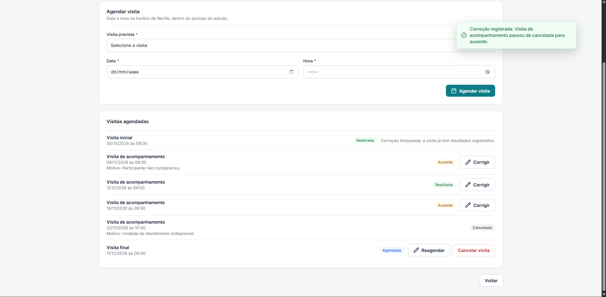

**Mostra:** a notificação "Correção registrada: Visita de acompanhamento passou de cancelada para ausente." A visita de 16/11/2026 aparece como "Ausente".
**Comprova:** RF13. Uma situação final pode ser trocada por outra. O motivo do cancelamento sai da visita, mas fica guardado na correção, como mostra a evidência 13.

#### 12. Correção de ausente para realizada

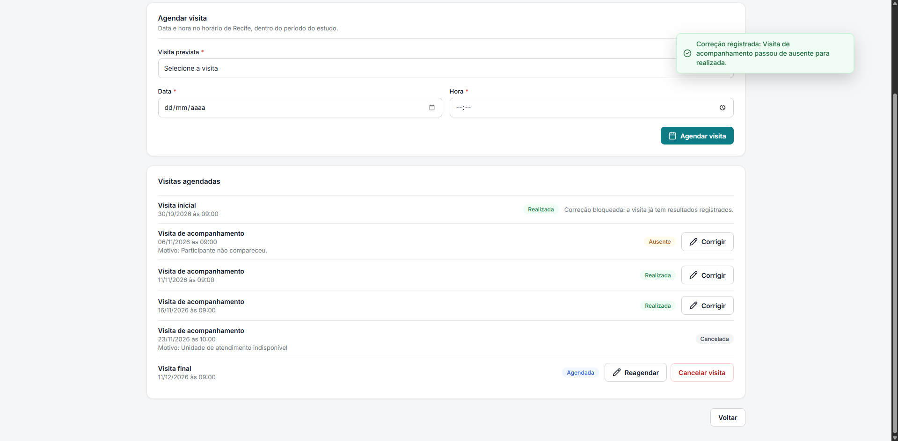

**Mostra:** a notificação "Correção registrada: Visita de acompanhamento passou de ausente para realizada." e a visita de 16/11/2026 como "Realizada".
**Comprova:** RF13. A correção troca a situação sem mudar a data agendada.

#### 13. Histórico com correções

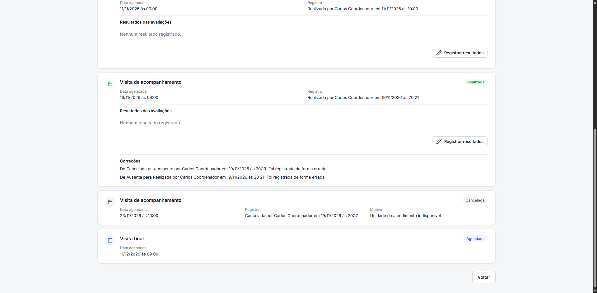

**Mostra:** a tela "Histórico do participante", rolada até as últimas visitas. A visita de 16/11/2026 aparece como "Realizada", com quem registrou e quando, e a seção "Correções" lista as duas trocas (de Cancelada para Ausente e de Ausente para Realizada), cada uma com autor, data e justificativa. Abaixo aparecem a visita cancelada, com o motivo, e a "Visita final", agendada.
**Comprova:** RF13 e RF15. As correções não apagam o registro anterior, e o histórico mostra as visitas em ordem cronológica.

### Erro e validação

#### 8. Cancelamento sem motivo

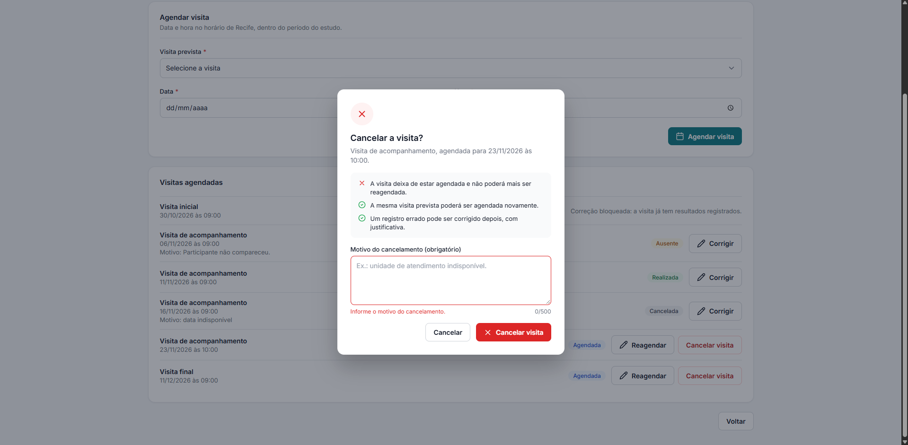

**Mostra:** o diálogo "Cancelar a visita?" da visita de 23/11/2026, com as consequências do cancelamento e a mensagem "Informe o motivo do cancelamento." abaixo do campo vazio.
**Comprova:** RF13. O motivo é obrigatório no cancelamento.

#### 11. Correção sem justificativa

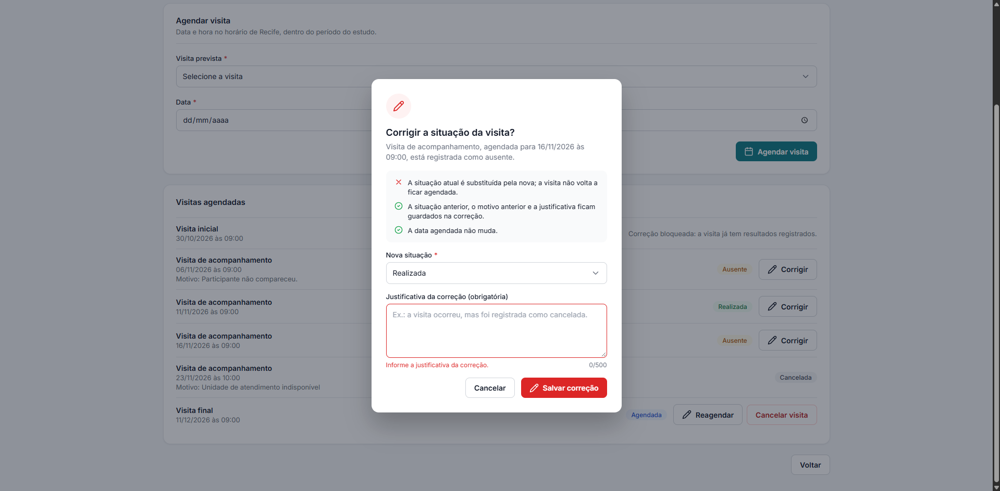

**Mostra:** o diálogo "Corrigir a situação da visita?" da visita de 16/11/2026, registrada como ausente, com a nova situação "Realizada" e a mensagem "Informe a justificativa da correção.".
**Comprova:** RF13. Toda correção exige justificativa.

## Pesquisador

#### 15. Lista somente para consulta

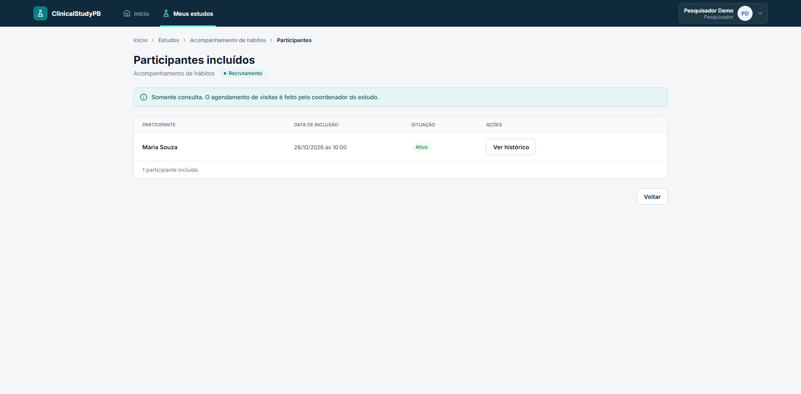

**Mostra:** a tela "Participantes incluídos" do pesquisador, no estudo "Acompanhamento de hábitos", com o aviso "Somente consulta. O agendamento de visitas é feito pelo coordenador do estudo.". A única ação é "Ver histórico".
**Comprova:** RF12 e RF15. O pesquisador responsável consulta a lista e o histórico, mas não agenda, não registra visitas e não retira participantes.

## RF14: resultados das avaliações

Estas capturas usam a **API real**, como as do RF16, mais abaixo: as rotas `GET /estudos/{estudoId}/participacoes/{participacaoId}/visitas/{visitaAgendadaId}` e `GET`, `POST` e `PUT` de `.../resultados` vieram nos PRs #52 e #59, e o histórico no PR #54. O estudo é o mesmo "Atividade física (teste 3390)". A participante fictícia "Carla Dias" foi incluída pelo fluxo real (elegibilidade, consentimento e inclusão) em 21/11/2026. A "Visita inicial" dela foi registrada como ausente e corrigida para realizada, e a segunda visita ficou agendada para 03/12/2026.

### Sucesso

#### 24. Histórico com a ação Registrar resultados

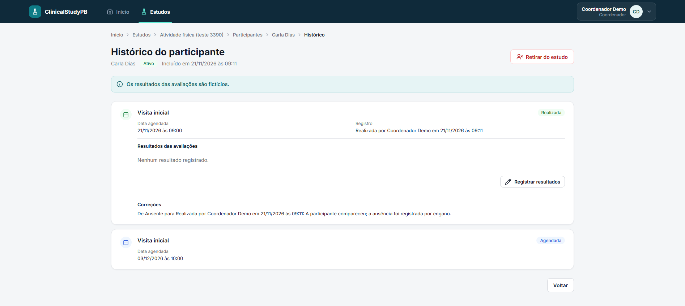

**Mostra:** o histórico de Carla Dias visto pelo coordenador. A "Visita inicial" aparece como "Realizada", com a correção de Ausente para Realizada, o texto "Nenhum resultado registrado" e o botão "Registrar resultados". A segunda visita aparece como "Agendada" para 03/12/2026.
**Comprova:** RF14. O coordenador chega aos resultados a partir da visita realizada, no histórico.

#### 25. Formulário de resultados

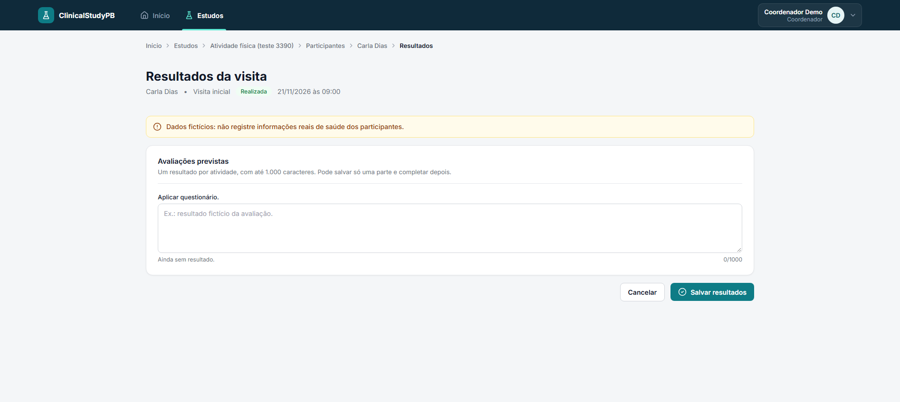

**Mostra:** a tela "Resultados da visita", com o aviso "Dados fictícios: não registre informações reais de saúde dos participantes." e um campo para a atividade "Aplicar questionário.", com o contador em 0/1000.
**Comprova:** RF14. A web monta um campo para cada atividade prevista da visita, a partir do protocolo, e lembra que os dados são fictícios.

#### 27. Resultados salvos

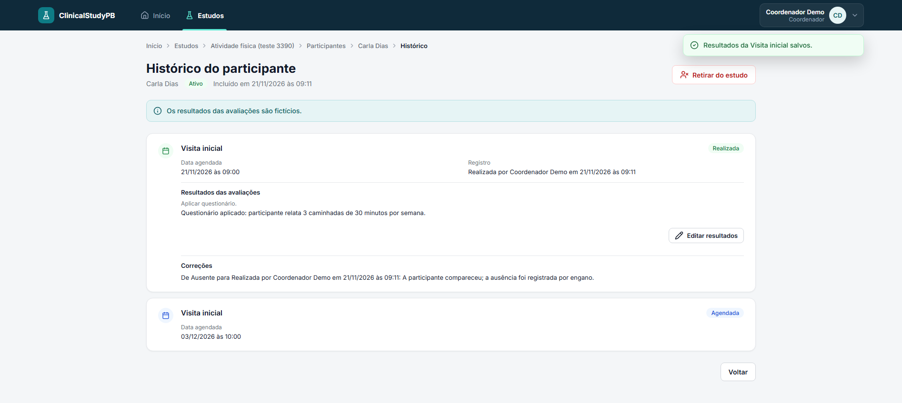

**Mostra:** a volta ao histórico com a notificação "Resultados da Visita inicial salvos.". A visita realizada passa a mostrar o resultado registrado e o botão "Editar resultados".
**Comprova:** RF14. O backend grava o resultado (`POST`, 201), e o histórico mostra o resultado junto da visita.

#### 28. Edição do resultado

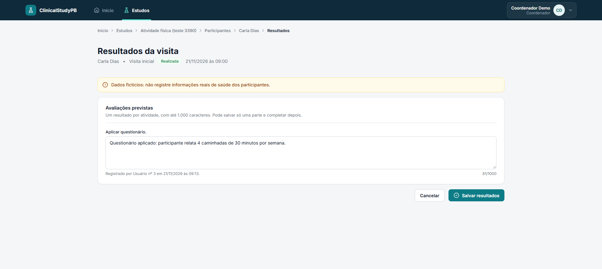

**Mostra:** o formulário reaberto com o texto salvo, alterado para "4 caminhadas", e a linha "Registrado por Usuário nº 3 em 21/11/2026 às 09:13.".
**Comprova:** RF14. O resultado salvo pode ser editado (`PUT`), e a tela mostra quem registrou e quando.
**Nota:** a resposta dos resultados traz só o id de quem registrou (`registradoPorId`), sem o nome. Por isso a tela mostra "Usuário nº 3" no lugar do nome do coordenador.

### Erro e bloqueio

#### 26. Texto acima de 1.000 caracteres

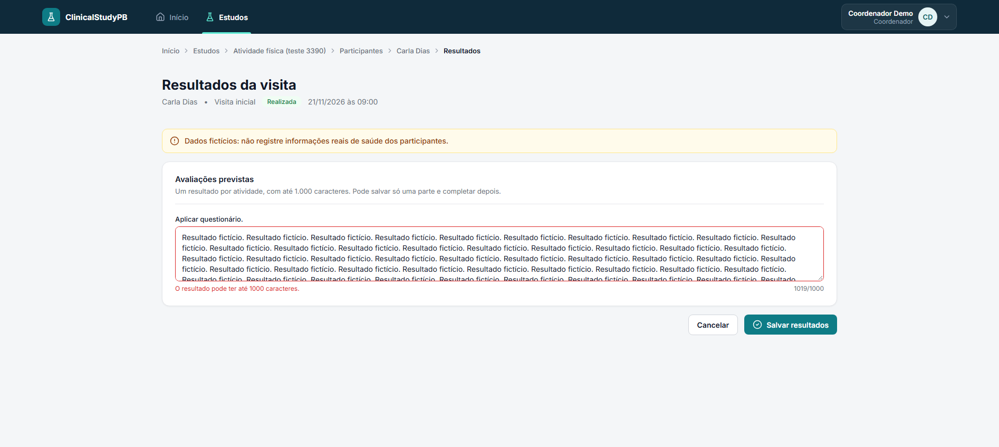

**Mostra:** o campo com 1019/1000 caracteres, destacado, e a mensagem "O resultado pode ter até 1000 caracteres.".
**Comprova:** RF14. O texto do resultado tem de 1 a 1.000 caracteres, e a web valida antes de enviar.

#### 29. Visita não realizada

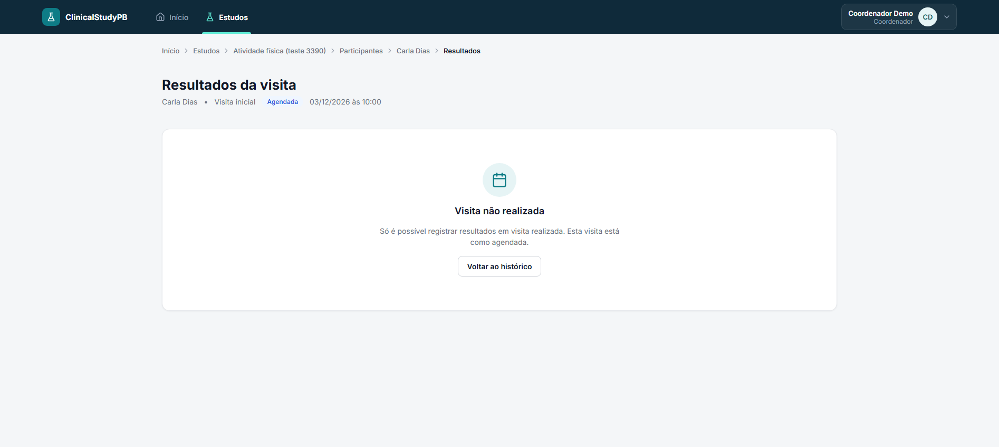

**Mostra:** a tela de resultados aberta para a visita de 03/12/2026, ainda agendada, com o aviso "Visita não realizada", a explicação "Só é possível registrar resultados em visita realizada. Esta visita está como agendada." e o botão "Voltar ao histórico".
**Comprova:** RF14. Só a visita realizada recebe resultados (`RESULTADO_INVALIDO` no backend), e a web não mostra o formulário nos outros casos.

## RF15: histórico

Estas capturas usam a **API real**, com a conta do pesquisador (`pesquisador@clinicalstudypb.test`) e a mesma participante "Carla Dias", depois da retirada pelo histórico (evidência 33, na seção RF16).

#### 30. Histórico visto pelo pesquisador

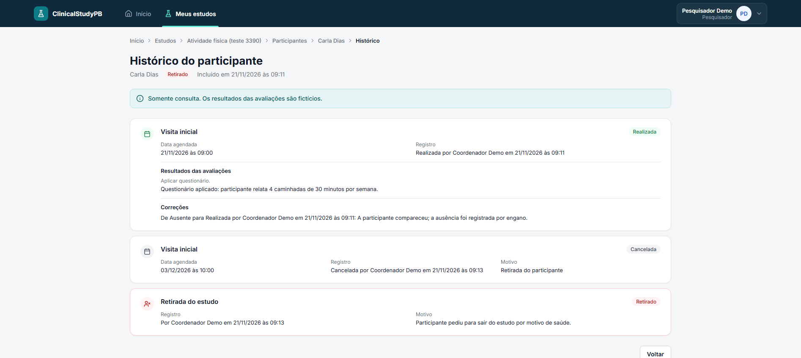

**Mostra:** o histórico de Carla Dias com o aviso "Somente consulta. Os resultados das avaliações são fictícios.". Aparecem a visita realizada, com o resultado e a correção, a visita cancelada com o motivo "Retirada do participante" e o item "Retirada do estudo". Não há botões de registro, de resultados nem de retirada.
**Comprova:** RF15. O pesquisador responsável consulta o histórico completo, em ordem cronológica, sem poder alterar nada.

#### 31. Participante não encontrado

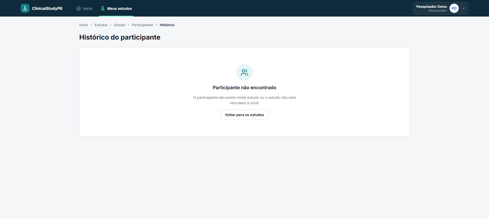

**Mostra:** o endereço `/estudos/5/participacoes/999/historico` aberto pelo pesquisador, com a mensagem "Participante não encontrado".
**Comprova:** RF15. Uma participação que não existe ou não é do estudo volta 404 (`RECURSO_NAO_ENCONTRADO`), e a web mostra o erro sem expor dados.

## RF16: retirada do participante

Estas capturas usam a **API real**: banco e backend no Docker ([guia Docker](execucao-docker.md)) e as quatro variáveis do `web/.env` como `real`. A rota `POST /estudos/{estudoId}/participacoes/{participacaoId}/retirada` veio no PR #48. O estudo é "Atividade física (teste 3390)", em Recrutamento, com o "Participante Demo" incluído pelo recrutamento.

A retirada não pode ser desfeita: depois da evidência 22, o "Participante Demo" fica retirado no banco local. Para repetir, recrie o banco do Docker ou inclua outro participante pelo recrutamento.

### Sucesso

#### 18. Lista com a ação Retirar

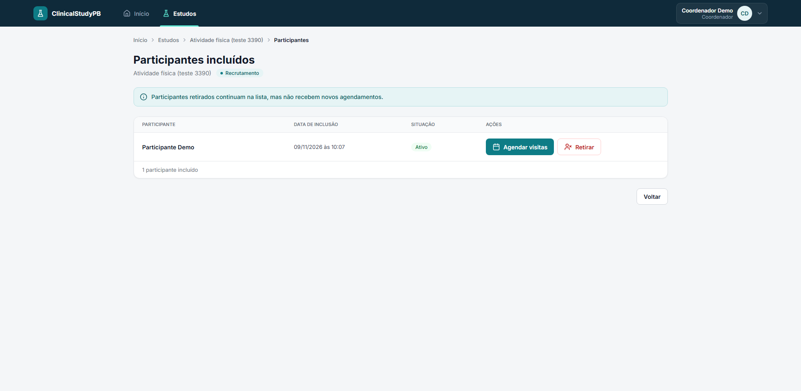

**Mostra:** a tela "Participantes incluídos" do coordenador, com o "Participante Demo" na situação "Ativo" e as ações "Agendar visitas" e "Retirar".
**Comprova:** RF16. O coordenador vinculado chega à retirada a partir da lista, no modo real.

#### 19. Diálogo de confirmação


**Mostra:** o diálogo "Retirar do estudo?". Ele avisa que a retirada não pode ser desfeita, que as visitas ainda agendadas serão canceladas e que não será mais possível agendar visitas nem lançar resultados. Também informa que as visitas realizadas, os resultados e o histórico continuam disponíveis, e que a conta do participante e os outros estudos dele não são afetados.
**Comprova:** RF16. O coordenador vê as consequências antes de confirmar.

#### 21. Motivo preenchido


**Mostra:** o campo "Motivo da retirada (obrigatório)" preenchido, com o contador de caracteres (até 500).
**Comprova:** RF16. O motivo fica registrado no histórico, no limite de 500 caracteres do backend.

#### 22. Retirada registrada


**Mostra:** a notificação "Retirada de Participante Demo registrada." e o participante na situação "Retirado", sem ações. O aviso informa que participantes retirados continuam na lista, mas não recebem novos agendamentos.
**Comprova:** RF16. O backend registra a retirada, e o participante continua na lista.

### Erro e bloqueio

#### 20. Retirada sem motivo


**Mostra:** o diálogo confirmado com o motivo vazio. O campo fica destacado com a mensagem "Informe o motivo da retirada." e nada é enviado ao backend.
**Comprova:** RF16. O motivo é obrigatório.

#### 23. Agendamento bloqueado para o retirado


**Mostra:** a tela "Agendamento de visitas" do "Participante Demo", já "Retirado", com o aviso "O participante foi retirado do estudo: não é possível agendar, reagendar nem registrar visitas." e sem o formulário de agendamento. O segundo aviso indica que a lista de visitas agendadas depende do histórico, que a web ainda não usa no modo real.
**Nota:** a captura é anterior ao PR #54. Desde então, o backend oferece o histórico, a web liga a chave `historico` no modo real, e a tela mostra a lista de visitas agendadas no lugar desse segundo aviso.
**Comprova:** RF16. Um participante retirado não recebe novos agendamentos nem registros de visita.

### Retirada pela tela do histórico

As evidências 32 e 33 usam a participante "Carla Dias", a mesma das seções RF14 e RF15. A evidência 30 foi capturada depois da 33.

#### 32. Diálogo aberto pelo histórico


**Mostra:** o diálogo "Retirar do estudo?" aberto pelo botão "Retirar do estudo" do histórico de Carla Dias, com o motivo preenchido e o aviso de que a visita agendada será cancelada.
**Comprova:** RF16. A retirada também é feita a partir do histórico, com as mesmas consequências e o mesmo motivo obrigatório.

#### 33. Retirada registrada pelo histórico


**Mostra:** a notificação "Retirada de Carla Dias registrada.", a participante como "Retirado" e a visita de 03/12/2026 como "Cancelada", com o motivo "Retirada do participante". O histórico ganha o item da retirada, com o motivo, e mantém a visita realizada e os resultados.
**Comprova:** RF16. A retirada cancela só as visitas agendadas e preserva as visitas realizadas, os resultados e o histórico.

A retirada repetida (`PARTICIPACAO_JA_RETIRADA`) fica sem captura, porque a tela não mostra o botão para quem já foi retirado. O caso está nos testes automatizados.

## Testes e cobertura da Sprint 3

#### 16. Testes


**Mostra:** o fim da execução do `npm run test`: **42 arquivos e 642 testes passando**. Aparecem os testes do acompanhamento, como `agendamento`, `registroVisita`, `historico`, `resultados`, `retirada` e o serviço simulado.
**Comprova:** as regras e as telas do acompanhamento têm testes automatizados (Vitest e Testing Library).

#### 17. Cobertura


**Mostra:** o relatório em HTML do Istanbul (`web/coverage/index.html`), com o total e a cobertura de cada pasta.
**Comprova:** a cobertura da web ao fim da Sprint 3:

| Escopo                                          | Linhas cobertas |
| ----------------------------------------------- | --------------- |
| Toda a web                                      | **99,4%**       |
| Acompanhamento (`src/pages/acompanhamento`)     | 99,64%          |
| Configuração do estudo (`src/pages/protocolo`)  | 99,26%          |
| Estudos (`src/pages/estudos`)                   | 100%            |
| Recrutamento (`src/pages/recrutamento`)         | 99,5%           |
| Serviços da API (`src/api`)                     | 99,85%          |

A única pasta em vermelho é `src`, com 0%, por causa do `App.tsx`, explicado na evidência 18 da Release 1.