# Guia de execução da aplicação web

Este guia mostra como instalar, executar e testar a aplicação web do ClinicalStudyPB. No fim, reúne as evidências da Sprint 1.

## Visão geral

Na Sprint 1, a web entrega três requisitos:

| Requisito | O que a web faz |
|---|---|
| RF01 | O administrador lista, cadastra, edita, desativa e reativa contas dos quatro perfis. |
| RF02 | Qualquer conta ativa entra com e-mail e senha e sai encerrando a sessão no servidor. |
| RF03 | Cada perfil vê apenas o que pode usar. Rotas de outro perfil levam ao acesso negado. |

Quem usa a web na Sprint 1:

- **Administrador:** gerencia as contas.
- **Pesquisador:** entra no sistema e acessa os próprios estudos.
- **Coordenador:** entra no sistema e consulta os estudos vinculados a ele.

A segurança é garantida pelo backend. A web organiza a navegação e mostra as respostas da API.

## Pré-requisitos

| Ferramenta | Versão | Uso |
|---|---|---|
| Node.js | 24.22.0 (ver `web/.nvmrc`) | Aplicação web |
| Docker com Compose v2 | — | Banco PostgreSQL local |
| JDK | 21 completo (`java` e `javac`) | Backend |

No Windows e no macOS, o Docker Desktop precisa estar aberto antes de subir o banco.

## Subir o banco e o backend

Todas as telas pedem login. Por isso, a web só funciona com o banco e o backend ligados.

### 1. Banco

A partir da raiz do repositório:

```bash
docker compose up -d db
docker compose ps
```

Espere o estado `healthy`. Sem o arquivo `.env` na raiz, a senha do banco é `clinicalstudypb_dev`. Os detalhes estão na seção "Banco de dados" do [README](../README.md#banco-de-dados-postgresql-com-docker-compose).

Se `SPRING_DATASOURCE_USERNAME` e `SPRING_DATASOURCE_PASSWORD` já estiverem definidas no terminal, o Compose usa esses valores na criação do banco.

### 2. Backend

O backend precisa destas variáveis, no mesmo terminal em que ele será iniciado:

| Variável | Valor local |
|---|---|
| `SPRING_DATASOURCE_URL` | `jdbc:postgresql://localhost:5432/clinicalstudypb` |
| `SPRING_DATASOURCE_USERNAME` | `clinicalstudypb` |
| `SPRING_DATASOURCE_PASSWORD` | a senha do banco (`clinicalstudypb_dev` sem `.env`) |
| `WEB_ORIGINS` | `http://localhost:5173` |

`WEB_ORIGINS` define a origem aceita para a web. Esse já é o valor padrão do backend, mas vale declarar.

Linux/macOS:

```bash
export SPRING_DATASOURCE_URL=jdbc:postgresql://localhost:5432/clinicalstudypb
export SPRING_DATASOURCE_USERNAME=clinicalstudypb
export SPRING_DATASOURCE_PASSWORD='SUBSTITUA_PELA_SENHA_DO_BANCO'
export WEB_ORIGINS=http://localhost:5173
cd backend
./mvnw spring-boot:run
```

Windows (PowerShell):

```powershell
$env:SPRING_DATASOURCE_URL="jdbc:postgresql://localhost:5432/clinicalstudypb"
$env:SPRING_DATASOURCE_USERNAME="clinicalstudypb"
$env:SPRING_DATASOURCE_PASSWORD="SUBSTITUA_PELA_SENHA_DO_BANCO"
$env:WEB_ORIGINS="http://localhost:5173"
cd backend
.\mvnw.cmd spring-boot:run
```

O backend está pronto quando aparece `Started ClinicalStudyPbApplication`. Deixe esse terminal aberto. Os detalhes estão na seção "Backend" do [README](../README.md#backend) e no [guia de autenticação](autenticacao.md).

## Credenciais fictícias

> **Dados fictícios.** As contas, os e-mails e as senhas abaixo servem só para testes locais. Não use dados reais.

Com o banco ligado, abra o terminal SQL do contêiner:

```bash
docker compose exec db psql -U clinicalstudypb -d clinicalstudypb
```

Crie uma conta de pesquisador e uma de administrador:

```sql
CREATE EXTENSION IF NOT EXISTS pgcrypto;

INSERT INTO usuarios (nome, email, senha_hash, perfil)
VALUES ('Paula Pesquisadora', 'paula@exemplo.com', crypt('Senha123', gen_salt('bf', 10)), 'PESQUISADOR');

INSERT INTO usuarios (nome, email, senha_hash, perfil)
VALUES ('Ana Administradora', 'ana@exemplo.com', crypt('Senha123', gen_salt('bf', 10)), 'ADMINISTRADOR');
```

| Conta | Senha | Perfil | Para testar |
|---|---|---|---|
| `paula@exemplo.com` | `Senha123` | PESQUISADOR | Login, logout e acesso negado |
| `ana@exemplo.com` | `Senha123` | ADMINISTRADOR | Gestão de usuários |

A senha é gravada com BCrypt (`gen_salt('bf', 10)`), como faz o backend. Depois disso, as outras contas podem ser criadas pela própria tela de usuários, com a conta de administrador.

## Rodar a web

Em outro terminal:

```bash
cd web
npm ci
npm run dev
```

Abra **http://localhost:5173**.

- `npm ci` instala as versões exatas do `package-lock.json`. Só é preciso na primeira vez ou quando as dependências mudarem.
- As chamadas para `/api` vão ao backend em `http://localhost:8080` pelo proxy do Vite, sem o prefixo. Por exemplo, `/api/usuarios` chega ao backend como `/usuarios`. O proxy fica em `web/vite.config.ts`.

O login e os usuários sempre usam o backend. As telas de estudos podem usar dados simulados ou a API, conforme `VITE_ESTUDOS_API` no `web/.env`:

| Valor | Comportamento |
|---|---|
| `simulado` (padrão) | Estudos fictícios em memória, que voltam ao estado inicial ao recarregar. |
| `real` | Estudos vindos do backend. |

Para trocar, copie `web/.env.example` para `web/.env`, ajuste o valor e reinicie o `npm run dev`.

## Testes e cobertura

Dentro de `web/`:

```bash
npm test                # testes com Vitest
npm run lint            # ESLint
npm run build           # verificação de tipos e build de produção
npm run test:coverage   # testes com cobertura (Istanbul)
```

O `npm run test:coverage` mostra a tabela no terminal e gera o relatório em **`web/coverage/index.html`**. Abra esse arquivo no navegador para ver as linhas cobertas de cada arquivo. A pasta `coverage/` não vai para o Git.

Os testes não precisam do backend nem do banco: as chamadas à API são simuladas.

## Problemas comuns

| Sintoma | Causa | Solução |
|---|---|---|
| A web mostra só "Não foi possível verificar sua sessão. Tente novamente." | O backend está parado ou não conecta ao banco. | Suba o banco e o backend. Confira: `curl -i -H "Accept: application/json" http://localhost:5173/api/auth/sessao` deve responder **401** (ninguém logado). Um **502** indica backend parado. |
| `Cannot find module` ao rodar a web ou os testes | Dependências não instaladas, ou comando fora de `web/`. | Entre em `web/` e rode `npm ci`. |
| `npm ci` falha com `EPERM` no Windows | O `npm run dev` está aberto e trava arquivos de `node_modules`. | Pare o `npm run dev` (`Ctrl+C`) e rode `npm ci` de novo. |

No PowerShell, use `curl.exe` no lugar de `curl`.

## Evidências da Sprint 1

As capturas foram feitas com o banco PostgreSQL e o backend locais, usando contas fictícias. Os arquivos estão em [`docs/evidencias/web/`](evidencias/web/).

### Sucesso

#### 1. Login do administrador

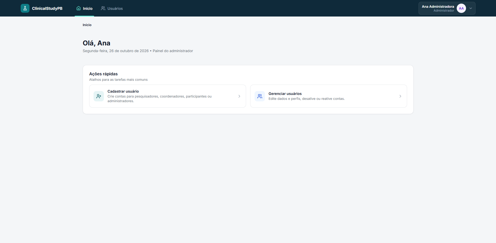

**Mostra:** a tela inicial da Ana Administradora logo após o login, com "Olá, Ana", o menu "Usuários" e os atalhos "Cadastrar usuário" e "Gerenciar usuários".
**Comprova:** RF02 (login com e-mail e senha) e RF03 (o administrador vê o menu de usuários).

#### 2. Início do pesquisador

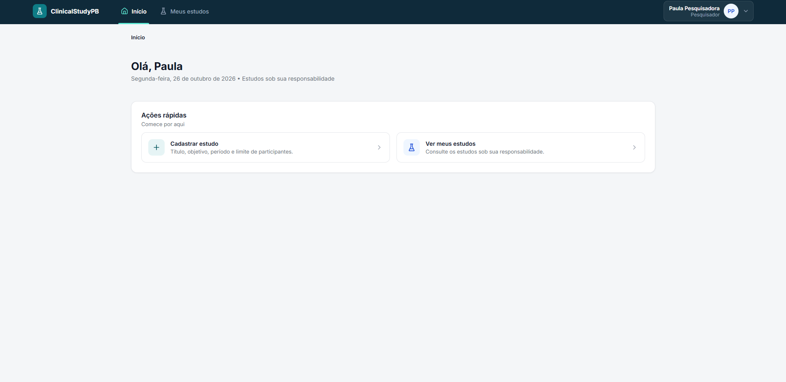

**Mostra:** a tela inicial da Paula Pesquisadora, com o menu "Meus estudos" e sem o menu "Usuários".
**Comprova:** RF03. O menu e os atalhos mudam conforme o perfil.

#### 3. Lista de usuários

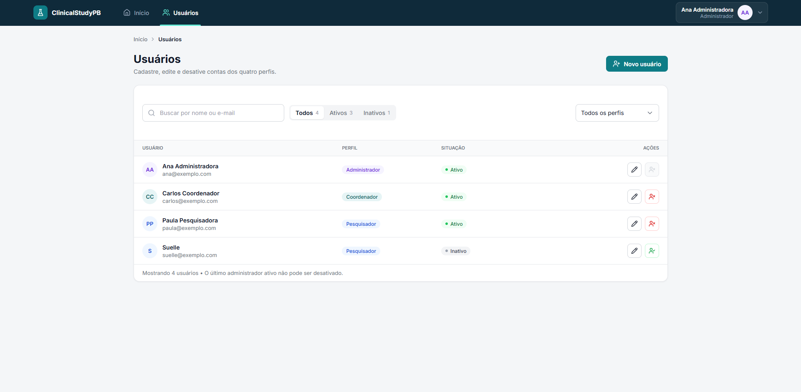

**Mostra:** a lista com nome, e-mail, perfil e situação; a busca; as abas Todos, Ativos e Inativos com contagem; e o filtro por perfil.
**Comprova:** RF01 (listagem). Contas ativas e inativas aparecem juntas, porque não há exclusão física (D01).

#### 4. Usuário cadastrado

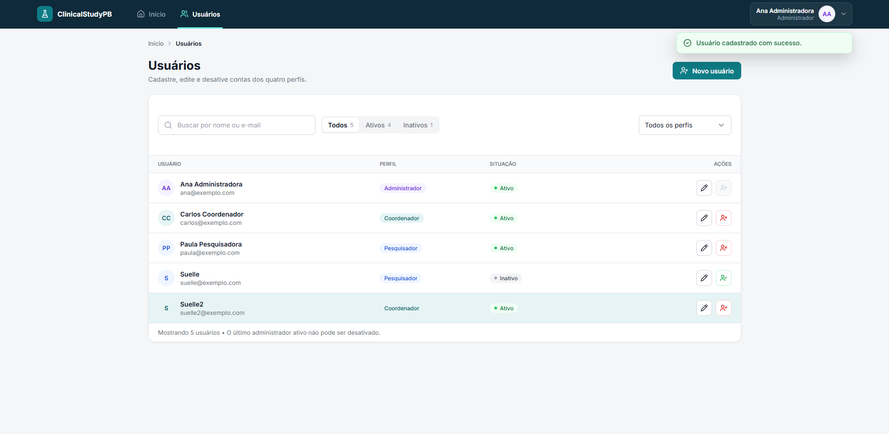

**Mostra:** a notificação "Usuário cadastrado com sucesso." e a nova conta destacada na lista, já como "Ativo".
**Comprova:** RF01. O cadastro gera uma conta que começa ativa.

#### 5. Edição de usuário

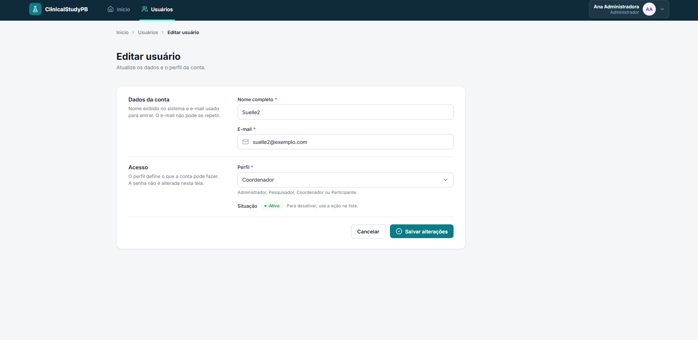

**Mostra:** o formulário com nome, e-mail e perfil. A senha não aparece, e a situação indica "Para desativar, use a ação na lista."
**Comprova:** RF01 (edição). A senha não é alterada nesta tela.

#### 6. Confirmação para desativar

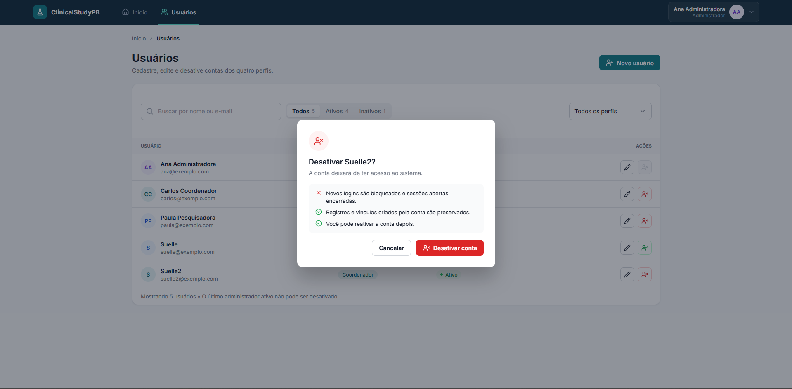

**Mostra:** o diálogo "Desativar …?", que explica que novos logins são bloqueados, as sessões abertas são encerradas, os registros são preservados e a conta pode ser reativada.
**Comprova:** D01 e a regra 5.3. Desativar não exclui a conta e bloqueia o acesso.

#### 7. Confirmação para reativar

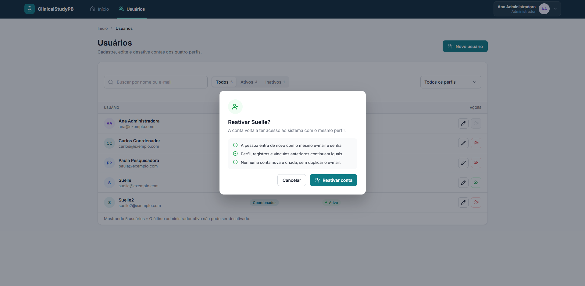

**Mostra:** o diálogo "Reativar …?" de uma conta inativa: a pessoa entra com o mesmo e-mail e senha, o perfil e os vínculos continuam iguais e nenhuma conta nova é criada.
**Comprova:** D01 e a regra 5.3. Reativar não duplica o e-mail.

#### 8. Menu da conta

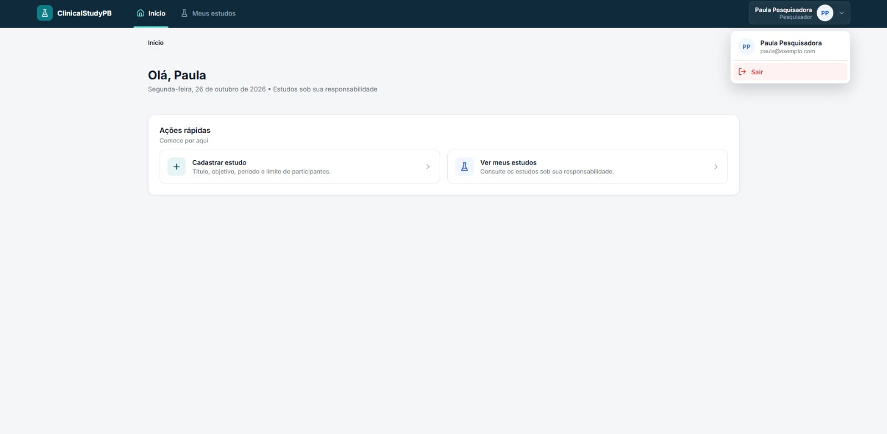

**Mostra:** o menu da conta aberto na barra, com nome, e-mail e a opção "Sair".
**Comprova:** RF02. O logout está disponível em todas as telas internas.

#### 9. Logout com sessão encerrada no servidor

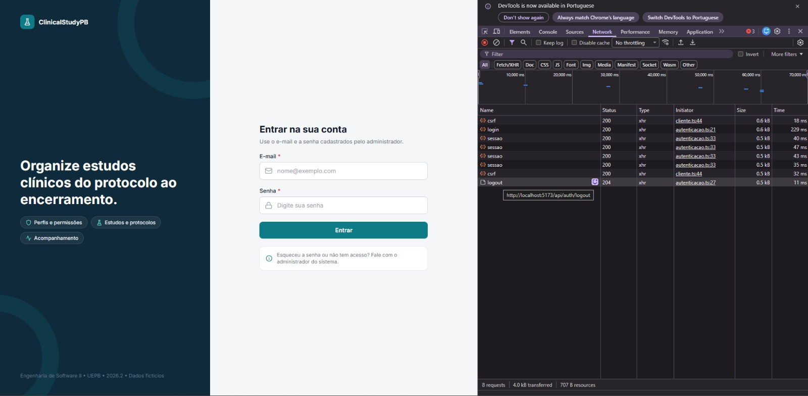

**Mostra:** a tela de login depois do Sair. No DevTools aparecem `GET /auth/csrf`, `POST /auth/login` (200), as consultas `GET /auth/sessao` (200), um novo `GET /auth/csrf` e **`POST /auth/logout` com 204**.
**Comprova:** RF02. O logout encerra a sessão no servidor, e não só na tela. Também mostra a proteção CSRF: o token é buscado antes do login e do logout, que são alterações.

### Erro e proteção

#### 10. Credenciais inválidas

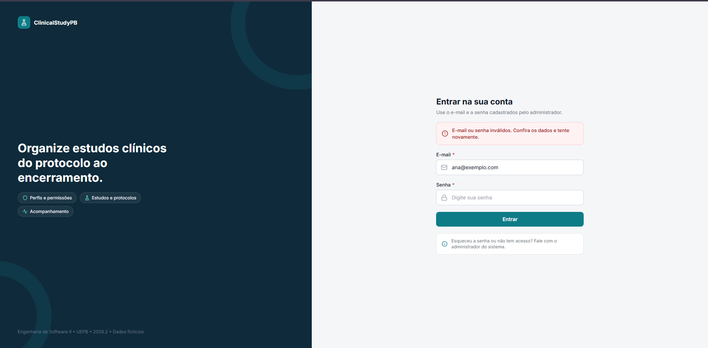

**Mostra:** a mensagem "E-mail ou senha inválidos. Confira os dados e tente novamente." O campo de senha é limpo.
**Comprova:** RF02. A mensagem é genérica e não revela se o e-mail existe.

#### 11. Cadastro com campos vazios

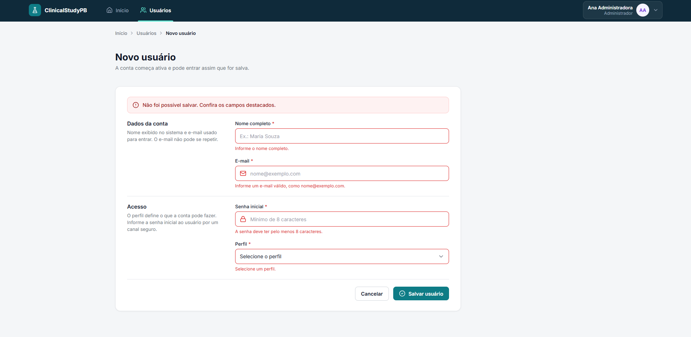

**Mostra:** a faixa "Não foi possível salvar. Confira os campos destacados." e o erro de cada campo: nome, e-mail, senha com pelo menos 8 caracteres e perfil.
**Comprova:** RF01. Nome, e-mail, senha inicial e perfil são obrigatórios: a web valida antes de enviar, e o backend valida de novo. A exceção é o mínimo de 8 caracteres da senha, que por enquanto só a web confere (pendência registrada para o backend).

#### 12. E-mail já cadastrado

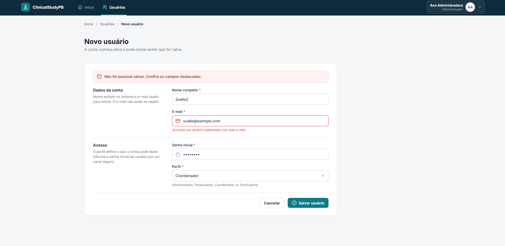

**Mostra:** a mensagem "Já existe um usuário cadastrado com este e-mail." no campo e-mail. O e-mail usado é o de uma conta **inativa**.
**Comprova:** RF01. O e-mail é único, inclusive entre contas desativadas (resposta 409 `EMAIL_JA_CADASTRADO`).

#### 13. Último administrador ativo

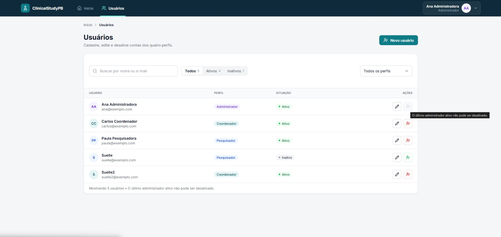

**Mostra:** o botão de desativar da única administradora ativa está desabilitado, com a dica "O último administrador ativo não pode ser desativado." A mesma nota aparece no rodapé da lista.
**Comprova:** a regra 5.3. O sistema nunca fica sem um administrador ativo. O backend também recusa a operação (`ULTIMO_ADMINISTRADOR`).

#### 14. Acesso negado por perfil

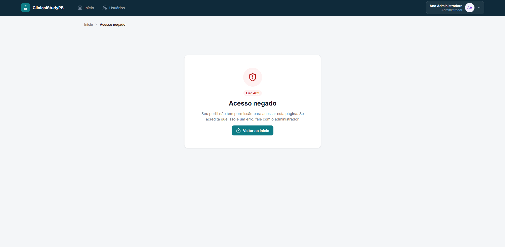

**Mostra:** a tela "Acesso negado" (Erro 403) para a administradora, ao abrir uma página de outro perfil, com o botão "Voltar ao início".
**Comprova:** RF03. Cada rota exige um perfil. O backend também responde 403 (`ACESSO_NEGADO`) quando o perfil não tem permissão.

#### 15. Sessão expirada

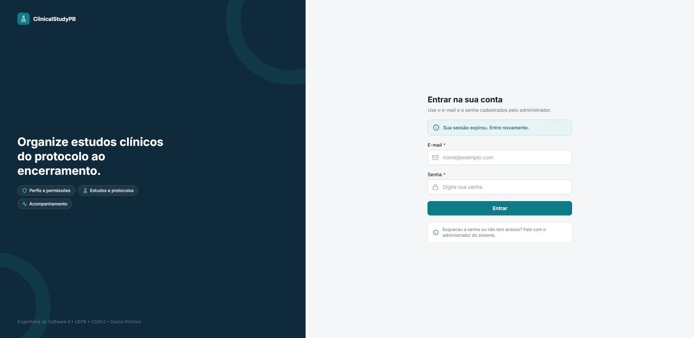

**Mostra:** a tela de login com o aviso "Sua sessão expirou. Entre novamente."
**Comprova:** RF02. Quando o backend responde 401 com alguém logado (sessão expirada, cookie apagado ou conta desativada), a web encerra a sessão na tela, avisa e, depois do novo login, volta à página de origem.

#### 16. Página não encontrada

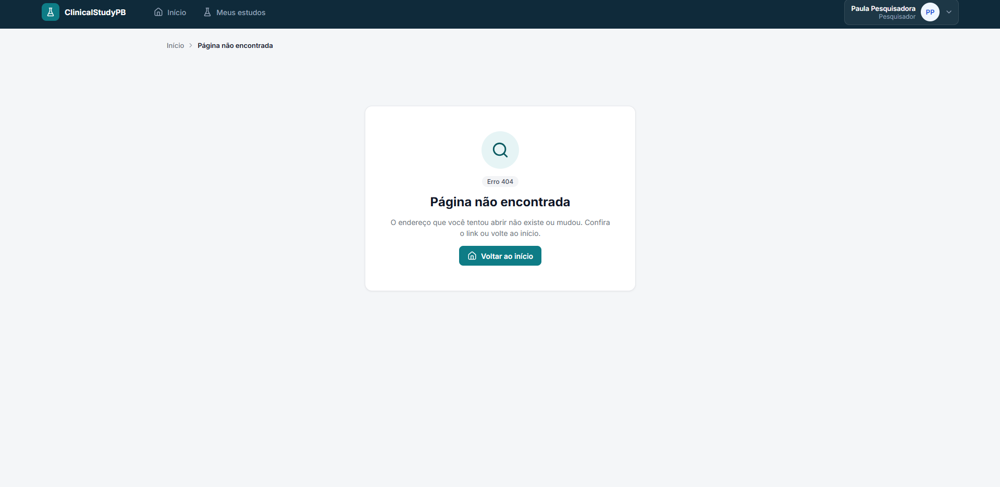

**Mostra:** a tela "Página não encontrada" (Erro 404) com a barra da pesquisadora e o botão "Voltar ao início".
**Comprova:** endereços inexistentes têm uma resposta clara, sem perder a sessão.

### Testes e cobertura

#### 17. Testes

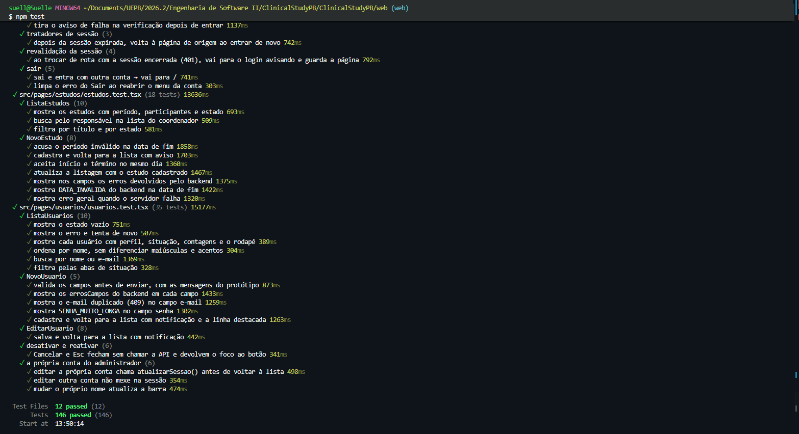

**Mostra:** o fim da execução do `npm test`: **12 arquivos e 146 testes passando**. Aparecem os grupos de sessão, revalidação, sair, estudos e usuários.
**Comprova:** os componentes de login e de usuários têm testes automatizados (Vitest e Testing Library).

#### 18. Cobertura

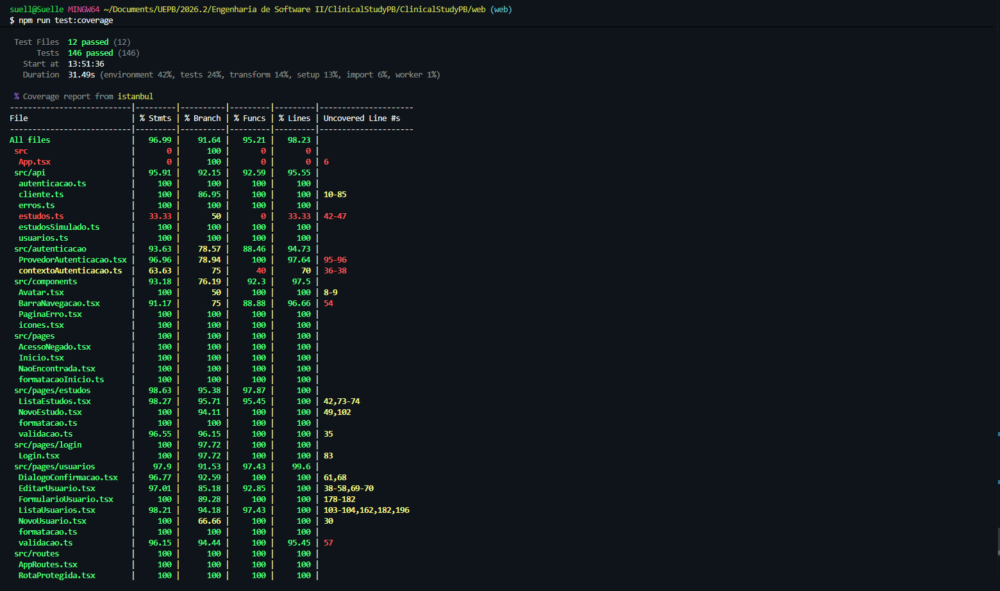

**Mostra:** a tabela do `npm run test:coverage`, gerada pelo Istanbul.
**Comprova:** a cobertura da web, prevista no kickoff:

| Escopo | Linhas cobertas |
|---|---|
| Toda a web (`src`) | **98,23%** |
| Login (`src/pages/login`) | 100% |
| Usuários (`src/pages/usuarios`) | 99,6% |
| Serviço de usuários (`src/api/usuarios.ts`) | 100% |
| Autenticação (`src/autenticacao`) | 94,73% |

Dois arquivos aparecem em vermelho, e isso é esperado:

- **`App.tsx` (0%):** só junta o provedor de autenticação e as rotas. Os testes usam essas duas partes diretamente, cada uma com o seu cenário. Assim, este arquivo não é carregado nos testes.
- **`api/estudos.ts` (33%):** o serviço real de estudos (`GET` e `POST /estudos`) não é exercitado. Os testes das telas de estudos usam um serviço simulado, que é o padrão da web enquanto `VITE_ESTUDOS_API` não for `real`.

Para reproduzir, rode `npm test` e `npm run test:coverage` dentro de `web/`.
