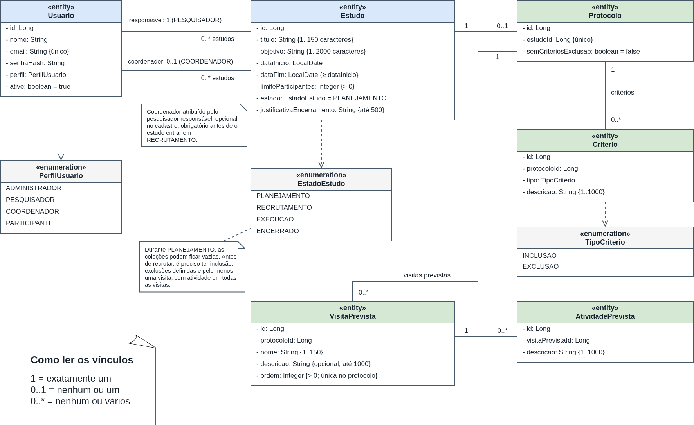

# Modelagem de critérios, visitas previstas e estados do estudo

>Este documento registra a modelagem das visitas e critérios dos estudos, definida por Georis em 29/10/2026. O objetivo é orientar o backend e a web com os mesmos campos, vínculos e regras para os RF05, RF06 e RF07.

O ponto de partida é a nossa arquitetura previamente definida (documento de _Kickoff_). As decisões detalhadas aqui completam o que já estava combinado, principalmente os campos dos registros, os limites dos textos e as validações. 
Este material define o comportamento esperado se aproximando mais do nível de código.

O nosso diagrama de modelo de domínio representa as relações no contexto geral do sistema:



## 1. Como os registros se organizam

O estudo representa o projeto de pesquisa. Já o protocolo reúne as regras de participação e o planejamento das visitas. Assim, a estrutura fica:

```text
Estudo
└── Protocolo
    ├── Critérios
    │   └── Cada critério: identificador, tipo e descrição
    └── Visitas previstas
        └── Atividades previstas
```

Um estudo pode existir sem protocolo enquanto está sendo preparado. Quando a primeira configuração válida for salva, o backend cria o protocolo e o associa ao estudo. As configurações seguintes utilizam esse mesmo protocolo.

| Relacionamento | Regra |
|---|---|
| Estudo e protocolo | Um estudo possui **zero ou um protocolo**. Cada protocolo pertence a exatamente um estudo. |
| Protocolo e critérios | Um protocolo pode reunir vários critérios. Cada critério pertence a exatamente um protocolo. |
| Protocolo e visitas previstas | Um protocolo pode reunir várias visitas previstas. Cada visita pertence a exatamente um protocolo. |
| Visita prevista e atividades | Uma visita pode reunir várias atividades. Cada atividade pertence a exatamente uma visita prevista. |

Durante o planejamento, essas coleções podem estar vazias. Isso permite salvar a configuração aos poucos. Entretanto, cada item salvo deve ter seus próprios campos válidos: um protocolo incompleto é permitido, mas um critério com descrição vazia não é (não faria sentido).

Nos campos abaixo, os nomes terminados em `Id` identificam o registro ao qual o item pertence. Na implementação Java, esses vínculos podem ser representados por referências às entidades. Essa escolha não altera os relacionamentos definidos aqui.

## 2. Entidades e campos

### 2.1. Protocolo

| Campo | Tipo | Regra |
|---|---|---|
| `id` | Identificador inteiro (`Long`) | Gerado pelo backend. |
| `estudoId` | Identificador de estudo | Obrigatório e único entre os protocolos, pois um estudo não pode ter dois protocolos. |
| `semCriteriosExclusao` | Booleano | Obrigatório, inicialmente `false`. Registra a declaração de que não existem critérios de exclusão. |

O protocolo não terá versões nem aprovação externa, conforme o Kickoff. Depois que o estudo sair do planejamento, sua configuração ficará somente para consulta.

### 2.2. Criterio

Inclusão e exclusão usam a mesma entidade. O campo `tipo` diferencia as duas finalidades, enquanto o identificador permite que a avaliação de elegibilidade referencie cada critério separadamente.

| Campo | Tipo | Regra |
|---|---|---|
| `id` | Identificador inteiro (`Long`) | Gerado pelo backend. |
| `protocoloId` | Identificador de protocolo | Obrigatório. |
| `tipo` | Enum `TipoCriterio` | Obrigatório, com os valores `INCLUSAO` e `EXCLUSAO`. |
| `descricao` | Texto | Obrigatória, de 1 a 1.000 caracteres após retirar espaços das pontas. |

Exemplo fictício:

```yaml
id: 12
protocoloId: 3
tipo: INCLUSAO
descricao: Ter disponibilidade para comparecer às visitas previstas.
```

O critério não contém fórmulas nem operadores de avaliação. Conforme nossa definição de arquitetura, o coordenador registra se cada inclusão foi atendida e se cada exclusão está presente.

### 2.3. VisitaPrevista

| Campo | Tipo | Regra |
|---|---|---|
| `id` | Identificador inteiro (`Long`) | Gerado pelo backend. |
| `protocoloId` | Identificador de protocolo | Obrigatório. |
| `nome` | Texto | Obrigatório, de 1 a 150 caracteres após retirar espaços das pontas. |
| `descricao` | Texto | Opcional, com até 1.000 caracteres. |
| `ordem` | Inteiro | Opcional na requisição. Deve ser maior que zero e sem repetição no protocolo. Se não for enviado, o backend calcula automaticamente (maior ordem existente + 1).|

`ordem` determina a sequência de apresentação das visitas. Se a ordem não for informada na criação de uma nova visita, o backend deve identificar a maior ordem já existente naquele protocolo e atribuir o valor seguinte (+1). 
O envio manual do campo continua permitido, e valores saltados (como 1, 3 e 5) são válidos, não sendo exigida a renumeração quando uma visita for removida. Em qualquer atribuição manual ou edição, o backend deve bloquear a requisição caso outra visita do mesmo protocolo já utilize o valor informado.

Uma visita prevista pode se chamar “Visita inicial” ou “Visita de acompanhamento”. Ela não terá participante nem data e hora de agendamento, pois representa um modelo do protocolo. A visita agendada será outro registro, ligado a uma pessoa, nas funcionalidades de acompanhamento.

### 2.4. AtividadePrevista

| Campo | Tipo | Regra |
|---|---|---|
| `id` | Identificador inteiro (`Long`) | Gerado pelo backend. |
| `visitaPrevistaId` | Identificador de visita prevista | Obrigatório. |
| `descricao` | Texto | Obrigatória, de 1 a 1.000 caracteres após retirar espaços das pontas. |

Por exemplo, uma atividade pode ser “Aplicar questionário fictício de acompanhamento”. Neste momento, a descrição é suficiente; não haverá um campo de nome separado. Resultados e informações de realização pertencem ao acompanhamento da visita agendada e não à atividade prevista.

### 2.5. Complemento em Estudo

Os campos atuais do estudo são mantidos, incluindo seu estado inicial `PLANEJAMENTO`. A modelagem acrescenta:

| Campo | Tipo | Regra |
|---|---|---|
| `justificativaEncerramento` | Texto | Até 500 caracteres. Obrigatória quando o estudo for encerrado a partir de planejamento ou recrutamento. |

No encerramento antecipado, a justificativa deve ter pelo menos um caractere após retirar espaços das pontas. No encerramento a partir de execução, ela não é obrigatória. Quando informada, deve respeitar o mesmo limite e permanecer disponível para consulta com o estudo.

A justificativa explica o motivo do encerramento. O registro de quem fez a alteração e quando pertence à auditoria prevista no Kickoff; esse campo não substitui a auditoria.

### 2.6. Validações comuns

Os textos são simples, sem formatação especial. O backend deve retirar espaços das pontas antes de validar o tamanho e rejeitar textos obrigatórios formados apenas por espaços. Nos campos opcionais, um texto vazio após essa limpeza será tratado como não informado.

Todos os identificadores são gerados pelo backend. Além disso, os vínculos devem ser verificados: uma atividade de uma visita não pode ser alterada por uma requisição que indique outra visita, e um critério não pode ser acessado como se pertencesse a outro protocolo.

## 3. Como registrar que não há critérios de exclusão

Uma lista vazia pode significar que o pesquisador ainda não terminou o cadastro. Por isso, um campo booleano `semCriteriosExclusao` diferencia essa situação de uma declaração explícita de ausência de exclusões.

Na web, ele será apresentado como a opção **“Este estudo não possui critérios de exclusão”**.

| Critérios de exclusão cadastrados | `semCriteriosExclusao` | Significado |
|---|---|---|
| Nenhum | `false` | A definição das exclusões ainda está pendente. |
| Nenhum | `true` | O pesquisador confirmou que não há critérios de exclusão. |
| Um ou mais | `false` | As exclusões estão definidas pelos critérios cadastrados. |
| Um ou mais | `true` | Combinação inválida, que deve ser rejeitada. |

Marcar essa opção não apaga critérios já cadastrados. Se existirem exclusões, o pesquisador deverá removê-las antes de declarar que não há nenhuma. Da mesma forma, para cadastrar uma exclusão quando a opção estiver marcada, deverá desmarcá-la primeiro.

Se o último critério de exclusão for removido, o campo continuará `false`. Portanto, a definição ficará pendente até que outro critério seja cadastrado ou que o pesquisador confirme a ausência de exclusões. A mesma consistência deve ser verificada ao mudar o tipo de um critério.

## 4. Quando a configuração pode ser alterada

1. **Somente o pesquisador responsável pelo estudo pode cadastrar, editar e remover critérios, visitas previstas e atividades**. Essas operações são permitidas apenas enquanto o estudo estiver em `PLANEJAMENTO`. 
2. Ao remover uma visita prevista, suas atividades também serão removidas. A web deve pedir uma confirmação que explique esse efeito antes de enviar a operação. No backend, a remoção da visita e de suas atividades deve ocorrer por completo, sem deixar atividades sem vínculo.
3. **Depois que o estudo sair de planejamento, o protocolo ficará somente para consulta**. Isso impede que critérios já utilizados nas avaliações sejam alterados ou removidos (o que seria adulteração na vida real). As permissões de leitura continuam seguindo o Kickoff: o pesquisador consulta seus estudos e o coordenador consulta os estudos aos quais está vinculado. 
4. A troca de coordenador só é permitida enquanto o estudo estiver na fase de PLANEJAMENTO. Após o início do recrutamento, a alteração é bloqueada.
5. A web deve orientar o usuário e desabilitar as ações indisponíveis. <u>Ainda assim, o backend precisa conferir o responsável, os vínculos e o estado atual a cada alteração, porque esconder um botão não garante o cumprimento da regra</u>.

## 5. Quando o protocolo está completo para recrutar

Para mudar de `PLANEJAMENTO` para `RECRUTAMENTO`, o estudo precisa ter um coordenador atribuído e atender a todas as condições abaixo:

1. Ter um protocolo vinculado ao estudo.
2. Ter pelo menos um critério de inclusão válido.
3. Ter pelo menos um critério de exclusão válido ou a declaração `semCriteriosExclusao = true`, respeitando a tabela da seção 3.
4. Ter pelo menos uma visita prevista válida.
5. Ter pelo menos uma atividade válida em **cada** visita prevista cadastrada.

A exigência de atividade em todas as visitas é um detalhamento adotado nesta modelagem por fazer sentido na prática diária (toda visita deve ter um objetivo). 

Essas condições não impedem salvar uma configuração incompleta durante o planejamento. Por exemplo, é permitido cadastrar uma visita e acrescentar suas atividades depois. **Porém, enquanto ela estiver vazia, o estudo não poderá abrir o recrutamento.**

## 6. Estados e transições permitidas

O enum `EstadoEstudo` mantém os valores `PLANEJAMENTO`, `RECRUTAMENTO`, `EXECUCAO` e `ENCERRADO`. A web pode apresentá-los como Planejamento, Recrutamento, Execução e Encerrado.

O fluxo principal é:

```text
Planejamento ──> Recrutamento ──> Execução ──> Encerrado
```

Também é permitido encerrar diretamente a partir de planejamento ou recrutamento, desde que sejam atendidas as condições da tabela. **Todas as mudanças são feitas pelo pesquisador responsável**.

| Estado atual | Próximo estado | Condição para permitir |
|---|---|---|
| `PLANEJAMENTO` | `RECRUTAMENTO` | Coordenador atribuído e protocolo completo conforme a seção 5. |
| `RECRUTAMENTO` | `EXECUCAO` | Pelo menos um participante incluído. A partir dessa mudança, novas inclusões ficam bloqueadas. |
| `EXECUCAO` | `ENCERRADO` | Nenhuma visita agendada e nenhuma solicitação pendente. As pendências devem ser resolvidas ou canceladas antes. |
| `PLANEJAMENTO` | `ENCERRADO` | Nenhum participante incluído e justificativa de encerramento válida. |
| `RECRUTAMENTO` | `ENCERRADO` | Nenhum participante incluído e justificativa de encerramento válida. |

>Não são permitidos retornos, saltos fora dessa tabela nem reabertura de um estudo encerrado. Uma solicitação para o estado em que o estudo já está não representa uma nova transição e deve ser rejeitada sem alteração. Em `ENCERRADO`, ficam disponíveis apenas consultas, respeitando as permissões de cada perfil.

Para mais detalhes, o [diagrama de estados dos estudos](../diagramas/10_estados_estudos.png) apresenta a modelagem de modo intuitivo.

A contagem de participantes segue o Kickoff: considera as inclusões históricas. Uma retirada posterior não apaga a inclusão nem libera uma nova vaga. Portanto, **um estudo que já teve participantes não pode utilizar o encerramento antecipado reservado a estudos sem inclusões**.

Antes de gravar uma mudança, o backend deve conferir as condições com os dados atuais. A verificação e a gravação devem ocorrer na mesma transação, com controle das operações simultâneas. Isso evita, por exemplo, que uma inclusão seja confirmada depois que outra operação já encerrou o recrutamento, ou que o protocolo seja alterado ao mesmo tempo em que ele é fechado para edição.

### 6.1. O que se aplica à Release 1

O cronograma oficial da professora coloca os RF05 a RF11 na Sprint 2. Portanto, critérios, visitas **previstas** e gerenciamento dos quatro estados fazem parte da Release 1.

Já o agendamento e o acompanhamento de visitas, RF12 a RF16, entram na Sprint 3. Os pedidos de reagendamento e retirada pelo aplicativo, RF19 e RF20, entram na Sprint 4. Ambos pertencem à Release 2, conforme a página 5 do enunciado.

Assim, a Release 1 deve permitir as transições do RF07 sem antecipar a implementação desses módulos. Enquanto não houver registros de visitas agendadas e solicitações porque os módulos ainda não existem, não há pendências dessas categorias que impeçam o encerramento. Uma visita **prevista** do protocolo não conta como visita agendada.

Quando os módulos de acompanhamento forem implementados, a validação de `EXECUCAO → ENCERRADO` deverá consultar suas pendências reais. 

## 7. Como informar os bloqueios à web

O backend mantém o formato definido no Kickoff e já utilizado pelo projeto: `codigo`, `mensagem` e, quando houver erro em um campo, `errosCampos`.

Para uma tentativa de abrir recrutamento sem critério de inclusão, a resposta será HTTP `400`, por exemplo:

```json
{
  "codigo": "PROTOCOLO_INCOMPLETO",
  "mensagem": "Cadastre pelo menos um critério de inclusão para iniciar o recrutamento."
}
```

A mensagem deve explicar o motivo concreto do bloqueio. Se faltar uma atividade, por exemplo, deve identificar a visita que precisa ser completada. A web apresenta a mensagem e mantém o estado exibido até que uma mudança seja confirmada pelo backend.

Para campos inválidos e regras de negócio não atendidas, usar `400`. Os demais casos seguem o contrato existente: `401` para ausência de sessão válida, `403` para perfil sem permissão, `404` para registro inexistente ou fora do alcance permitido e `409` para conflitos. Esses códigos HTTP não substituem uma mensagem compreensível.

As rotas e os DTOs concretos serão definidos na implementação e refletidos no OpenAPI. Esta modelagem estabelece os dados e as regras que essas operações precisam respeitar.

## 8. Exemplos para conferir a implementação

| Situação | Resultado esperado |
|---|---|
| Pesquisador responsável salva um critério válido, mas ainda não cadastrou visitas. | Permitir o cadastro e manter o estudo em planejamento. |
| Uma descrição obrigatória contém apenas espaços ou ultrapassa 1.000 caracteres. | Rejeitar o item e indicar o campo inválido. |
| Duas visitas do mesmo protocolo recebem ordem `2`. | Rejeitar a repetição. |
| As visitas têm ordens `1`, `3` e `5`. | Permitir; os intervalos não são um erro. |
| Há uma exclusão cadastrada e o pesquisador tenta marcar que não existem exclusões. | Rejeitar, preservando os critérios existentes. |
| O último critério de exclusão é removido e a opção permanece `false`. | Permitir em planejamento, mas bloquear a abertura do recrutamento até definir as exclusões. |
| O pesquisador confirma a remoção de uma visita durante o planejamento. | Remover a visita e suas atividades na mesma operação. |
| O protocolo está completo, mas não há coordenador atribuído. | Bloquear a abertura do recrutamento e explicar a necessidade do vínculo. |
| Há inclusão, exclusões definidas, coordenador e duas visitas, mas uma visita está sem atividade. | Bloquear a abertura do recrutamento e identificar a visita incompleta. |
| Todas as condições da seção 5 estão atendidas. | Permitir a mudança para recrutamento. |
| O pesquisador tenta editar um critério após abrir o recrutamento. | Bloquear a edição, mantendo o protocolo disponível para consulta. |
| Um pesquisador tenta alterar o protocolo de outro pesquisador. | Bloquear pelo vínculo, mesmo que o estudo esteja em planejamento. |
| O estudo está em recrutamento, mas não tem participante incluído. | Bloquear a mudança para execução. |
| O estudo tem pelo menos um participante incluído e muda para execução. | Permitir a mudança e impedir novas inclusões. |
| O estudo não tem inclusões e recebe uma justificativa válida para encerramento antecipado. | Permitir o encerramento a partir de planejamento ou recrutamento. |
| O encerramento antecipado não tem justificativa ou ela excede 500 caracteres. | Bloquear e indicar o problema no campo. |
| O estudo já teve uma inclusão, mesmo que a pessoa tenha se retirado depois. | Bloquear o encerramento direto a partir de recrutamento. |
| O estudo está em execução e há uma visita agendada ou solicitação pendente, quando esses módulos existirem. | Bloquear o encerramento até resolver as pendências. |
| O estudo está em execução e não há visitas agendadas nem solicitações pendentes. | Permitir o encerramento. |
| O estudo está encerrado e alguém tenta reabri-lo. | Bloquear; o histórico continua consultável. |

## Referências 

As fontes desta modelagem são:

- **ProjetoES2-2026.2.pdf**, página 3: escopo dos RF05 a RF07 e distinção dos requisitos de acompanhamento e aplicativo; página 5: distribuição dos requisitos entre as releases e sprints.
- **Kickoff.docx**, seções 5.1 e 5.2: permissões por perfil e vínculo; seção 8.1: estudo, protocolo e transições; seção 8.2: respostas da API; seções 8.3 e 8.4: inclusões e acompanhamento.
