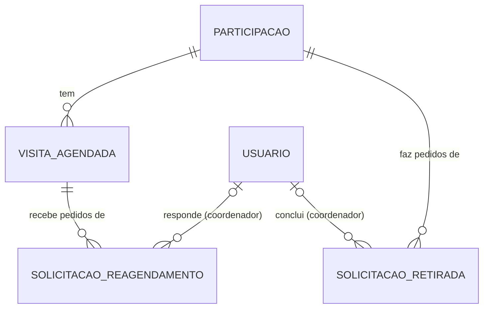
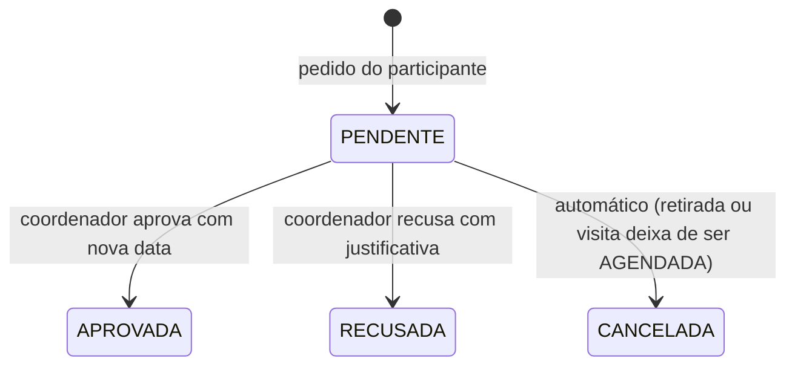
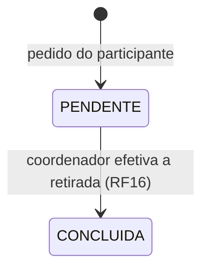

# Modelagem dos pedidos do participante (RF19 e RF20)

>Este documento registra a modelagem da confirmação de presença, do pedido de reagendamento e do pedido de retirada voluntária, definida por Georis em 25/11/2026. O objetivo é orientar o backend, a web e o mobile com os mesmos campos, vínculos e regras na Sprint 4.

O ponto de partida é o Kickoff (seções 1.2, 5.2, 8.1 e 8.4, decisões D04, D10 e D13), o planejamento da Sprint 4 (PBIs 01 e 02) e a modelagem dos RF12 a RF18. Este material completa o que já estava combinado. Quando uma regra vem do Kickoff ou do planejamento, isso é indicado; as escolhas desta modelagem que não estavam escritas aparecem na seção 9.

## 1. Como os registros se organizam

Os pedidos do participante **não alteram sozinhos** a visita nem a participação: são registros que esperam a resposta do coordenador (D10). Confirmar presença (RF19) não é registrar comparecimento (RF13), e pedir a retirada (RF20) não processa a retirada (RF16).



Já existem: Participação e VisitaAgendada (Sprint 3). Novos nesta sprint: `SolicitacaoReagendamento`, `SolicitacaoRetirada` e o enum `SituacaoSolicitacao`, além do campo `presencaConfirmadaEm` em `VisitaAgendada`.

| Relacionamento | Regra |
|---|---|
| Visita agendada e pedidos de reagendamento | Uma visita pode ter vários pedidos ao longo do tempo, mas **no máximo um `PENDENTE`**. Cada pedido pertence a exatamente uma visita. |
| Participação e pedidos de retirada | Uma participação pode ter vários pedidos, mas **no máximo um `PENDENTE`**. Na prática, um pedido só é concluído com a retirada, que é irreversível. |
| Confirmação de presença | Não é uma tabela: é a data guardada na própria visita (`presencaConfirmadaEm`). Quem confirma é sempre o participante da participação, então não há outro campo. |

Os dois pedidos ficam em tabelas separadas porque os campos e as situações válidas são diferentes (o reagendamento tem nova data e pode ser recusado; a retirada não tem recusa uma vez que é direito do participante). Assim, cada tabela tem suas próprias restrições no banco, em vez de uma tabela genérica com muitas colunas vazias.

## 2. Entidades e campos

### 2.1. VisitaAgendada (complemento)

| Campo | Tipo | Regra |
|---|---|---|
| `presencaConfirmadaEm` | Data e hora | Vazio até o participante confirmar. Preenchido pelo backend. A `situacao` da visita continua `AGENDADA`. |

A confirmação vale para a data atual da visita. Quando a data muda, ela é limpa (seção 4). Depois que a visita deixa de ser `AGENDADA`, o valor permanece apenas como registro e o app deixa de exibi-lo como pendência.

### 2.2. SolicitacaoReagendamento

| Campo | Tipo | Regra |
|---|---|---|
| `id` | Identificador inteiro (`Long`) | Gerado pelo backend. |
| `visitaAgendadaId` | Identificador de visita | Obrigatório. |
| `dataHoraOriginal` | Data e hora | Data da visita no momento do pedido, copiada pelo backend. Preserva o histórico depois de uma aprovação. |
| `dataHoraDesejada` | Data e hora | Obrigatória, informada pelo participante. Regras na seção 3.2. |
| `motivo` | Texto | Opcional, de 1 a 500 caracteres após retirar espaços das pontas. Texto só com espaços é tratado como ausente. |
| `situacao` | Enum `SituacaoSolicitacao` | `PENDENTE`, `APROVADA`, `RECUSADA` ou `CANCELADA`. Inicia `PENDENTE`. |
| `solicitadaEm` | Data e hora | Preenchida pelo backend. |
| `respondidaPorId` | Identificador de usuário | Coordenador que aprovou ou recusou. Vazio enquanto `PENDENTE` e no cancelamento automático. |
| `encerradaEm` | Data e hora | Momento em que o pedido deixou de ser `PENDENTE` (resposta ou cancelamento). |
| `dataHoraAprovada` | Data e hora | Só em `APROVADA`. É a data registrada pelo coordenador, que pode diferir da desejada. |
| `justificativaRecusa` | Texto | Só em `RECUSADA`. Obrigatória, de 1 a 500 caracteres após retirar espaços das pontas. |

### 2.3. SolicitacaoRetirada

| Campo | Tipo | Regra |
|---|---|---|
| `id` | `Long` | Gerado pelo backend. |
| `participacaoId` | Identificador de participação | Obrigatório. |
| `motivo` | Texto | **Opcional**: o participante não precisa justificar a saída. De 1 a 500 caracteres quando informado. |
| `situacao` | Enum `SituacaoSolicitacao` | `PENDENTE` ou `CONCLUIDA`. Não existe recusa da retirada voluntária. Inicia `PENDENTE`. |
| `solicitadaEm` | Data e hora | Preenchida pelo backend. |
| `respondidaPorId` | Identificador de usuário | Coordenador que efetivou a retirada. Vazio enquanto `PENDENTE`. |
| `encerradaEm` | Data e hora | Momento da conclusão. Vazio enquanto `PENDENTE`. |

### 2.4. SituacaoSolicitacao

Um único enum com as cinco situações do planejamento, para que web e mobile usem o mesmo tipo. Cada tabela restringe, por CHECK, as situações que aceita:

| Situação | Reagendamento | Retirada |
|---|---|---|
| `PENDENTE` | Sim | Sim |
| `APROVADA` | Sim | Não |
| `RECUSADA` | Sim | Não |
| `CONCLUIDA` | Não | Sim |
| `CANCELADA` | Sim | Não |

### 2.5. Coerência da resposta

O banco confere que os campos da resposta combinam com a situação, para que nenhum erro de serviço grave um pedido inconsistente.

| Situação | `respondidaPorId` | `encerradaEm` | `dataHoraAprovada` | `justificativaRecusa` |
|---|---|---|---|---|
| `PENDENTE` | vazio | vazio | vazio | vazio |
| `APROVADA` | obrigatório | obrigatório | obrigatória | vazia |
| `RECUSADA` | obrigatório | obrigatório | vazia | obrigatória |
| `CANCELADA` | vazio | obrigatório | vazia | vazia |
| `CONCLUIDA` (retirada) | obrigatório | obrigatório | não se aplica | não se aplica |

### 2.6. Validações comuns

Valem as regras comuns da modelagem RF12 a RF18: espaços das pontas retirados antes de validar, identificadores gerados pelo backend e **vínculos verificados**. Antes de qualquer gravação, os serviços desta sprint conferem:

1. a participação pertence à conta autenticada (o participante age só nas próprias participações, sem identificador de participante na URL);
2. a visita pertence a essa participação;
3. o pedido pertence ao estudo da rota e a um estudo ao qual o coordenador está vinculado (D04);
4. o estado atual da visita, da participação e do estudo, **dentro da transação**, e não o que a tela exibia.

Cada conferência deve ter um teste de rejeição.

## 3. Regras por requisito

### 3.1. RF19: confirmar presença

A confirmação só é aceita quando **todas** as condições abaixo forem verdadeiras:

1. Quem confirma é o participante dono da participação.
2. A participação está `ATIVA`.
3. O estudo está em `RECRUTAMENTO` ou `EXECUCAO`.
4. A visita está `AGENDADA` e é **futura** (o dia da `dataHora` é hoje ou posterior, no fuso `America/Recife`).

Efeito: grava `presencaConfirmadaEm`. A visita continua `AGENDADA`; ela só fica `REALIZADA` quando o coordenador registra pelo RF13 (Kickoff 1.2 e 8.4). Confirmar de novo uma visita já confirmada apenas atualiza a data, sem erro.

### 3.2. RF19: pedir reagendamento

O pedido só é aceito quando **todas** as condições abaixo forem verdadeiras:

1. Quem pede é o participante dono da participação, que está `ATIVA`.
2. O estudo está em `RECRUTAMENTO` ou `EXECUCAO`.
3. A visita está `AGENDADA` e é futura.
4. A `dataHoraDesejada` segue a mesma regra de data do RF12: não é anterior a hoje e está dentro do período do estudo (`dataInicio` a `dataFim`, inclusive).
5. Não existe outro pedido `PENDENTE` para a visita (`409`, inclusive em requisições simultâneas, pelo índice único parcial).

Efeito: cria o pedido `PENDENTE`, com `dataHoraOriginal` copiada da visita. **A visita mantém a data atual** até a resposta.

### 3.3. Resposta do coordenador ao reagendamento



Resposta pelo coordenador vinculado ao estudo, que antes de responder **confere de novo o estado atual**: pedido ainda `PENDENTE`, visita ainda `AGENDADA`, participação `ATIVA` e estudo em `RECRUTAMENTO` ou `EXECUCAO`. Um pedido não é aprovado, por exemplo, se a visita já foi cancelada ou registrada.

| Resposta | Regra | Efeito |
|---|---|---|
| Aprovar | O coordenador informa a nova data e hora, com a mesma regra de data do RF12. | Atualiza **a mesma visita**, sem criar outra, e limpa a confirmação de presença. Pedido `APROVADA`, com `dataHoraAprovada`, responsável e `encerradaEm`. |
| Recusar | Justificativa obrigatória, de 1 a 500 caracteres. | A visita mantém a data atual. Pedido `RECUSADA`, com `justificativaRecusa`, responsável e `encerradaEm`. |

A resposta fica visível no app. Pelo D13 e pela regra do app, o participante **não** vê quem respondeu; vê a situação, a nova data (se aprovada) e a justificativa da recusa. Pedidos encerrados continuam consultáveis.

### 3.4. RF20: pedir retirada voluntária

O pedido só é aceito quando **todas** as condições abaixo forem verdadeiras:

1. Quem pede é o participante dono da participação.
2. A participação está `ATIVA`. Quem já foi retirado não pede de novo.
3. O estudo está em `RECRUTAMENTO` ou `EXECUCAO`.
4. Não existe outro pedido `PENDENTE` para a participação (`409`, inclusive em requisições simultâneas).

Efeito: cria o pedido `PENDENTE`, com data e hora, e motivo opcional. O pedido **não retira ninguém sozinho**.

### 3.5. Concluir a retirada pelo RF16



O coordenador vinculado conclui o pedido **pela operação de retirada que já existe** (RF16), na mesma transação. Condições do RF16: estudo em `RECRUTAMENTO` ou `EXECUCAO` e participação `ATIVA`. Na transação, o backend:

1. marca a participação como `RETIRADA`, com data, motivo e responsável (regras do RF16);
2. cancela as visitas `AGENDADA`, com o motivo automático "Retirada do participante" (RF16);
3. **cancela os pedidos de reagendamento `PENDENTE`** dessas visitas (`CANCELADA`, sem responsável);
4. passa o pedido de retirada a `CONCLUIDA`, com o coordenador e `encerradaEm`.

O `motivoRetirada` da participação é obrigatório no RF16, mas o pedido do participante não exige motivo. Por isso, **ao concluir um pedido, o `motivoRetirada` recebe o motivo do pedido quando existir; caso contrário, o texto automático "Retirada voluntária solicitada pelo participante"**.

O coordenador também continua podendo retirar diretamente, sem pedido, com justificativa (Kickoff 8.4). Se houver pedido `PENDENTE` nessa participação, ele passa a `CONCLUIDA` junto com a retirada, pois o pedido foi atendido.

Não há recusa da retirada voluntária. A conta não é excluída, os outros estudos não são afetados e o histórico é preservado. O participante mantém acesso ao histórico do estudo, identificado como "Retirado".

## 4. Efeito nas regras já entregues

Estas mudanças alteram fluxos da Sprint 3 e ficam na task de ajuste das regras (T4058), com testes de aceite e de rejeição.

| Regra existente | Mudança |
|---|---|
| RF12: reagendar pela web (editar `dataHora`) | Passa a **limpar a confirmação de presença** (`limparConfirmacaoPresenca`). O mesmo vale para a aprovação de um pedido. |
| RF13: registrar `REALIZADA`, `AUSENTE` ou `CANCELADA` | Pedidos de reagendamento `PENDENTE` da visita passam a `CANCELADA` (decisão D-B, seção 9). |
| RF16: retirada | Passa a cancelar os pedidos de reagendamento pendentes (item 3 da seção 3.5) e a concluir o pedido de retirada pendente. O RF16 já previa isso para o RF19. |
| RF07: `EXECUCAO` para `ENCERRADO` | Além de visita `AGENDADA` (`VISITAS_PENDENTES`), passa a **bloquear com solicitação pendente** (`SOLICITACOES_PENDENTES`, `400`), informando as quantidades. O Kickoff 8.1 pede resolver ou cancelar as pendências antes de encerrar. |
| `GET /participante/estudos` (RF17) | Passa a incluir `dataInclusao` (T4058). |

Todas as operações de escrita dos pedidos devem **bloquear o registro do estudo** (o mesmo bloqueio pessimista do RF07 e do RF12 a RF16) e conferir o estado dentro da transação. Assim, um pedido não é confirmado depois que o encerramento já foi validado, e o contrário também vale. Pedido, resposta e retirada da mesma participação também são serializados.

## 5. Permissões

Confirma a atribuição do Kickoff (5.2 e D10): o participante age nas próprias participações e o coordenador vinculado responde.

| Operação | Admin | Pesquisador | Coordenador | Participante |
|---|---|---|---|---|
| Confirmar presença e pedir reagendamento, RF19 | Não | Não | Não | Próprios, estudo em recrutamento ou execução |
| Pedir retirada voluntária, RF20 | Não | Não | Não | Próprios, estudo em recrutamento ou execução |
| Listar e responder pedidos de reagendamento | Não | Não | Vinculado | Consulta a resposta dos próprios pedidos |
| Listar e concluir pedidos de retirada | Não | Não | Vinculado | Consulta a situação dos próprios pedidos |

Perfil sem permissão recebe `403`. Estudo, visita, participação ou pedido fora do alcance (outro participante, coordenador não vinculado) recebe `404`, conforme o contrato existente. O vínculo é conferido pela API além do perfil (Kickoff 4.4).

## 6. Rotas previstas

Proposta para as tasks de implementação (T4056, T4057 e T4060) consolidarem e a T4059 registrar no OpenAPI. As rotas do participante usam a sessão, sem identificador de participante na URL, como as do RF17 e RF18.

| Operação | Rota proposta | Sucesso |
|---|---|---|
| Confirmar presença | `POST /participante/visitas/{visitaId}/confirmacao` | `200`, com a visita |
| Pedir reagendamento | `POST /participante/visitas/{visitaId}/reagendamentos` | `201`, com o pedido |
| Pedir retirada | `POST /participante/estudos/{estudoId}/retirada-solicitacoes` | `201`, com o pedido |
| Listar pedidos do estudo (coordenador) | `GET /estudos/{estudoId}/solicitacoes-reagendamento` e `GET /estudos/{estudoId}/solicitacoes-retirada`, com `situacao` opcional | `200` |
| Aprovar ou recusar reagendamento | `POST /estudos/{estudoId}/solicitacoes-reagendamento/{id}/aprovacao` e `/recusa` | `200` |
| Concluir retirada | `POST /estudos/{estudoId}/solicitacoes-retirada/{id}/conclusao` | `200` |

Exemplo de pedido de reagendamento:

```json
{
  "dataHoraDesejada": "2026-12-03T14:00:00-03:00",
  "motivo": "Consulta médica no mesmo horário"
}
```

### Consulta dos próprios pedidos pelo participante

O participante consulta os próprios pedidos pelas consultas já existentes do RF17 e RF18, sem rotas GET novas. Os DTOs ganham campos adicionais, compatíveis com o app atual, e todas as consultas continuam baseadas na sessão e exclusivas do perfil `PARTICIPANTE`.

| Consulta existente | Campo novo | Conteúdo |
|---|---|---|
| `GET /participante/visitas/proximas` e `GET /participante/visitas/historico` | `presencaConfirmadaEm` | Data da confirmação, ou `null` |
| `GET /participante/visitas/proximas` e `GET /participante/visitas/historico` | `solicitacoesReagendamento` | Pedidos da visita, do mais recente para o mais antigo. Cada item traz `id`, `situacao`, `dataHoraOriginal`, `dataHoraDesejada`, `motivo`, `solicitadaEm`, `dataHoraAprovada`, `justificativaRecusa` e `encerradaEm` |
| `GET /participante/estudos` | `solicitacoesRetirada` | Pedidos da participação, do mais recente para o mais antigo. Cada item traz `id`, `situacao`, `motivo`, `solicitadaEm` e `encerradaEm` |

O primeiro item de cada lista é o pedido corrente. Os pedidos encerrados (`APROVADA`, `RECUSADA`, `CONCLUIDA` e `CANCELADA`) permanecem na lista, o que atende à regra de que continuam consultáveis. As listas vêm vazias quando não há pedidos. 
O app continua sem receber `respondidaPor` nem outros dados internos (D-I).

## 7. Erros

Formato do Kickoff: `codigo`, `mensagem` e `errosCampos` quando houver erro em campo. Códigos já existentes são reaproveitados quando a situação é a mesma.

| Situação | HTTP | Código / retorno |
|---|---|---|
| Requisição sem autenticação | 401 | Não autenticado |
| Perfil sem permissão ou token CSRF ausente/inválido | 403 | Acesso negado |
| Participação retirada | 400 | `PARTICIPACAO_INVALIDA` |
| Estudo fora de recrutamento ou execução | 400 | `ESTADO_ESTUDO_INVALIDO` |
| Visita que não está `AGENDADA` ou que já passou (confirmar ou pedir reagendamento) | 400 | `TRANSICAO_VISITA_INVALIDA` |
| Data desejada ou aprovada anterior a hoje ou fora do período do estudo | 400 | `DATA_VISITA_INVALIDA` |
| Já existe pedido pendente para a visita ou para a participação | 409 | `SOLICITACAO_JA_PENDENTE` |
| Responder ou concluir um pedido que não está `PENDENTE` | 400 | `SOLICITACAO_NAO_PENDENTE` |
| Recusa sem justificativa, ou com mais de 500 caracteres | 400 | `JUSTIFICATIVA_RECUSA_INVALIDA` |
| Motivo acima de 500 caracteres | 400 | `VALIDACAO_INVALIDA` (ou erro de campo em `errosCampos`) |
| Encerrar estudo em `EXECUCAO` com solicitação pendente | 400 | `SOLICITACOES_PENDENTES` |
| Estudo, visita, participação ou pedido fora do vínculo autorizado | 404 | `RECURSO_NAO_ENCONTRADO` |

## 8. Exemplos para conferir a implementação

| Situação | Resultado esperado |
|---|---|
| Participante confirma presença em visita futura `AGENDADA`. | `presencaConfirmadaEm` preenchido; a visita continua `AGENDADA`. |
| Participante confirma presença em visita `REALIZADA`, cancelada ou de data passada. | Rejeitar. |
| Coordenador reagenda a visita pela web depois da confirmação. | A confirmação é limpa. |
| Participante pede reagendamento de visita futura `AGENDADA`. | Pedido `PENDENTE`; a visita mantém a data atual. |
| Participante faz um segundo pedido para a mesma visita enquanto o primeiro está `PENDENTE`. | `409`. |
| Participante faz novo pedido depois de o primeiro ter sido `RECUSADA`. | Permitir. |
| Participante pede reagendamento para uma data de ontem ou fora do período do estudo. | Rejeitar. |
| Coordenador aprova com uma nova data diferente da desejada. | A mesma visita recebe a data aprovada; a confirmação é limpa; o pedido guarda a data aprovada e a original. |
| Coordenador recusa sem justificativa. | Rejeitar. |
| Coordenador recusa com justificativa. | Pedido `RECUSADA`; a visita mantém a data; o app mostra a resposta. |
| Coordenador tenta aprovar pedido cuja visita já foi cancelada ou registrada. | Rejeitar. |
| Coordenador registra a visita como `CANCELADA` com pedido `PENDENTE`. | O pedido passa a `CANCELADA`, sem responsável. |
| Participante A tenta pedir reagendamento da visita do participante B. | `404`. |
| Coordenador não vinculado lista ou responde pedidos do estudo. | `404`. |
| Pesquisador ou administrador responde um pedido. | `403`. |
| Participante pede a retirada sem informar motivo. | Pedido `PENDENTE` criado. |
| Participante faz um segundo pedido de retirada pendente. | `409`. |
| Participante já retirado pede a retirada. | Rejeitar. |
| Coordenador conclui o pedido de retirada sem motivo no pedido. | Participação `RETIRADA` com o motivo automático; visitas `AGENDADA` canceladas; pedidos de reagendamento pendentes `CANCELADA`; pedido `CONCLUIDA`. |
| Coordenador retira diretamente um participante que tem pedido de retirada `PENDENTE`. | O pedido passa a `CONCLUIDA`. |
| Encerrar o estudo com visita `AGENDADA` ou com solicitação pendente. | Bloquear e informar a pendência. |
| Participante retirado abre o app. | Estudo "Retirado", histórico disponível e pedidos encerrados consultáveis. |

## 9. Decisões desta modelagem

O Kickoff e o planejamento não definem estes pontos, então ficam aqui registrados:

| ID | Decisão | Motivo |
|---|---|---|
| D-A | Confirmação de presença é uma coluna da visita, não uma tabela. | O planejamento pede só guardar a confirmação e a data; quem confirma é sempre o participante da participação. |
| D-B | Quando a visita deixa de ser `AGENDADA` (RF13), o pedido de reagendamento pendente passa a `CANCELADA`. | Um pedido não pode mais ser aprovado, e um pedido pendente bloqueia o encerramento do estudo. Sem isso, só restaria recusar com justificativa. |
| D-C | Retirada direta pelo RF16 conclui o pedido de retirada pendente. | O pedido foi atendido. `CANCELADA` não é usada na retirada. |
| D-D | `motivoRetirada` usa o motivo do pedido ou o texto automático "Retirada voluntária solicitada pelo participante". | O RF16 exige motivo; o RF20 não. |
| D-E | Pedidos e confirmação só com estudo em `RECRUTAMENTO` ou `EXECUCAO`. | Mesmas condições do RF12 e do RF16; fora delas o pedido nunca poderia ser respondido. |
| D-F | A nova data do pedido e da aprovação segue a regra de data do RF12. | Mantém uma única regra de data para visitas. |
| D-G | O pedido guarda `dataHoraOriginal`. | A auditoria (D12) está fora do escopo, então a data anterior não ficaria registrada em nenhum outro lugar. O Kickoff 8.4 cita a auditoria na aprovação; ela não se aplica nesta entrega. |
| D-H | Um único enum `SituacaoSolicitacao`, com CHECK por tabela. | Web e mobile usam o mesmo tipo; o banco impede situações que não pertencem ao pedido. |
| D-I | O participante vê a situação, a nova data e a justificativa da recusa, mas não quem respondeu. | O planejamento diz que ele "vê a resposta no app" e que o app não mostra quem registrou. |
| D-J | Confirmar de novo uma visita já confirmada atualiza a data, sem erro. | Evita falha em toque repetido no app; a visita continua `AGENDADA`. |
| D-K | A consulta dos pedidos pelo participante amplia as consultas do RF17 e RF18, sem rotas GET novas. | O app precisa da confirmação e do pedido corrente nas telas de visita e de estudo, para exibir a situação e impedir um segundo pedido. Os campos já seriam necessários nessas telas, e assim evita-se uma chamada extra por tela. |

## Migração

Nova migração Flyway (V12, `V12__cria_solicitacoes_do_participante.sql`) com: coluna `presenca_confirmada_em` em `visitas_agendadas` (visitas existentes iniciam sem confirmação); tabelas `solicitacoes_reagendamento` e `solicitacoes_retirada`, com CHECK de situação e de coerência da resposta; e índices únicos parciais que garantem **um pedido `PENDENTE` por visita** e **um por participação**. Os nomes seguem o plural usado no restante do projeto. A migração de dados de demonstração da T4063 deve usar a **V13**.

## Referências

- **Kickoff.docx**: seção 1.2 (RF19 e RF20 e uso da mesma API); 4.4 (vínculo validado pelo backend); 5.2 (permissões); 8.1 (encerramento com pendência); 8.4 (confirmação, reagendamento, retirada e efeitos); D04, D10 e D13.
- **Planejamento da Sprint 4**: PBIs 01 e 02 e detalhamentos dos RF19 e RF20.
- **RF12-RF18.md**: validações comuns, estados, permissões, retirada e formato de erros.
