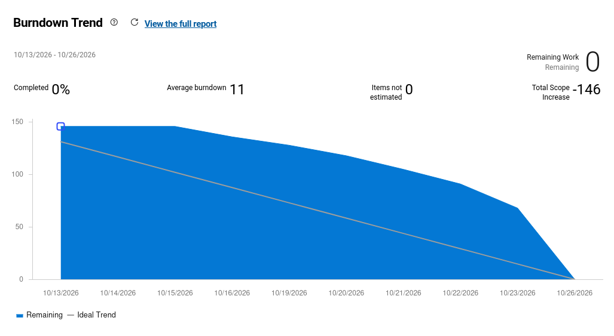

# Review  Sprint 1

**Encerramento:** 26/10/2026 · **PO:** Georis Samuel Martins Gouveia  
**Período planejado:** 13 a 26/10/2026 · [Planning e backlog](planning.md)

A Sprint 1 entregou a base funcional do ClinicalStudyPB, com backend, banco de
dados, aplicação web integrada e protótipo mobile. O objetivo funcional foi
alcançado, mas ainda existem pendências de automação e documentação para atender
integralmente aos critérios de conclusão.

## O que foi entregue

- Arquitetura inicial, organização dos módulos e diagramas do sistema.
- PostgreSQL com migrações Flyway e dados fictícios para demonstração.
- Login, logout, sessão, proteção CSRF e controle de acesso por perfil.
- Cadastro, listagem, edição, desativação e reativação de usuários.
- Cadastro e listagem de estudos pela web, com validações e persistência. O
  pesquisador autenticado é definido automaticamente como responsável.
- Base mobile com navegação, telas de protótipo e testes iniciais. Isso ainda não
  representa a entrega das funcionalidades finais do participante.
- Swagger/OpenAPI, coleção Postman, orientações de execução e evidências. Também
  existem testes automatizados de backend, web, mobile e persistência com PostgreSQL.

## Melhorias incorporadas durante a sprint

Além do cadastro básico, implementamos no backend a atribuição de coordenadores e
a consulta restrita aos estudos vinculados. Também acrescentamos proteção do último
administrador ativo, bloqueio de alterações de perfil incompatíveis com vínculos e
ajustes de integração, como rejeição de limites decimais, mensagens consistentes e
nome do responsável nas respostas.

## Pendências registradas no fechamento

| Task no Azure | Responsável | O que falta |
|---|---|---|
| **3246 - Configurar Actions, verificações e relatórios de cobertura** | Gabriela | Integrar a execução automática dos testes e a publicação dos relatórios. A web já possui cobertura configurada, mas ainda não existe o workflow na `main` considerada nesta Review. |
| **3250 - Automatizar E2E web de login e cadastro de estudo** | Gabriela | Versionar a automação do fluxo completo pelo navegador. Os testes de componentes e a coleção Postman não substituem essa entrega. |

Essas pendências correspondem à Review do documento de fechamento; a existência de
testes nas outras camadas foi preservada no registro das entregas.

## Burndown da sprint

*O gráfico registra a evolução do trabalho restante no Azure.*

### Legenda

* **Eixo X (Linha do tempo):** Período de execução da Sprint 1.
* **Eixo Y (Volume de Trabalho):** Quantidade de trabalho pendente (medida em horas/story points no nosso caso).
* **Área Azul (Remaining work):** Representa o volume real de tarefas que ainda estavam pendentes ao longo dos dias.
* **Indicadores de Resumo (Topo do Gráfico):**
  * **Completed 0% / Remaining Work 0:** Mostra que o saldo de trabalho pendente ao final do período chegou a zero.
  * **Average Burndown: 11:** Média de pontos/esforço *queimados* por dia de trabalho.
  * **Total Scope Increase: -146:** Indica apenas que fomos decrementando as horas das tasks manualmente e que todas foram finalizadas. 
  É um dado do próprio Azure, mas não é útil para o nosso caso.

  
### Avaliação 

> 1. O gráfico evidencia um comportamento de entrega concentrada na reta final do ciclo. 
> 2. No início e meio da sprint (entre 13/10 e 20/10), a curva de trabalho restante manteve-se estável e significativamente acima da linha de tendência ideal (*Ideal Trend*), refletindo a fase inicial dedicada à estruturação da arquitetura, configuração do repositório e modelagem. 
> 3. Ritmo de Entrega (Burn rate): Observa-se uma acentuada queda na curva azul a partir do dia 21/10, intensificando-se nos dias 22 e 23 de outubro, o que demonstra a conclusão em lote das tarefas de implementação base de backend, web e mobile, além dos testes e ajustes de código.

