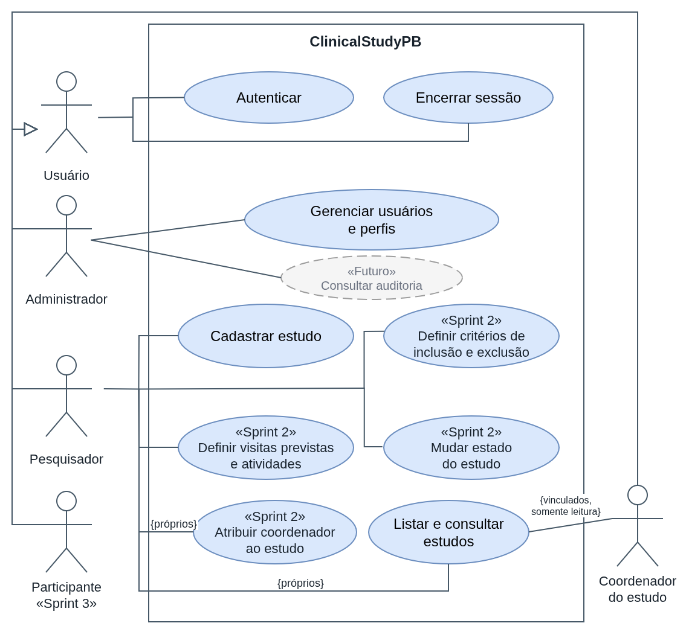
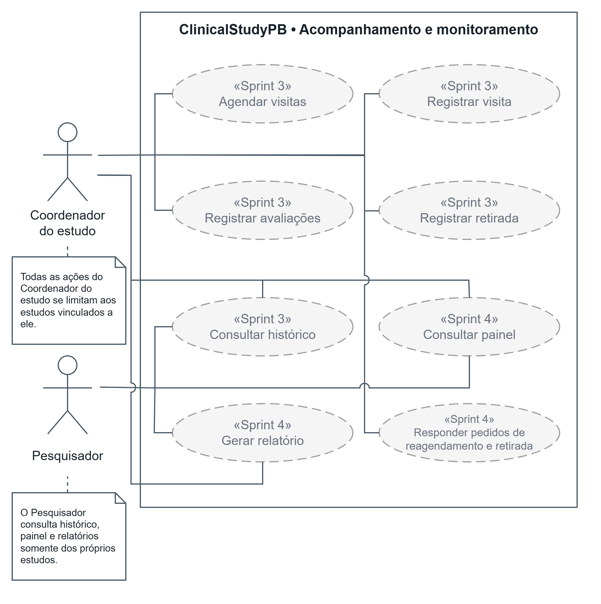
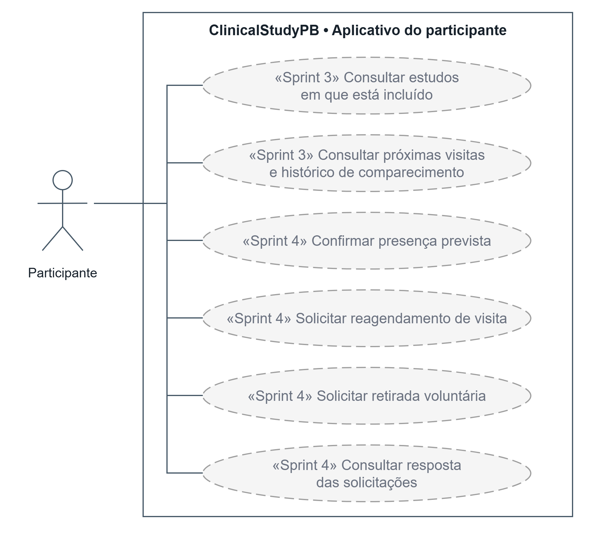
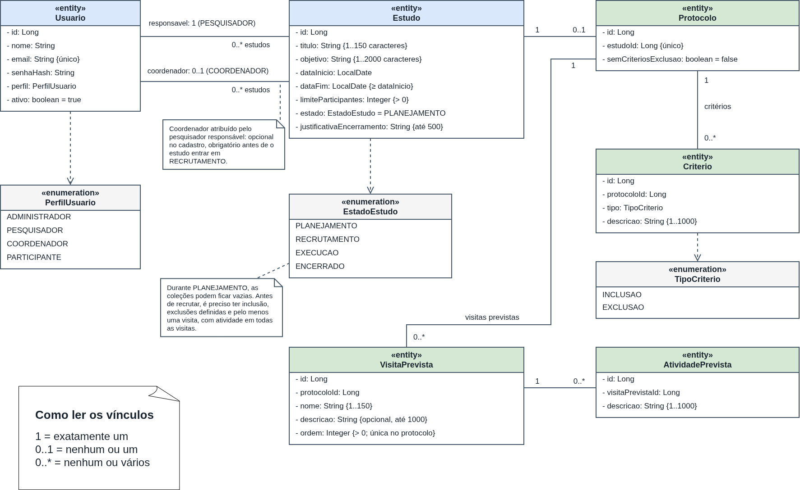
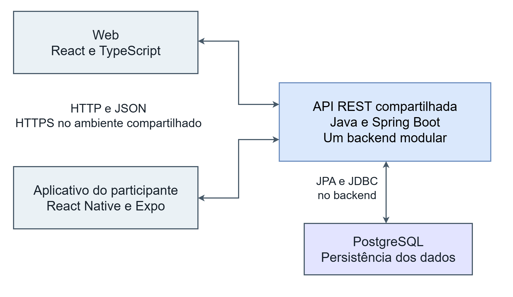
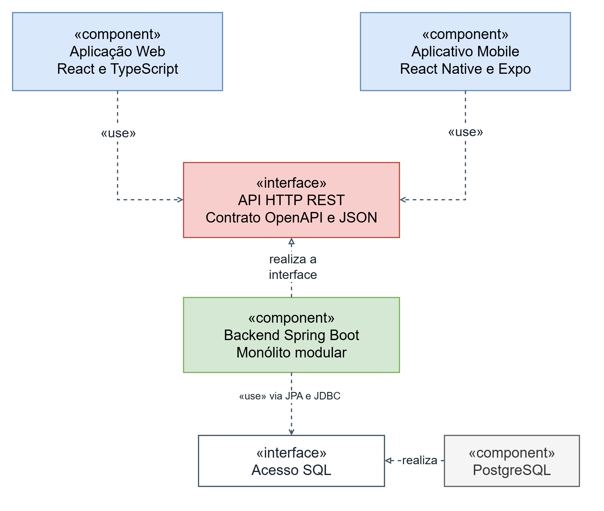

# Release 1: Estrutura e recrutamento
 
**Data de entrega:** 09/11/2026
**Tag:** `release1`
**Sprints Cobertas:** Sprint 1 (13/10 a 26/10) e Sprint 2 (27/10 a 09/11)
 
## 1. Objetivo da entrega
 
Entregar a aplicação web funcional permitindo cadastrar um estudo, avaliar candidatos e incluir participantes, com a estrutura inicial do backend, da web e do mobile.
 
## 2. Requisitos
 
| ID | Requisito | Sprint | Situação | Justificativa |
|----|-----------|--------|----------|---------------|
| RF01 | Cadastrar e gerenciar usuários | 1 | Concluído | Cadastro, listagem, edição, desativação e reativação de usuários dos quatro perfis, com e-mail único e proteção do último administrador ativo, integrados ao backend. |
| RF02 | Autenticação e encerramento de sessão | 1 | <...> | <...> |
| RF03 | Restringir funcionalidades por perfil | 1 | <...> | <...> |
| RF04 | Cadastrar estudos | 1 | <...> | <...> |
| RF05 | Definir critérios de inclusão e exclusão | 2 | Parcial | Telas e backend prontos; a integração com as rotas finais de critérios (edição, remoção e declaração de ausência de exclusões) está no PR #33, aguardando merge. |
| RF06 | Definir visitas previstas e atividades | 2 | Parcial | Telas e backend prontos; a integração com as rotas finais de visitas e atividades está no PR #33, aguardando merge. |
| RF07 | Gerenciar estados do estudo | 2 | Parcial | Transições e regras integradas ao backend na main; iniciar o recrutamento pela tela depende do protocolo integrado no PR #33. |
| RF08 | Cadastrar candidatos | 2 | <...> | <...> |
| RF09 | Registrar avaliação de elegibilidade | 2 | <...> | <...> |
| RF10 | Registrar consentimento simulado | 2 | <...> | <...> |
| RF11 | Incluir candidatos elegíveis, respeitando o limite de vagas | 2 | <...> | <...> |
 
## 3. Funcionalidades entregues
 
Para cada requisito, incluir ao menos uma captura de sucesso e uma de erro ou validação. Nomear as imagens pelo requisito e pelo resultado, por exemplo `rf05-criterios-sucesso.png` e `rf09-elegibilidade-erro.png`. Não incluir vídeos.
 
### 3.1 Web
**Responsáveis:** Suelle Ferreira Maciel (Web 1) e Sinddy Lorranny Nobrega Nascimento (Web 2)

Aplicação React + TypeScript (Vite) integrada à API REST por um cliente HTTP único, com sessão por cookie HttpOnly e proteção CSRF. As rotas são protegidas por perfil na interface, e o backend continua sendo o responsável pelo controle de acesso. Instruções de execução em [`docs/guia-execucao-web.md`](../../docs/guia-execucao-web.md).

#### Acesso e usuários (RF01 a RF03) • Sprint 1 • Suelle
- **Login e logout (RF02):** entrada com e-mail e senha, mensagem para credenciais inválidas, encerramento da sessão pelo menu da conta e aviso quando a sessão expira.
- **Restrição por perfil (RF03):** cada perfil vê apenas o seu menu e as suas telas; rotas de outro perfil levam à página de acesso negado.
- **Gestão de usuários (RF01):** o administrador lista, cadastra, edita, desativa e reativa usuários, com validação de campos, e-mail único e proteção do último administrador ativo.

| Fluxo | Sucesso | Erro ou validação |
|---|---|---|
| Login (RF02) | [Login como administrador](evidencias/web/01-login-sucesso-admin.png) | [Credenciais inválidas](evidencias/web/10-credenciais-invalidas.png) |
| Logout e sessão (RF02) | [Menu da conta](evidencias/web/08-logout-menu-conta.png) • [Sessão encerrada](evidencias/web/09-logout-sessao-encerrada.png) | [Sessão expirada](evidencias/web/15-sessao-expirada.png) |
| Acesso por perfil (RF03) | [Início do pesquisador](evidencias/web/02-inicio-pesquisador.png) | [Acesso negado](evidencias/web/14-acesso-negado.png) • [Página não encontrada](evidencias/web/16-pagina-nao-encontrada.png) |
| Usuários (RF01) | [Lista](evidencias/web/03-usuarios-lista.png) • [Cadastro](evidencias/web/04-usuario-cadastrado.png) • [Edição](evidencias/web/05-usuario-edicao.png) • [Desativar](evidencias/web/06-usuario-desativar.png) • [Reativar](evidencias/web/07-usuario-reativar.png) | [Campos vazios](evidencias/web/11-cadastro-campos-vazios.png) • [E-mail duplicado](evidencias/web/12-email-duplicado.png) • [Último administrador](evidencias/web/13-ultimo-administrador.png) |

#### Cadastro de estudos (RF04) • Sprint 1 • Sinddy
<Sinddy: descrever o fluxo e linkar as capturas.>

#### Configuração do estudo (RF05 a RF07) • Sprint 2 • Suelle
O pesquisador responsável abre o estudo pelo título em "Meus estudos" (`/estudos/:id`), em uma tela com as abas **Resumo**, **Critérios** e **Visitas**.

- **Critérios de inclusão e exclusão (RF05):** cadastro, edição e remoção de critérios, com descrição de 1 a 1.000 caracteres. A opção "Este estudo não possui critérios de exclusão" só pode ser marcada sem exclusões cadastradas e, enquanto marcada, bloqueia o cadastro de exclusões.
- **Visitas previstas e atividades (RF06):** visitas em ordem, com nome, ordem única e descrição opcional; cada visita tem suas atividades. Remover uma visita remove também as atividades, após confirmação.
- **Estado do estudo (RF07):** o cabeçalho mostra apenas as transições permitidas a partir do estado atual. "Iniciar recrutamento" fica bloqueado até cumprir os requisitos (coordenador atribuído, critério de inclusão, exclusões definidas e visitas com atividades), listados no quadro da aba Resumo. O encerramento pede justificativa, obrigatória quando antecipado. Fora do Planejamento, critérios e visitas ficam somente para consulta.

| RF | Sucesso | Erro ou validação |
|---|---|---|
| RF05 | [Critérios cadastrados](evidencias/web/19-rf05-criterios-sucesso.png) | [Descrição obrigatória](evidencias/web/20-rf05-criterios-erro.png) |
| RF06 | [Visitas e atividades](evidencias/web/21-rf06-visitas-sucesso.png) | [Ordem duplicada](evidencias/web/22-rf06-visitas-erro.png) |
| RF07 | [Confirmação](evidencias/web/24-rf07-estado-confirmacao.png) • [Recrutamento iniciado](evidencias/web/25-rf07-estado-sucesso.png) | [Recrutamento bloqueado por pendências](evidencias/web/23-rf07-estado-erro.png) |

#### Recrutamento (RF08 a RF11) • Sprint 2 • Sinddy
<Sinddy: descrever o fluxo e linkar as capturas (a partir de 28-...).>

#### Testes da web
Testes de componentes e de serviços com Vitest e Testing Library: 28 arquivos e 414 testes passando, com 99,23% das linhas cobertas. [Execução dos testes](evidencias/web/26-rf05-07-testes.png) • [Relatório de cobertura](evidencias/web/27-rf05-07-cobertura.png)
 
### 3.2 Mobile
**Responsável:** <nome>
 
<Descrever o que foi entregue no mobile (app executável e navegação entre telas) e linkar [`evidencias/mobile/`](evidencias/mobile/), incluindo o teste da Sprint 2 em [`teste-mobile-sprint2.md`](evidencias/mobile/teste-mobile-sprint2.md).>
 
### 3.3 Backend
**Responsável:** <nome>
 
<Descrever endpoints e regras de negócio entregues. Evidências em [`evidencias/backend/`](evidencias/backend/): [Docker](evidencias/backend/docker/) e [Postman](evidencias/backend/postman/).>
 
## 4. Diagramas
 
Os diagramas representam o desenho do sistema completo; os fluxos de acompanhamento e do participante serão implementados na Release 2. Clique em uma imagem para ampliá-la.

### Casos de uso

<table>
  <tr>
    <td width="50%" align="center">
       
      Acesso e estudos
    </td>
    <td width="50%" align="center">
       
      Recrutamento
    </td>
  </tr>
  <tr>
    <td width="50%" align="center">
       
      Acompanhamento
    </td>
    <td width="50%" align="center">
       
      Participante
    </td>
  </tr>
</table>

### Modelo de domínio

  

### Sequência do cadastro

  

### Arquitetura

  

<table>
  <tr>
    <td width="50%" align="center">
       
      Componentes
    </td>
    <td width="50%" align="center">
       
      Camadas do backend
    </td>
  </tr>
</table>

### Estados do estudo

  

 
## 5. Alterações na arquitetura e no stack
 
<Descrever alterações em relação ao planejado, ou escrever "Nenhuma alteração nesta release".>
 
## 6. Resultados dos testes e cobertura
 
**Responsável:** <nome>
 
- Testes unitários: <resultado>
- Testes de integração: <resultado>
- Testes de componentes (web): 28 arquivos e 414 testes passando (Vitest e Testing Library), com 99,23% das linhas da web cobertas. [Execução](evidencias/web/26-rf05-07-testes.png) • [Cobertura](evidencias/web/27-rf05-07-cobertura.png)
- Cobertura de linhas do código de negócio do backend: <percentual> (mínimo exigido: 80%)
<Linkar o relatório de testes e a evidência de cobertura.>

## 7. Problemas conhecidos e pendências
 
- RF05 a RF07: o PR #33 (telas de visitas e integração do protocolo com as rotas finais do backend) aguarda merge, bloqueado pelo CI do GitHub Actions, que não executa por um problema da conta do criador do repositório. Evidências e resultados de testes da web foram gerados na branch `web`.

## 8. Processo de desenvolvimento
 
### Sprint 1 (13/10 a 26/10)
 
\<Resumo de uma ou duas linhas do que foi planejado e entregue.\>
- [Planning](sprints/sprint01/planning.md)
- [Review](sprints/sprint01/review.md)
- [Burndown](sprints/sprint01/burndown.png)
 
### Sprint 2 (27/10 a 09/11)
\<Resumo de uma ou duas linhas do que foi planejado e entregue.\>
- [Planning](sprints/sprint02/planning.md)
- [Review](sprints/sprint02/review.md)
- Burndown: <linkar quando exportado do Azure DevOps>
 
### Organização da equipe
| Integrante | Papel | Contribuições na release |
|------------|-------|--------------------------|
| <Georis Samuel> | Tech Leader / Gerente | <...> |
| <nome> | Desenvolvedor Backend | <...> |
| Suelle Ferreira Maciel | Desenvolvedora Web (Web 1) | Base React, rotas e cliente HTTP (T12); login e logout integrados (T13); gestão de usuários (T14); testes e documentação web da Sprint 1 (T15, T16); telas de critérios, visitas e estado do estudo (T45 a T47); testes e evidências das telas de configuração (T48, T49); revisão dos PRs de web e Docker. |
| <nome> | Desenvolvedor Web | <...> |
| Horlan Lacerda | Desenvolvedor Mobile | <...> |
| <nome> | QA / DevOps | <...> |
 
Testes, documentação e revisão de código são responsabilidades compartilhadas por toda a equipe.
