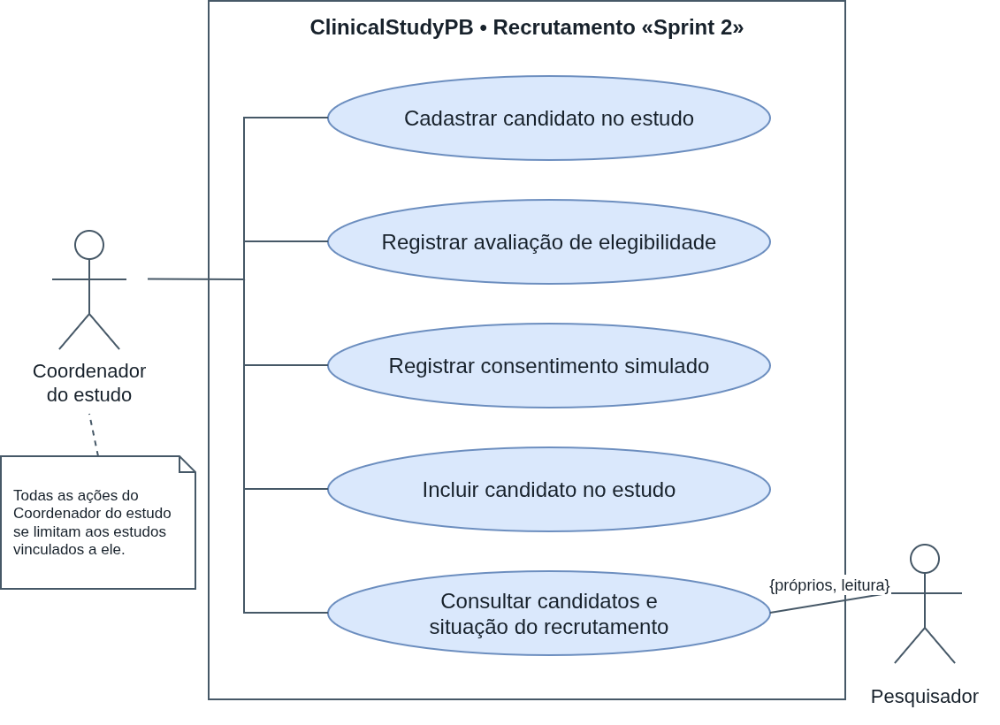
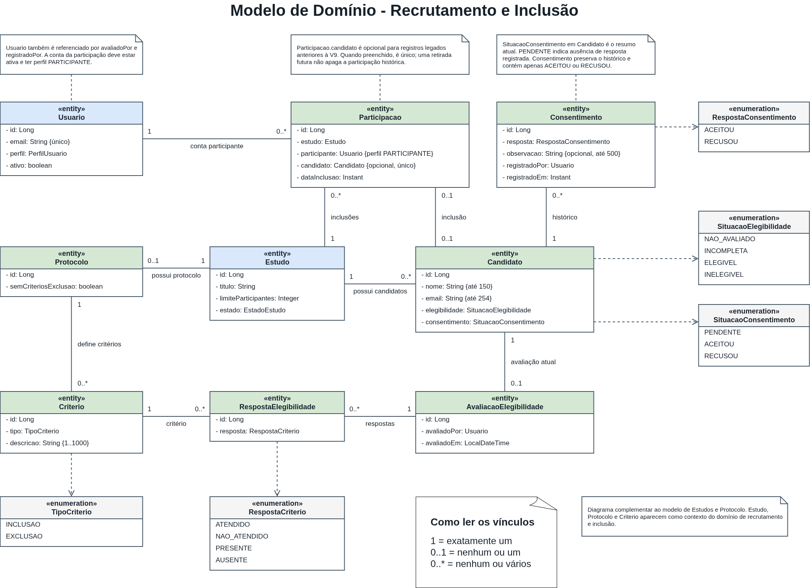
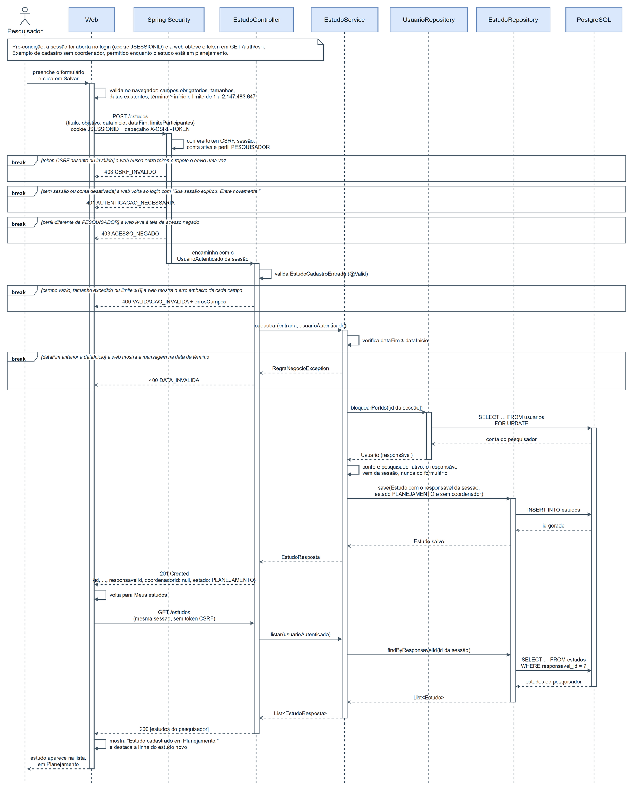
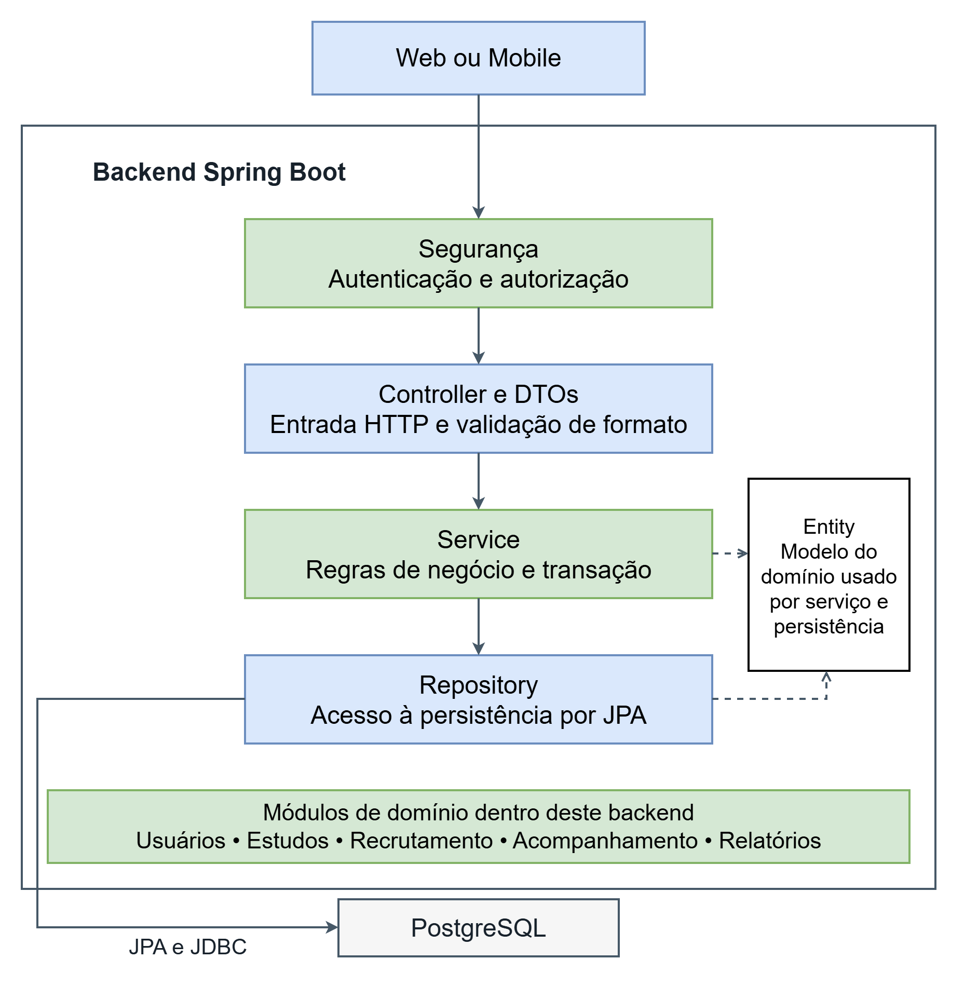
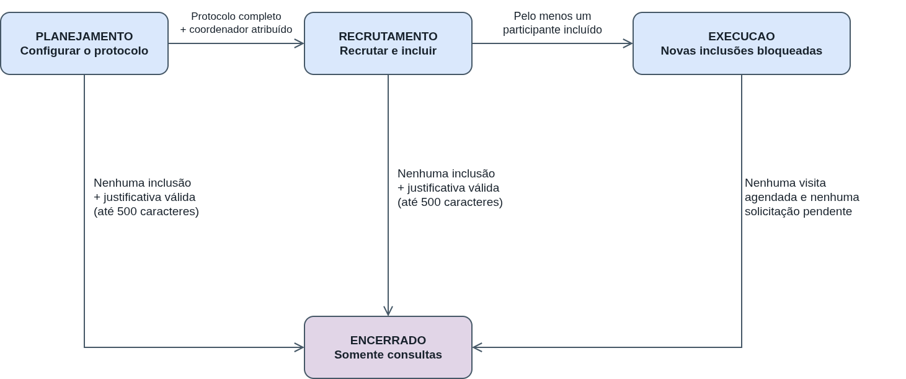

# Release 1: Estrutura e recrutamento
 
**Data de entrega:** 09/11/2026
**Tag:** `release1`
**Sprints Cobertas:** Sprint 1 (13/10 a 26/10) e Sprint 2 (27/10 a 09/11)
 
## 1. Objetivo da entrega
 
Entregar a aplicação web funcional permitindo cadastrar um estudo, avaliar candidatos e incluir participantes, com a estrutura inicial do backend, da web e do mobile.
 
## 2. Requisitos
 
| ID | Requisito | Sprint | Situação | Justificativa |
|----|-----------|--------|----------|---------------|
| RF01 | Cadastrar e gerenciar usuários | 1 | Concluído | Cadastro, listagem, edição, desativação e reativação dos quatro perfis, com e-mail único e proteção do último administrador ativo. |
| RF02 | Autenticação e encerramento de sessão | 1 | Concluído | Login e logout integrados ao backend, sessão por cookie, proteção CSRF, tratamento de credenciais inválidas e aviso de sessão expirada. Há telas de evidência e testes. |
| RF03 | Restringir funcionalidades por perfil | 1 | Concluído | Menus e rotas são protegidos na interface, e a API aplica autenticação, perfil e vínculo com o estudo. Acesso negado é tratado e documentado. |
| RF04 | Cadastrar estudos | 1 | Concluído | Cadastro e listagem de estudos com validações e persistência no backend. O responsável vem da sessão; o coordenador pode ser atribuído conforme as regras. |
| RF05 | Definir critérios de inclusão e exclusão | 2 | Parcial | Telas e backend prontos; a integração com as rotas finais de critérios (edição, remoção e declaração de ausência de exclusões) está no PR #33, aguardando merge. |
| RF06 | Definir visitas previstas e atividades | 2 | Parcial | Telas e backend prontos; a integração com as rotas finais de visitas e atividades está no PR #33, aguardando merge. |
| RF07 | Gerenciar estados do estudo | 2 | Parcial | Transições e regras integradas ao backend na main; iniciar o recrutamento pela tela depende do protocolo integrado no PR #33. |
| RF08 | Cadastrar candidatos | 2 | Concluído | Backend e interface oferecem cadastro e listagem de candidatos vinculados ao estudo, com validação, prevenção de duplicidade e autorização por coordenador vinculado. A web tem adaptador para API real. |
| RF09 | Registrar avaliação de elegibilidade | 2 | Concluído | Avaliação baseada nos critérios, respostas persistidas e situação calculada no backend; há telas e chamadas da web para consultar e salvar avaliações. |
| RF10 | Registrar consentimento simulado | 2 | Concluído | Registro de aceite ou recusa, observação opcional, histórico de correções e bloqueio após inclusão, com endpoints backend e telas da web. |
| RF11 | Incluir candidatos elegíveis, respeitando o limite de vagas | 2 | Concluído | Inclusão verifica elegibilidade, aceite, conta participante, duplicidade e vagas; a operação é transacional e protege disputas pela última vaga. Há endpoint e fluxo web. |

 
## 3. Funcionalidades entregues

 
### 3.1 Web
**Responsáveis:** Suelle Ferreira Maciel (Web 1) e Sinddy Lorranny Nobrega Nascimento (Web 2)

Aplicação React + TypeScript (Vite) integrada à API REST por um cliente HTTP único, com sessão por cookie HttpOnly e proteção CSRF. As rotas são protegidas por perfil na interface, e o backend continua sendo o responsável pelo controle de acesso. Instruções de execução em [`docs/guia-execucao-web.md`](../../docs/guia-execucao-web.md).

#### Acesso e usuários (RF01 a RF03) • Sprint 1 • Suelle
- **Login e logout (RF02):** entrada com e-mail e senha, mensagem para credenciais inválidas, encerramento da sessão pelo menu da conta e aviso quando a sessão expira.
- **Restrição por perfil (RF03):** cada perfil vê apenas o seu menu e as suas telas; rotas de outro perfil levam à página de acesso negado.
- **Gestão de usuários (RF01):** o administrador lista, cadastra, edita, desativa e reativa usuários, com validação de campos, e-mail único e proteção do último administrador ativo.

| Fluxo | Sucesso | Erro ou validação |
|---|---|---|
| Login (RF02) | [Login como administrador](evidencias/web/01-login-sucesso-admin.png) | [Credenciais inválidas](evidencias/web/10-credenciais-invalidas.png) |
| Logout e sessão (RF02) | [Menu da conta](evidencias/web/08-logout-menu-conta.png) • [Sessão encerrada](evidencias/web/09-logout-sessao-encerrada.png) | [Sessão expirada](evidencias/web/15-sessao-expirada.png) |
| Acesso por perfil (RF03) | [Início do pesquisador](evidencias/web/02-inicio-pesquisador.png) | [Acesso negado](evidencias/web/14-acesso-negado.png) • [Página não encontrada](evidencias/web/16-pagina-nao-encontrada.png) |
| Usuários (RF01) | [Lista](evidencias/web/03-usuarios-lista.png) • [Cadastro](evidencias/web/04-usuario-cadastrado.png) • [Edição](evidencias/web/05-usuario-edicao.png) • [Desativar](evidencias/web/06-usuario-desativar.png) • [Reativar](evidencias/web/07-usuario-reativar.png) | [Campos vazios](evidencias/web/11-cadastro-campos-vazios.png) • [E-mail duplicado](evidencias/web/12-email-duplicado.png) • [Último administrador](evidencias/web/13-ultimo-administrador.png) |

#### Cadastro de estudos (RF04) • Sprint 1 • Sinddy
<Sinddy: descrever o fluxo e linkar as capturas.>

#### Configuração do estudo (RF05 a RF07) • Sprint 2 • Suelle
O pesquisador responsável abre o estudo pelo título em "Meus estudos" (`/estudos/:id`), em uma tela com as abas **Resumo**, **Critérios** e **Visitas**.

- **Critérios de inclusão e exclusão (RF05):** cadastro, edição e remoção de critérios, com descrição de 1 a 1.000 caracteres. A opção "Este estudo não possui critérios de exclusão" só pode ser marcada sem exclusões cadastradas e, enquanto marcada, bloqueia o cadastro de exclusões.
- **Visitas previstas e atividades (RF06):** visitas em ordem, com nome, ordem única e descrição opcional; cada visita tem suas atividades. Remover uma visita remove também as atividades, após confirmação.
- **Estado do estudo (RF07):** o cabeçalho mostra apenas as transições permitidas a partir do estado atual. "Iniciar recrutamento" fica bloqueado até cumprir os requisitos (coordenador atribuído, critério de inclusão, exclusões definidas e visitas com atividades), listados no quadro da aba Resumo. O encerramento pede justificativa, obrigatória quando antecipado. Fora do Planejamento, critérios e visitas ficam somente para consulta.

| RF | Sucesso | Erro ou validação |
|---|---|---|
| RF05 | [Critérios cadastrados](evidencias/web/19-rf05-criterios-sucesso.png) | [Descrição obrigatória](evidencias/web/20-rf05-criterios-erro.png) |
| RF06 | [Visitas e atividades](evidencias/web/21-rf06-visitas-sucesso.png) | [Ordem duplicada](evidencias/web/22-rf06-visitas-erro.png) |
| RF07 | [Confirmação](evidencias/web/24-rf07-estado-confirmacao.png) • [Recrutamento iniciado](evidencias/web/25-rf07-estado-sucesso.png) | [Recrutamento bloqueado por pendências](evidencias/web/23-rf07-estado-erro.png) |

#### Recrutamento (RF08 a RF11) • Sprint 2 • Sinddy
<Sinddy: descrever o fluxo e linkar as capturas (a partir de 28-...).>

#### Testes da web
Testes de componentes e de serviços com Vitest e Testing Library: 28 arquivos e 414 testes passando na branch `web`, antes do PR #39, com 99,23% das linhas cobertas. [Execução dos testes](evidencias/web/26-rf05-07-testes.png) • [Relatório de cobertura](evidencias/web/27-rf05-07-cobertura.png)
 
### 3.2 Mobile
**Responsável:** <nome>
 
<Descrever o que foi entregue no mobile (app executável e navegação entre telas) e linkar [`evidencias/mobile/`](evidencias/mobile/), incluindo o teste da Sprint 2 em [`teste-mobile-sprint2.md`](evidencias/mobile/teste-mobile-sprint2.md).>

### 3.3 Backend

**Responsáveis:** Georis Samuel e Luiz Inácio

A API Spring Boot implementa os fluxos de configuração do protocolo, recrutamento e inclusão de participantes. Todas as operações de alteração exigem sessão autenticada, 
perfil compatível, vínculo com o estudo e token CSRF. As regras de negócio são validadas no backend, inclusive em operações simultâneas.

#### Configuração do estudo (RF05 a RF07) • Georis e Luiz

- **RF05 - Critérios:** cadastro, consulta, edição e remoção de critérios de inclusão e exclusão; declaração controlada de ausência de critérios de exclusão.
- **RF06 - Visitas e atividades:** cadastro, edição, ordenação e remoção de visitas previstas e suas atividades.
- **RF07 - Estados do estudo:** transições entre planejamento, recrutamento, execução e encerramento, com validação de protocolo completo, participantes e justificativa de encerramento.
- O protocolo pode ser configurado durante o planejamento e é validado antes da abertura do recrutamento.

Documentação: [configuração do protocolo](../../docs/configuracao-protocolo.md) • [estados do estudo](../../docs/estados-estudo.md).

#### Recrutamento (RF08 e RF09) • Luiz

- **RF08 - Cadastro de candidatos:** permite cadastrar, consultar e listar candidatos vinculados a um estudo. O cadastro valida nome e e-mail, impede e-mails duplicados no mesmo estudo e restringe as alterações ao coordenador responsável durante o recrutamento.
- **RF09 - Avaliação de elegibilidade:** permite avaliar candidatos com base nos critérios de inclusão e exclusão definidos no protocolo do estudo. As respostas são registradas e utilizadas para determinar a situação de elegibilidade do candidato.
- **Validações:** o backend verifica permissões, vínculo com o estudo, condições do recrutamento e consistência das respostas, impedindo operações inválidas.

As funcionalidades foram verificadas por testes automatizados, incluindo cenários de sucesso, validações, controle de acesso e consultas sem protocolo.

Documentação: [candidatos e avaliação de elegibilidade](../../docs/recrutamento-e-elegibilidade.md).

#### Consentimento e inclusão (RF10 e RF11) • Georis

- **RF10 - Consentimento simulado:** registro de aceite ou recusa, com observação opcional e histórico de correções.
- **RF11 - Inclusão:** valida conta de participante, vínculo, elegibilidade completa, consentimento aceito, limite de vagas e duplicidade antes de criar a participação.
- A inclusão usa transação e bloqueios para impedir que duas operações ocupem a última vaga simultaneamente.

Documentação: [consentimento e inclusão](../../docs/consentimento-inclusao.md).

#### Qualidade e contrato da API

As rotas foram documentadas no OpenAPI/Swagger e verificadas por testes de API, 
regras de negócio, persistência, migrações e concorrência. Os cenários funcionais executados no Postman e seu relatório estão em [evidências do Postman](evidencias/backend/postman/). A execução integrada com banco, backend e web via Docker Compose está documentada em [evidências do Docker](evidencias/backend/docker/).

#### Evidências do backend

| Evidência | Comprovação |
|---|---|
| [Execução bem sucedida do Swagger](evidencias/backend/swagger/swagger-interface-inicial.png) e [Rotas documentadas no Swagger](evidencias/backend/swagger/swagger-rotas-exemplo.png) | Contrato OpenAPI disponível para configuração, recrutamento e inclusão. |
| [Execução dos testes](evidencias/backend/testes-backend.png) | Suíte final executada sem falhas. |
| [Cobertura JaCoCo](evidencias/backend/jacoco/cobertura-jacoco.png) | Cobertura de linhas do backend, incluindo serviços acima do mínimo exigido. |
| [Postman Runner (parte 1)](evidencias/backend/postman/runner-resultado-1.png) | Execução automatizada dos cenários da coleção. |
| [Postman Runner (parte 2)](evidencias/backend/postman/runner-resultado-2.png) | Continuação dos cenários e resultados da coleção. |

## 4. Diagramas
 
Os diagramas representam o desenho do sistema completo; os fluxos de acompanhamento e do participante serão implementados na Release 2. Clique em uma imagem para ampliá-la.

### Casos de uso

<table>
  <tr>
    <td width="50%" align="center">
       
      Acesso e estudos
    </td>
    <td width="50%" align="center">
       
      Recrutamento
    </td>
  </tr>
  <tr>
    <td width="50%" align="center">
       
      Acompanhamento
    </td>
    <td width="50%" align="center">
       
      Participante
    </td>
  </tr>
</table>

 

### Modelos de domínio

  

   

 

### Sequência do cadastro

  

 

### Arquitetura

  

<table>
  <tr>
    <td width="50%" align="center">
       
      Componentes
    </td>
    <td width="50%" align="center">
       
      Camadas do backend
    </td>
  </tr>
</table>

 

### Estados do estudo

  

## 5. Alterações na arquitetura e no stack

Não houve alteração das tecnologias definidas no Kickoff, o backend permanece em Java 21 com Spring Boot e Maven, a web em React com TypeScript e Vite, o mobile em React Native com Expo e o banco em PostgreSQL com Flyway.

Durante a release, a arquitetura evoluiu dentro desse stack para suportar os requisitos entregues:

- novas migrações Flyway para protocolo, candidatos, avaliações, participações e histórico de consentimentos;
- serviços transacionais com bloqueio pessimista para mudanças de estado, avaliações e inclusão de participantes;
- documentação das rotas com OpenAPI/Swagger e coleções Postman;
- execução de testes de integração com PostgreSQL e verificação de cobertura com JaCoCo;
- integração contínua ampliada para executar os testes de integração do backend.

Na web, a evolução também ficou dentro do stack previsto:

- serviços da API com versões real e simulada, escolhidas por `VITE_ESTUDOS_API`, `VITE_PROTOCOLO_API` e `VITE_CANDIDATOS_API`, o que permitiu desenvolver as telas antes dos endpoints;
- cliente HTTP único com sessão por cookie, proteção CSRF e tratamento centralizado de 401 e 403;
- componentes compartilhados, como o diálogo de confirmação usado em usuários, protocolo e estados;
- execução da web também pelo Docker Compose (perfil `web`).

<Horlan: completar com as evoluções do mobile.>

Essas evoluções não alteram a arquitetura geral prevista, mas detalham e consolidam sua implementação para os fluxos da Release 1.

## 6. Resultados dos testes e cobertura

- **Testes de componentes (web)**: 28 arquivos e 414 testes passando na branch `web`, antes do PR #39 (Vitest e Testing Library), com 99,23% das linhas da web cobertas. [Execução](evidencias/web/26-rf05-07-testes.png) • [Cobertura](evidencias/web/27-rf05-07-cobertura.png)
- **Backend:** na validação de 05/11/2026, foram executados 272 testes, sem falhas, erros ou testes ignorados. A suíte contempla testes de regras de negócio, API, persistência, migrações e concorrência, incluindo os novos cenários de critérios, visitas, candidatos e elegibilidade. [Execução](evidencias/backend/testes-backend.png)
- **Testes de integração do backend:** executados com PostgreSQL exclusivo de testes, cobrindo persistência, migrações, transações e cenários concorrentes de recrutamento e inclusão.
- **Cobertura do backend:** 97% de cobertura geral de linhas no JaCoCo. Os serviços de recrutamento alcançaram 95% e os serviços de estudos, 96%, ambos acima do mínimo exigido de 80%. [Relatório JaCoCo](evidencias/backend/jacoco/cobertura-jacoco.png)
- **Validação funcional da API:** cenários executados pela coleção Postman. [Resultados do Runner](evidencias/backend/postman/)

_Testes, documentação e revisão de código são responsabilidades compartilhadas por toda a equipe._

## 7. Problemas conhecidos e pendências
 
- GitHub Actions: o pipeline de CI está configurado (`.github/workflows/ci.yml`), mas desde 06/11/2026 os jobs não são iniciados pelo GitHub ("account is locked due to a billing issue"), embora a conta dona do repositório não tenha pendências de cobrança. Foi aberto um chamado no suporte do GitHub. Enquanto isso, os testes e a cobertura foram executados localmente e estão registrados nas evidências.

## 8. Processo de desenvolvimento
 
### Sprint 1 (13/10 a 26/10)
O nosso objetivo foi a definição de arquitetura, modelagem do sistema por meio de diagramas, configuração do ambiente web, backend e mobile; além de
implementação inicial das entidades e telas do sistema. Conseguimos entregar um sistema funcionando que permitia cadastro e definição dos 4 diferentes perfis existentes
a única pendência foi a pipeline CI que, devido à prioridade das outras tasks, optamos por deixar para a próxima sprint
- [Planning](sprints/sprint01/planning.md)
- [Review](sprints/sprint01/review.md)
- [Burndown](sprints/sprint01/burndown.png)
 

### Sprint 2 (27/10 a 09/11)

A Sprint 2 teve como objetivo concluir os requisitos RF05 a RF11, envolvendo configuração dos estudos, recrutamento, avaliação de elegibilidade, consentimento e inclusão de participantes. Também foram realizadas atividades de integração entre web e backend, testes automatizados, manutenção do mobile e preparação da documentação da Release 1.

A Sprint foi encerrada em 09/11/2026, com todas as atividades planejadas concluídas e sem pendências para a próxima Sprint. O burndown do Azure DevOps registrou 0 horas de trabalho restante.

- [Planning](sprints/sprint02/planning.md)
- [Review](sprints/sprint02/review.md)
- [Burndown](sprints/sprint02/burndown-chart-sprint2.png)
 
### Organização da equipe
| Integrante | Papel | Contribuições na release |
|------------|-------|--------------------------|
| Georis Samuel | Tech Leader / Gerente | Modelagem da arquitetura inicial do projeto, coordenação técnica e revisão de PRs; modelagem dos RF05–RF07; implementação das transições de estado do estudo; configuração completa do protocolo; implementação e documentação do consentimento e inclusão de participantes (RF10 e RF11); testes de integração, documentação OpenAPI/Postman e revisão da CI do backend. |
| Luiz Inácio| Desenvolvedor Backend | Implementação de critérios, visitas e atividades previstas (RF05 e RF06); cadastro de candidatos (RF08); avaliação de elegibilidade (RF09); ampliação dos testes de API, persistência e regras de negócio do backend; documentação e planejamento da Sprint 2. |
| Suelle Maciel | Desenvolvedora Web (Web 1) | Base React, rotas e cliente HTTP; login e logout integrados; gestão de usuários; testes e documentação web da Sprint 1; telas de critérios, visitas e estado do estudo; testes e evidências das telas de configuração; revisão dos PRs de web e Docker. |
| <nome> | Desenvolvedor Web | <...> |
| Horlan Lacerda | Desenvolvedor Mobile | <...> |
| <nome> | QA / DevOps | <...> |
 

