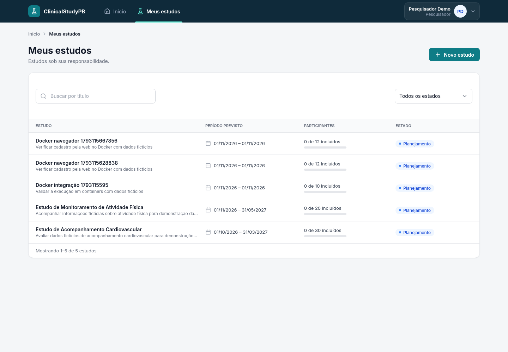

# Validação da execução com Docker

Data: 27/10/2026. Alteração preparada na branch `build/docker`, sobre a base
`82e9c9a838f9744a063aebf68f8552d0de6d010a`, antes do commit desta configuração.

## Ambiente verificado

A execução ocorreu em Linux, com Docker Engine 29.9.2 e Compose 5.6.1. Foram usadas
as imagens PostgreSQL 17.11, Temurin 21.0.12.1+1 e Node 24.22.0.

O projeto Compose de teste se chamou `clinical-docker-verificacao`, com volume
próprio, portas 25437 (banco), 28080 (backend) e 25173 (web). Isso permitiu testar a
personalização das portas sem usar o banco de desenvolvimento. Foram utilizados
apenas usuários e estudos fictícios. A execução foi feita sobre uma cópia do código
com as alterações Docker; não houve commit automático.

## Resultados

| Verificação | Resultado observado |
|---|---|
| Construção do backend | `mvnw verify`: 109 testes, zero falhas e erros |
| Testes da web dentro do container | 12 arquivos, 147 testes aprovados |
| Qualidade da web | `npm run lint` aprovado |
| Compilação da web | `npm run build` aprovado |
| Inicialização com profile `web` | Banco, backend e web em estado `healthy` |
| Requisições pelo proxy `/api` | 22 verificações aprovadas, incluindo sessão, CSRF e cadastro |
| Navegador Chrome | Login inválido e válido; cadastro com resposta 201; estudo visível após recarregar |
| Erros JavaScript no fluxo do navegador | Nenhum erro de página capturado |
| PostgreSQL | Estudos criados pela API e pela tela confirmados por consulta SQL |
| Flyway | Migrações V1 a V4 aplicadas com sucesso no banco vazio |
| Recriação dos containers | Após `down` sem `-v` e novo `up`, os estudos permaneceram no banco |
| Execução sem profile `web` | Somente banco e backend iniciados e saudáveis |
| Profile `test` com serviço `db-test` explícito | Banco descartável iniciado e saudável |

As verificações por HTTP incluíram: retorno 401 sem sessão e com senha incorreta;
consulta administrativa permitida; pesquisador impedido de gerenciar usuários;
cadastro impedido sem CSRF; limite decimal `2.5` rejeitado com 400, sem persistir;
responsável obtido da sessão; nome do responsável na resposta; estudo novo no início
da listagem; logout; e coordenador sem acesso a estudo não vinculado a ele.

Na consulta SQL após recriar os containers, permaneceram o estudo 3, com limite 10,
e o estudo 5, criado pelo navegador, com limite 12. Esses IDs pertencem somente ao
banco descartável desta verificação.

## Evidência do navegador

A imagem mostra a web atendida pelo container Vite, com estudos consultados no
Spring Boot e persistidos no PostgreSQL, após recarregar a página.

## Como repetir a conferência principal

Siga a preparação e os comandos do [guia Docker](../../../../docs/execucao-docker.md).
Com o ambiente completo iniciado:

1. Entre na web como pesquisador, usando a conta fictícia documentada no guia.
2. Cadastre um estudo e atualize a listagem; o cadastro deve continuar aparecendo.
3. Faça logout e confirme a mensagem ao tentar entrar com senha incorreta.
4. Execute os testes, lint e build da web pelos comandos da seção 6 do guia.
5. Encerre com `docker compose --profile web down`, sem `-v`, e inicie novamente;
   o estudo deve permanecer na listagem.

O teste de persistência desta entrega usou um volume isolado. Não é necessário
apagar o volume de desenvolvimento para repetir esse fluxo.

## Limites da verificação

Os comandos foram executados em Linux; as instruções para PowerShell foram
preparadas, mas não executadas no Windows. O Expo não foi modificado nem incluído
nesta rodada de testes. A suíte Java `*IT`, que tem execução separada, não foi
executada por completo nesta rodada; a persistência real foi verificada nos fluxos
HTTP, no navegador e no PostgreSQL. O uso do Vite no container é destinado ao
ambiente local, e não representa uma configuração de produção.
