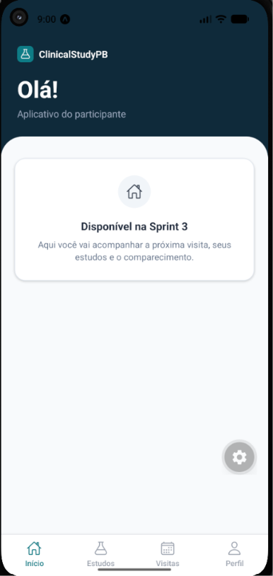
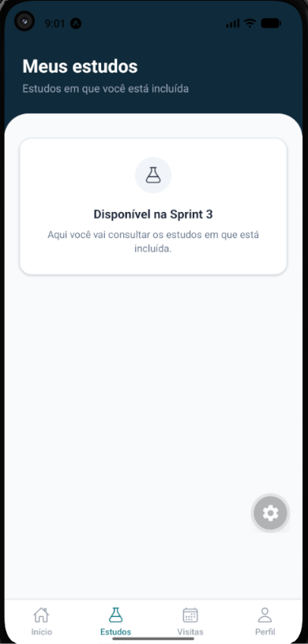
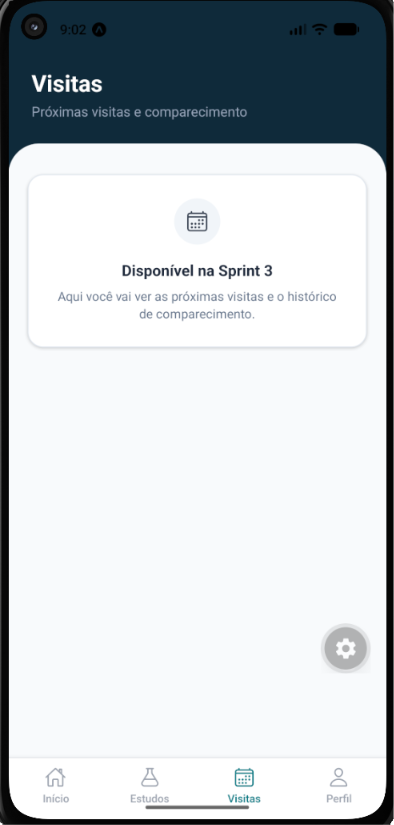
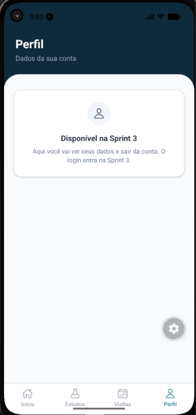
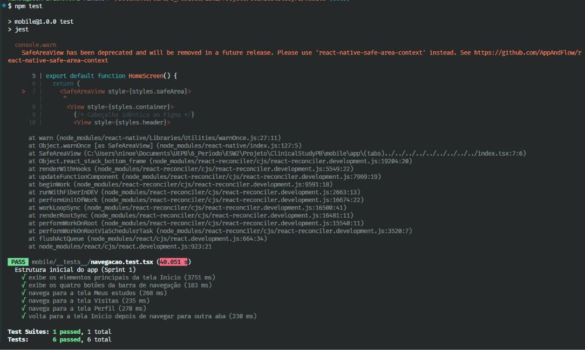
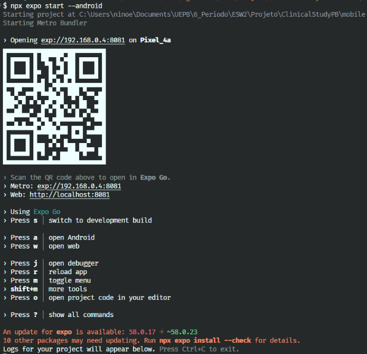

# Execução da aplicação mobile e evidências no emulador - Sprint 2

**Task:** 3420 - Atualizar documentação de execução mobile e evidências no emulador (atualiza o registro da task 3418)
**Responsável:** Horlan de Lacerda
**Data:** 09/11/2026

## Objetivo
Revisar as instruções para configurar e executar a aplicação mobile e registrar evidências do app funcionando no emulador utilizado pela equipe, de modo que outro integrante consiga seguir as instruções e executar o app.

## Ambiente
- Framework: Expo / React Native
- Comando de execução: `npx expo start --android`, dentro da pasta `mobile/`

### Plataforma testada
- Emulador Android: Pixel 4a, API 37.2
- Expo Go no celular: Samsung Galaxy S24, Android 16

### Versões testadas
| Item | Versão |
|------|--------|
| Expo SDK | 58 (pacote `expo` 58.0.17) |
| React Native | 0.88.0 |
| Node | 24.11.1 |

## Instruções de execução
O passo a passo completo está na seção "Aplicação mobile" do README principal. Resumo dos comandos, executados em `mobile/`, com o emulador já aberto:

```bash
npm ci
adb devices
npx expo start --android
npm test
```

- `adb devices` deve listar o emulador com o status `device`.
- Se o app não abrir sozinho no emulador, pressionar `a` no terminal do Expo.
- No emulador, `localhost` aponta para o próprio emulador. Para acessar o backend, usar `10.0.2.2` (por exemplo, `http://10.0.2.2:8080`).
- No celular físico, instalar o Expo Go, deixar celular e computador na mesma rede Wi-Fi, rodar `npx expo start` e ler o QR code do terminal com o Expo Go. Nesse caso, o servidor do backend é o IP do computador na rede local.

## Evidências (capturas de tela)
Todas as capturas estão na pasta [releases/release1/evidencias/mobile](./), ao lado deste documento.









## O que foi verificado
- [x] Instruções seguidas do zero (`npm ci` até `npx expo start --android`) sem passos faltando
- [x] App abre no emulador na tela Início
- [x] Navegação entre as quatro abas funciona
- [x] Testes unitários passam (`npm test`)
- [x] Sem erros bloqueantes no console

## Resultado
A aplicação mobile foi executada no emulador descrito acima seguindo as instruções documentadas, e as evidências do funcionamento estão registradas neste documento.

## Critério de conclusão
Atendido: outro integrante consegue seguir as instruções de execução, e as evidências do funcionamento mobile estão organizadas na documentação.
