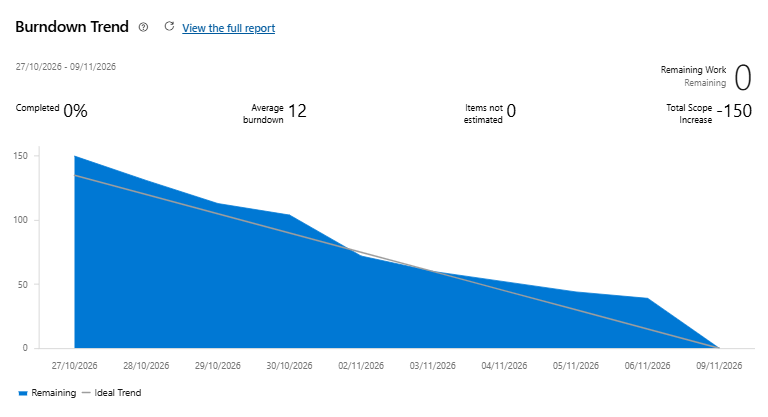

# Review Sprint 2

| Informação | Definição |
|---|---|
| Projeto | ClinicalStudyPB — Engenharia de Software II, UEPB, 2026.2 |
| Product Owner da Sprint | Luiz Inácio Moura da Costa |
| Período planejado | 27/10/2026 a 09/11/2026 |
| Situação | Concluída em 09/11/2026 |
| Release | Release 1 |

## Resumo da Sprint

A Sprint 2 teve como objetivo concluir os requisitos RF05 a RF11, envolvendo a configuração dos estudos, o recrutamento de candidatos, a avaliação de elegibilidade, o consentimento e a inclusão de participantes.

Também foram planejadas atividades de integração entre web e backend, testes automatizados, manutenção da aplicação mobile e preparação da documentação e das evidências da Release 1.

A Sprint 2 foi concluída em 09/11/2026, com todas as atividades planejadas finalizadas e sem pendências para a próxima Sprint, conforme o acompanhamento da equipe no Azure DevOps.
 

## O que foi entregue

- Implementação dos critérios de inclusão e exclusão.
- Cadastro de visitas previstas e suas atividades.
- Regras para alteração dos estados do estudo.
- Cadastro e listagem de candidatos vinculados aos estudos.
- Avaliação dos critérios de elegibilidade.
- Validações para impedir operações inválidas.
- Registro e consulta do consentimento simulado.
- Inclusão de candidatos elegíveis como participantes.
- Validação das condições de inclusão e do limite de vagas.
- Ampliação dos testes automatizados do backend.
- Verificação da cobertura de código.
- Integração dos fluxos web com o backend.
- Manutenção e validação da aplicação mobile.
- Organização do Planning e da Review.
- Atualização da documentação técnica e dos READMEs.
- Preparação das evidências, resultados de testes e burndowns.

## Validação e qualidade

Durante a Sprint 2, foram ampliados os testes automatizados e realizadas verificações de integração e persistência.

Na execução realizada em 05/11/2026, o backend apresentou:

- 272 testes aprovados, sem falhas, erros ou testes ignorados.
- BUILD SUCCESS na execução do Maven.
- Testes de integração executados com PostgreSQL 17.11.
- Metas de cobertura configuradas no JaCoCo atendidas.

Esses resultados correspondem à validação de 05/11/2026. A validação final da Release 1 considera também os resultados atualizados do pipeline e dos testes da versão entregue.

## Melhorias incorporadas durante a Sprint

Durante o desenvolvimento da Sprint 2, a equipe também realizou ajustes para melhorar a segurança, a consistência e a qualidade das funcionalidades.

Entre as principais melhorias estão:

- **Validação da elegibilidade:** reforço das verificações para garantir que somente candidatos que atendam aos critérios possam ser incluídos como participantes.
- **Histórico de consentimento:** armazenamento das respostas e correções do consentimento simulado, preservando os registros anteriores.
- **Controle de operações simultâneas:** ajuste na ordem dos bloqueios utilizados pelo backend para reduzir riscos de conflitos durante avaliações e inclusões.
- **Ampliação dos testes:** inclusão de novos cenários envolvendo critérios, visitas previstas, candidatos e elegibilidade, verificando também situações em que o estudo não possui protocolo.

Essas melhorias ajudaram a reforçar as regras de negócio e a confiabilidade do backend da Release 1.
 

## Fechamento da Sprint
A Sprint 2 foi encerrada em 09/11/2026, com todas as atividades planejadas concluídas e sem pendências para a próxima Sprint.

O Azure DevOps registrou 0 horas de trabalho restante, indicando a conclusão do esforço planejado de 150 horas.

## Burndown da Sprint

*O gráfico registra a evolução do trabalho restante no Azure DevOps.*

### Legenda

- **Eixo X (Linha do tempo):** período de execução da Sprint 2, de 27/10 a 09/11/2026.
- **Eixo Y (Volume de trabalho):** quantidade de trabalho restante, medida em horas.
- **Área azul (Remaining Work):** representa o volume real de trabalho pendente ao longo da Sprint.
- **Linha ideal (Ideal Trend):** representa a redução esperada do trabalho durante o período.
- **Indicadores de resumo:**
  - **Completed 0% / Remaining Work 0:** apesar do indicador Completed apresentar 0%, o saldo de trabalho restante chegou a zero.
  - **Average Burndown 12:** média de redução de aproximadamente 12 horas por dia de trabalho, conforme o Azure.
  - **Total Scope Increase -150:** indicador de variação de escopo apresentado pelo Azure. Esse valor não representa, por si só, a remoção de funcionalidades planejadas.

### Avaliação

1. **Comportamento geral:** o gráfico mostra uma redução contínua do trabalho restante durante a Sprint, encerrando o período com 0 horas pendentes.

2. **Início e meio da Sprint:** entre 27/10 e 02/11, a curva permaneceu acima da linha ideal em boa parte do período, aproximando-se dela conforme as tarefas avançaram. Nos dias seguintes, a redução continuou de forma gradual.

3. **Ritmo de entrega (Burn rate):** na reta final, principalmente entre 06/11 e 09/11, ocorreu uma queda mais acentuada do trabalho restante, refletindo a conclusão das últimas atividades de integração, testes e preparação da Release 1.
