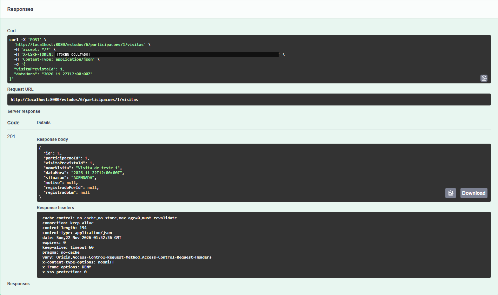
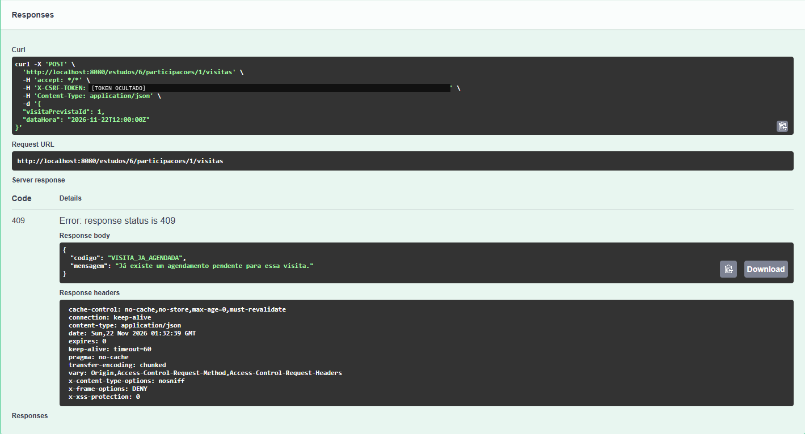
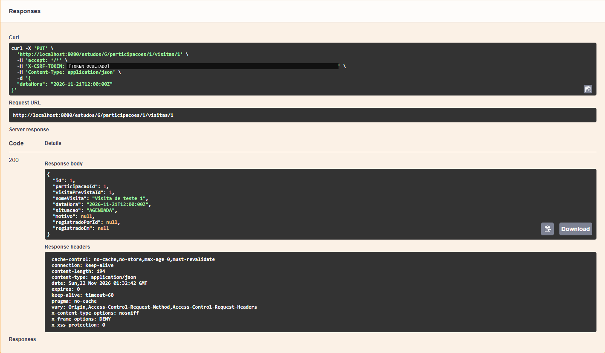
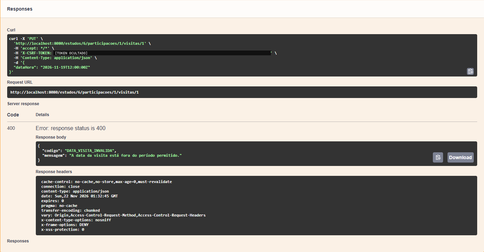
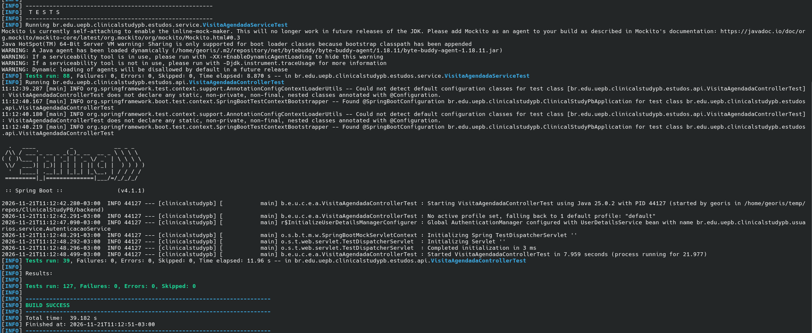

# RF12: agendamento e reagendamento de visitas

## Objetivo

Comprovar o agendamento e o reagendamento de visitas pelo coordenador vinculado ao estudo, além da rejeição de agendamentos duplicados e datas inválidas.

## Links

- [Abrir Swagger UI](http://localhost:8080/swagger-ui.html)
- [Consultar contrato OpenAPI](http://localhost:8080/v3/api-docs)
- [Documentação do RF12](../../../../../../docs/api/acompanhamento-de-participantes.md)
- Endpoint testado: [`POST /estudos/6/participacoes/1/visitas`](http://localhost:8080/swagger-ui.html)
- Endpoint testado: [`PUT /estudos/6/participacoes/1/visitas/1`](http://localhost:8080/swagger-ui.html)

## Pré-requisitos

- Backend iniciado e banco PostgreSQL saudável no Docker
- Sessão autenticada como coordenador vinculado ao estudo
- Estudo em `EXECUCAO` e participação `ATIVA`
- Visita prevista disponível e data dentro do período do estudo

## Dados de teste

| Dado | Valor |
|---|---|
| Coordenador | `coordenador@clinicalstudypb.test` |
| Estudo | Evidencias RF12-RF15 f3614de8cc |
| ID do estudo | 6 |
| Participante | Participante Demo |
| ID da participação | 1 |
| ID da visita prevista | 1 |
| ID da visita agendada | 1 |

Os dados do estudo, do protocolo e da participação foram preparados por SQL exclusivamente para os testes. O cadastro e a inclusão não fazem parte destes cenários.

## Cenário 1: agendamento com sucesso

1. Fazer login no Swagger com o coordenador fictício vinculado ao estudo.
2. Obter um novo token CSRF após o login.
3. Executar `POST /estudos/6/participacoes/1/visitas`.
4. Enviar o corpo da requisição abaixo.

```json
{
  "visitaPrevistaId": 1,
  "dataHora": "2026-11-22T12:00:00Z"
}
```

**Resultado esperado:** `201 Created`, visita criada com situação `AGENDADA`.

**Resultado observado:** A API retornou `201` e a visita foi criada com situação `AGENDADA`.

**Evidência:**



[Ver captura do cenário 1](01-rf12-agendamento-sucesso.png)

## Cenário 2: agendamento duplicado

1. Executar `POST /estudos/6/participacoes/1/visitas`.
2. Enviar o corpo da requisição abaixo.

```json
{
  "visitaPrevistaId": 1,
  "dataHora": "2026-11-22T12:00:00Z"
}
```

**Resultado esperado:** `409 Conflict`, código `VISITA_JA_AGENDADA`.

**Resultado observado:** A API retornou `409 / VISITA_JA_AGENDADA`, rejeitando a duplicidade.

**Evidência:**



[Ver captura do cenário 2](02-rf12-agendamento-erro-duplicado.png)

## Cenário 3: reagendamento com sucesso

1. Executar `PUT /estudos/6/participacoes/1/visitas/1`.
2. Enviar o corpo da requisição abaixo.

```json
{
  "dataHora": "2026-11-21T12:00:00Z"
}
```

**Resultado esperado:** `200 OK`, data da visita atualizada para 21/11/2026.

**Resultado observado:** A API retornou `200` e a nova data foi confirmada.

**Evidência:**



[Ver captura do cenário 3](03-rf12-reagendamento-sucesso.png)

## Cenário 4: reagendamento para data passada

1. Executar `PUT /estudos/6/participacoes/1/visitas/1`.
2. Enviar o corpo da requisição abaixo.

```json
{
  "dataHora": "2026-11-19T12:00:00Z"
}
```

**Resultado esperado:** `400 Bad Request`, código `DATA_VISITA_INVALIDA`.

**Resultado observado:** A API retornou `400 / DATA_VISITA_INVALIDA`, rejeitando a data.

**Evidência:**



[Ver captura do cenário 4](04-rf12-reagendamento-erro.png)

## Reexecução dos cenários

As datas nos corpos JSON acima são as utilizadas nas capturas originais de novembro de 2026 e foram preservadas para manter a correspondência com as evidências. **Não reutilizar essas datas em novas execuções sem conferir o dia atual e o período do estudo.**

Para repetir os cenários 1 a 3, preparar datas futuras válidas dentro da vigência do estudo e manter o mesmo identificador de visita entre agendamento e reagendamento. No cenário 4, utilizar uma data anterior ao dia da nova execução para verificar a rejeição. Atualizar também os IDs de exemplo caso o banco tenha sido recriado.

## Testes Spring

- Classes: `VisitaAgendadaControllerTest` e `VisitaAgendadaServiceTest`
- Comando de referência (Maven):

```bash
./mvnw -Dtest=VisitaAgendadaControllerTest,VisitaAgendadaServiceTest test
```

- Resultado: 127 testes, 0 falhas, 0 erros e 0 ignorados
- As classes são compartilhadas entre RF12 e RF13; a quantidade corresponde à execução das classes completas, não a testes exclusivos deste requisito.
- Evidência:



[Ver captura dos testes Spring](../../spring/rf12-testes-spring.png)

## Observação sobre a versão testada

As capturas do Swagger foram obtidas antes da atualização da branch local. Os resultados documentados correspondem à execução registrada nas imagens.
