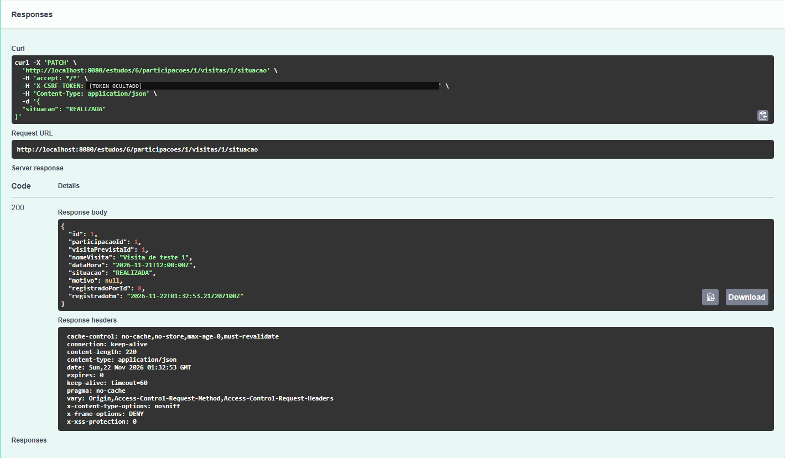
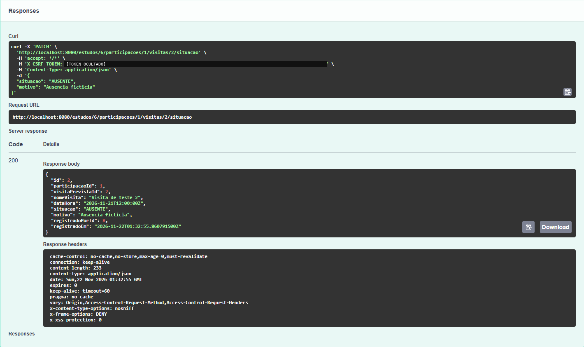
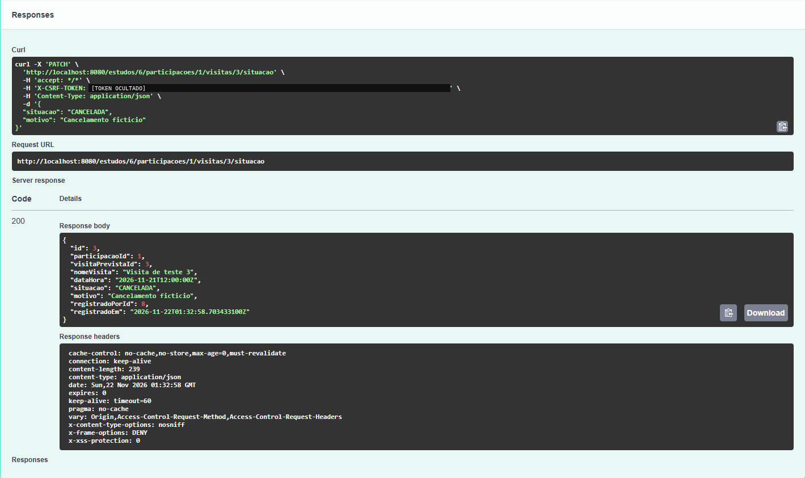
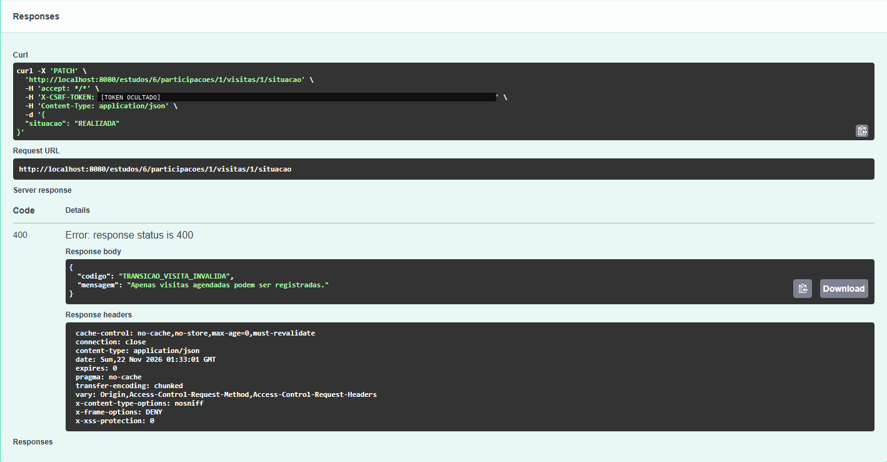
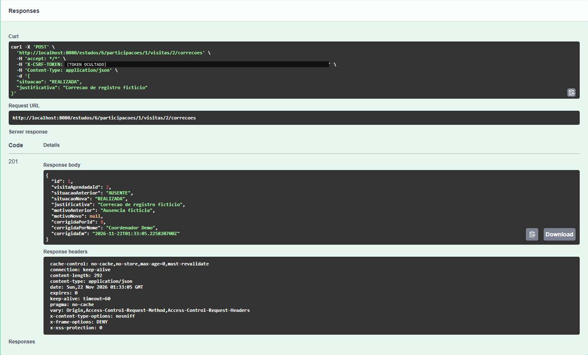
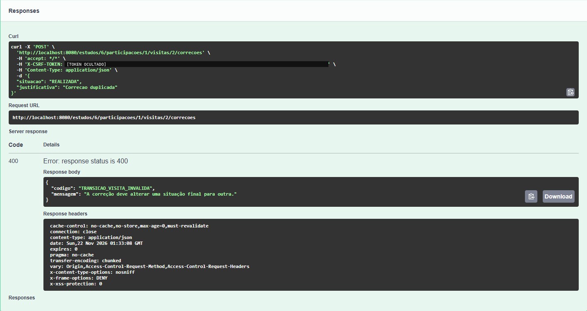
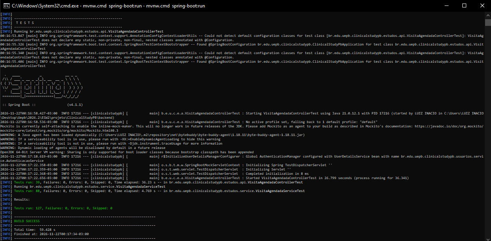

# RF13: registro e correção de visitas

## Objetivo

Comprovar o registro de realização, ausência e cancelamento de visitas, a correção de uma situação final e a rejeição de transições inválidas.

## Links

- [Abrir Swagger UI](http://localhost:8080/swagger-ui.html)
- [Consultar contrato OpenAPI](http://localhost:8080/v3/api-docs)
- [Documentação do RF13](../../../../../../docs/api/acompanhamento-de-participantes.md)
- Endpoint testado: [`PATCH /estudos/6/participacoes/1/visitas/1/situacao`](http://localhost:8080/swagger-ui.html)
- Endpoint testado: [`PATCH /estudos/6/participacoes/1/visitas/2/situacao`](http://localhost:8080/swagger-ui.html)
- Endpoint testado: [`PATCH /estudos/6/participacoes/1/visitas/3/situacao`](http://localhost:8080/swagger-ui.html)
- Endpoint testado: [`POST /estudos/6/participacoes/1/visitas/2/correcoes`](http://localhost:8080/swagger-ui.html)

## Pré-requisitos

- Backend iniciado e banco PostgreSQL saudável no Docker
- Sessão autenticada como coordenador vinculado ao estudo
- Estudo em `EXECUCAO` e participação `ATIVA`
- Três visitas agendadas, preparadas pela API, para registrar as situações e testar a correção

## Dados de teste

| Dado | Valor |
|---|---|
| Coordenador | `coordenador@clinicalstudypb.test` |
| Estudo | Evidencias RF12-RF15 f3614de8cc |
| ID do estudo | 6 |
| Participante | Participante Demo |
| ID da participação | 1 |
| IDs das visitas agendadas | 1, 2 e 3 |

Os dados do estudo, do protocolo e da participação foram preparados por SQL exclusivamente para os testes. O cadastro e a inclusão não fazem parte destes cenários.

## Cenário 1: registro de visita realizada

1. Fazer login no Swagger com o coordenador fictício vinculado ao estudo.
2. Obter um novo token CSRF após o login.
3. Executar `PATCH /estudos/6/participacoes/1/visitas/1/situacao`.
4. Enviar o corpo da requisição abaixo.

```json
{
  "situacao": "REALIZADA"
}
```

**Resultado esperado:** `200 OK`, situação `REALIZADA`.

**Resultado observado:** A API retornou `200` e a situação `REALIZADA`.

**Evidência:**



[Ver captura do cenário 1](01-rf13-registro-realizada.png)

## Cenário 2: registro de ausência

1. Executar `PATCH /estudos/6/participacoes/1/visitas/2/situacao`.
2. Enviar o corpo da requisição abaixo.

```json
{
  "situacao": "AUSENTE",
  "motivo": "Ausencia ficticia"
}
```

**Resultado esperado:** `200 OK`, situação `AUSENTE`, com motivo informado.

**Resultado observado:** A API retornou `200` e a situação `AUSENTE`.

**Evidência:**



[Ver captura do cenário 2](02-rf13-registro-ausente.png)

## Cenário 3: registro de cancelamento

1. Executar `PATCH /estudos/6/participacoes/1/visitas/3/situacao`.
2. Enviar o corpo da requisição abaixo.

```json
{
  "situacao": "CANCELADA",
  "motivo": "Cancelamento ficticio"
}
```

**Resultado esperado:** `200 OK`, situação `CANCELADA`, com motivo informado.

**Resultado observado:** A API retornou `200` e a situação `CANCELADA`.

**Evidência:**



[Ver captura do cenário 3](03-rf13-registro-cancelada.png)

## Cenário 4: novo registro de visita já finalizada

1. Executar `PATCH /estudos/6/participacoes/1/visitas/1/situacao`.
2. Enviar o corpo da requisição abaixo.

```json
{
  "situacao": "REALIZADA"
}
```

**Resultado esperado:** `400 Bad Request`, código `TRANSICAO_VISITA_INVALIDA`.

**Resultado observado:** A API retornou `400 / TRANSICAO_VISITA_INVALIDA` e rejeitou o novo registro.

**Evidência:**



[Ver captura do cenário 4](04-rf13-registro-erro.png)

## Cenário 5: correção de ausência para realizada

1. Executar `POST /estudos/6/participacoes/1/visitas/2/correcoes`.
2. Enviar o corpo da requisição abaixo.

```json
{
  "situacao": "REALIZADA",
  "justificativa": "Correcao de registro ficticio"
}
```

**Resultado esperado:** `201 Created`, correção registrada com justificativa.

**Resultado observado:** A API retornou `201`, aceitando a solicitação de correção.

**Evidência:**



[Ver captura do cenário 5](05-rf13-correcao-sucesso.png)

## Cenário 6: correção para a mesma situação

1. Executar `POST /estudos/6/participacoes/1/visitas/2/correcoes`.
2. Enviar o corpo da requisição abaixo.

```json
{
  "situacao": "REALIZADA",
  "justificativa": "Correcao duplicada"
}
```

**Resultado esperado:** `400 Bad Request`, código `TRANSICAO_VISITA_INVALIDA`.

**Resultado observado:** A API retornou `400 / TRANSICAO_VISITA_INVALIDA`, rejeitando a correção repetida.

**Evidência:**



[Ver captura do cenário 6](06-rf13-correcao-erro.png)

## Testes Spring

- Classes: `VisitaAgendadaControllerTest` e `VisitaAgendadaServiceTest`
- Comando de referência (Maven):

```bash
./mvnw -Dtest=VisitaAgendadaControllerTest,VisitaAgendadaServiceTest test
```

- Resultado: 127 testes, 0 falhas, 0 erros e 0 ignorados
- As classes são compartilhadas entre RF12 e RF13; a quantidade corresponde à execução das classes completas, não a testes exclusivos deste requisito.
- Evidência:



[Ver captura dos testes Spring](../../spring/rf13-testes-spring.png)

## Observação sobre a versão testada

As capturas do Swagger foram obtidas antes da atualização da branch local. Os resultados documentados correspondem à execução registrada nas imagens.
