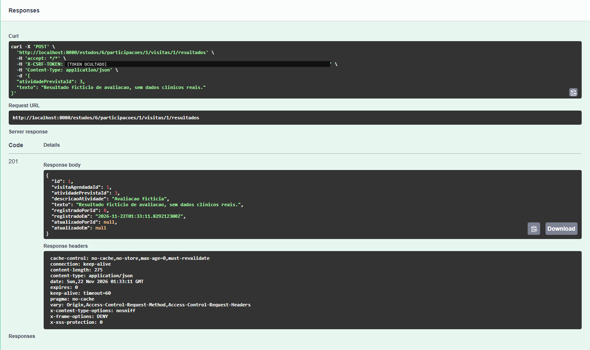
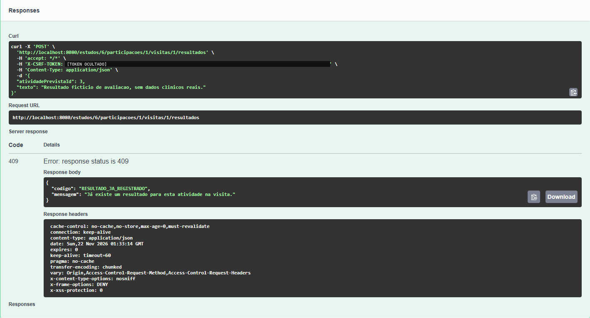
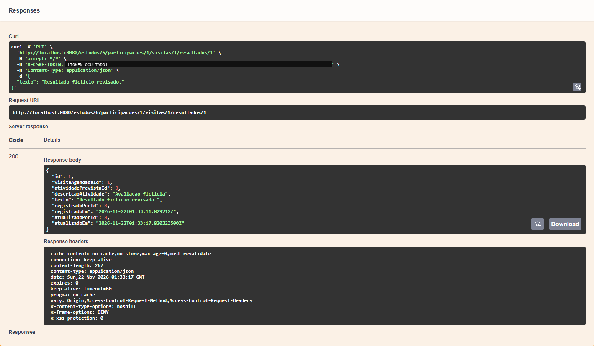
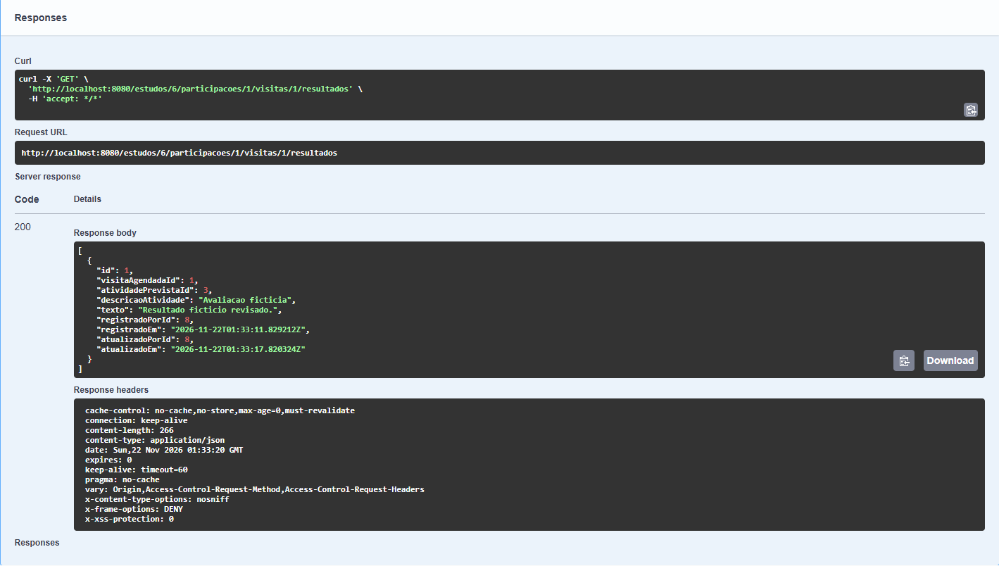
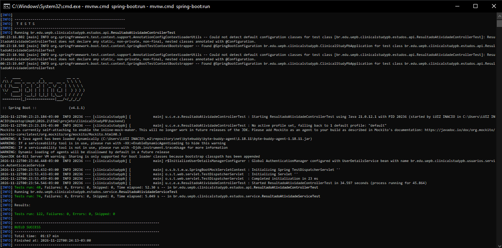

# RF14: resultados fictícios das atividades

## Objetivo

Comprovar o registro, a edição e a consulta de resultados fictícios de atividades previstas, além da rejeição de um resultado duplicado.

## Links

- [Abrir Swagger UI](http://localhost:8080/swagger-ui.html)
- [Consultar contrato OpenAPI](http://localhost:8080/v3/api-docs)
- [Documentação do RF14](../../../../../../docs/api/acompanhamento-de-participantes.md)
- Endpoint testado: [`POST /estudos/6/participacoes/1/visitas/1/resultados`](http://localhost:8080/swagger-ui.html)
- Endpoint testado: [`PUT /estudos/6/participacoes/1/visitas/1/resultados/1`](http://localhost:8080/swagger-ui.html)
- Endpoint testado: [`GET /estudos/6/participacoes/1/visitas/1/resultados`](http://localhost:8080/swagger-ui.html)

## Pré-requisitos

- Backend iniciado e banco PostgreSQL saudável no Docker
- Sessão autenticada como coordenador vinculado ao estudo
- Estudo em `EXECUCAO` e participação `ATIVA`
- Visita realizada com atividade prevista vinculada

## Dados de teste

| Dado | Valor |
|---|---|
| Coordenador | `coordenador@clinicalstudypb.test` |
| Estudo | Evidencias RF12-RF15 f3614de8cc |
| ID do estudo | 6 |
| Participante | Participante Demo |
| ID da participação | 1 |
| ID da visita agendada | 1 |
| ID da atividade prevista | 3 |
| ID do resultado | 1 |

Os dados do estudo, do protocolo e da participação foram preparados por SQL exclusivamente para os testes. O cadastro e a inclusão não fazem parte destes cenários.

## Cenário 1: registro de resultado fictício

1. Fazer login no Swagger com o coordenador fictício vinculado ao estudo.
2. Obter um novo token CSRF após o login.
3. Executar `POST /estudos/6/participacoes/1/visitas/1/resultados`.
4. Enviar o corpo da requisição abaixo.

```json
{
  "atividadePrevistaId": 3,
  "texto": "Resultado ficticio de avaliacao, sem dados clinicos reais."
}
```

**Resultado esperado:** `201 Created`, resultado registrado para a atividade prevista.

**Resultado observado:** A API retornou `201` e aceitou o registro do resultado.

**Evidência:**



[Ver captura do cenário 1](01-rf14-resultado-sucesso.png)

## Cenário 2: resultado duplicado

1. Executar `POST /estudos/6/participacoes/1/visitas/1/resultados`.
2. Enviar o corpo da requisição abaixo.

```json
{
  "atividadePrevistaId": 3,
  "texto": "Resultado ficticio de avaliacao, sem dados clinicos reais."
}
```

**Resultado esperado:** `409 Conflict`, código `RESULTADO_JA_REGISTRADO`.

**Resultado observado:** A API retornou `409 / RESULTADO_JA_REGISTRADO`, rejeitando a duplicidade.

**Evidência:**



[Ver captura do cenário 2](02-rf14-resultado-erro.png)

## Cenário 3: edição de resultado fictício

1. Executar `PUT /estudos/6/participacoes/1/visitas/1/resultados/1`.
2. Enviar o corpo da requisição abaixo.

```json
{
  "texto": "Resultado ficticio revisado."
}
```

**Resultado esperado:** `200 OK`, texto do resultado atualizado.

**Resultado observado:** A API retornou `200` e o texto revisado foi confirmado.

**Evidência:**



[Ver captura do cenário 3](03-rf14-resultado-edicao.png)

## Cenário 4: consulta de resultados

1. Executar `GET /estudos/6/participacoes/1/visitas/1/resultados`.

**Resultado esperado:** `200 OK`, lista contendo o resultado registrado.

**Resultado observado:** A API retornou `200` e a lista continha o resultado de ID 1.

**Evidência:**



[Ver captura do cenário 4](04-rf14-resultado-listagem.png)

## Testes Spring

- Classes: `ResultadoAtividadeControllerTest` e `ResultadoAtividadeServiceTest`
- Comando de referência (Maven):

```bash
./mvnw -Dtest=ResultadoAtividadeControllerTest,ResultadoAtividadeServiceTest test
```

- Resultado: 122 testes, 0 falhas, 0 erros e 0 ignorados
- Evidência:



[Ver captura dos testes Spring](../../spring/rf14-testes-spring.png)

## Observação sobre a versão testada

As capturas do Swagger foram obtidas antes da atualização da branch local. Os resultados documentados correspondem à execução registrada nas imagens.
