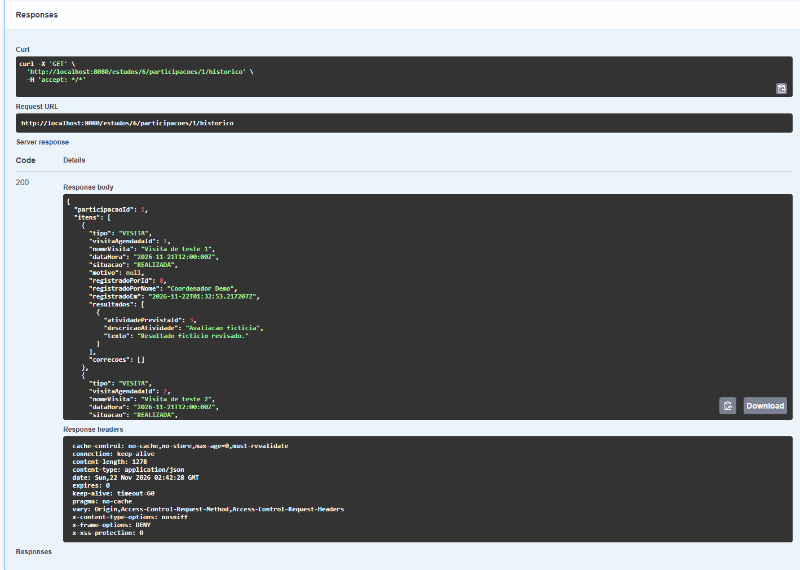
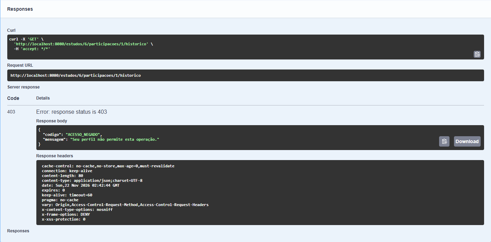
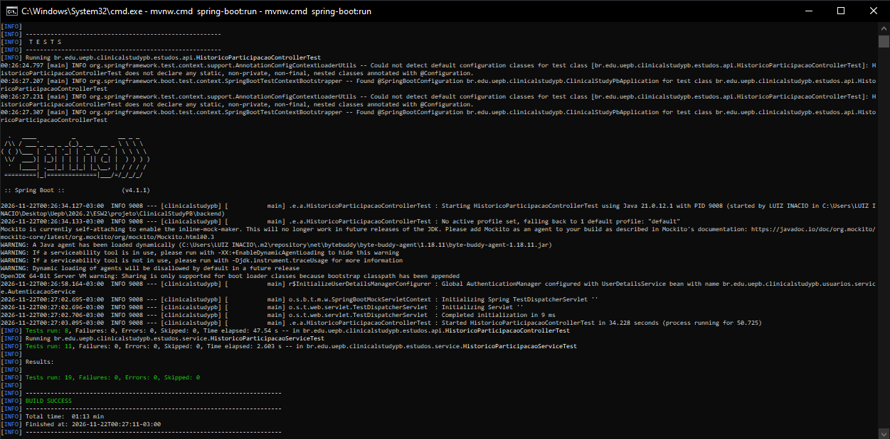

# RF15: histórico completo de visitas

## Objetivo

Comprovar a consulta do histórico da participação, incluindo visitas, resultados e correções, e a restrição de acesso ao perfil participante.

## Links

- [Abrir Swagger UI](http://localhost:8080/swagger-ui.html)
- [Consultar contrato OpenAPI](http://localhost:8080/v3/api-docs)
- [Documentação do RF15](../../../../../../docs/api/acompanhamento-de-participantes.md)
- Endpoint testado: [`GET /estudos/6/participacoes/1/historico`](http://localhost:8080/swagger-ui.html)

## Pré-requisitos

- Backend iniciado e banco PostgreSQL saudável no Docker
- Sessão autenticada como coordenador vinculado ao estudo para a consulta de sucesso
- Conta fictícia com perfil `PARTICIPANTE` para o cenário de acesso negado
- Participação com visitas, resultados de atividades e correções registrados nos testes anteriores

## Dados de teste

| Dado | Valor |
|---|---|
| Coordenador | `coordenador@clinicalstudypb.test` |
| Estudo | Evidencias RF12-RF15 f3614de8cc |
| ID do estudo | 6 |
| Participante | Participante Demo |
| ID da participação | 1 |
| Conta sem permissão | `participante@clinicalstudypb.test` |
| IDs das visitas agendadas | 1, 2 e 3 |

Os dados do estudo, do protocolo e da participação foram preparados por SQL exclusivamente para os testes. O cadastro e a inclusão não fazem parte destes cenários.

## Cenário 1: consulta do histórico completo

1. Fazer login no Swagger com o coordenador fictício vinculado ao estudo.
2. Obter um novo token CSRF após o login.
3. Executar `GET /estudos/6/participacoes/1/historico`.

**Resultado esperado:** `200 OK`, histórico com visitas, resultados e correções.

**Resultado observado:** A API retornou `200`. A captura mostra itens do histórico e um resultado de atividade, mas exibe apenas parte do JSON; não é possível confirmar nela a existência de três itens completos nem de correções.

**Evidência:**



[Ver captura do cenário 1](01-rf15-historico-sucesso.png)

**Limite da evidência:** para comprovar todos os registros e correções mencionados no objetivo, acrescentar uma captura da continuação do JSON ou outra evidência que mostre esses campos.

## Cenário 2: acesso negado ao perfil participante

1. Autenticar-se em outra sessão com a conta fictícia do perfil `PARTICIPANTE`.
2. Executar `GET /estudos/6/participacoes/1/historico`.

**Resultado esperado:** `403 Forbidden`, código `ACESSO_NEGADO`.

**Resultado observado:** A API retornou `403 / ACESSO_NEGADO`, impedindo o acesso ao histórico de gestão.

**Evidência:**



[Ver captura do cenário 2](02-rf15-historico-erro-acesso.png)

## Testes Spring

- Classes: `HistoricoParticipacaoControllerTest` e `HistoricoParticipacaoServiceTest`
- Comando de referência (Maven):

```bash
./mvnw -Dtest=HistoricoParticipacaoControllerTest,HistoricoParticipacaoServiceTest test
```

- Resultado: 19 testes, 0 falhas, 0 erros e 0 ignorados
- Evidência:



[Ver captura dos testes Spring](../../spring/rf15-testes-spring.png)

## Observação

Na primeira execução, a consulta retornou `500` devido a `NoClassDefFoundError` em `HistoricoParticipacaoService$1`. Após recompilar o backend de forma limpa, a consulta foi repetida e retornou `200`. A consulta de acesso negado também passou. Não foi necessário alterar o código-fonte.

## Observação sobre a versão testada

As capturas do Swagger foram obtidas antes da atualização da branch local. Os resultados documentados correspondem à execução registrada nas imagens.
