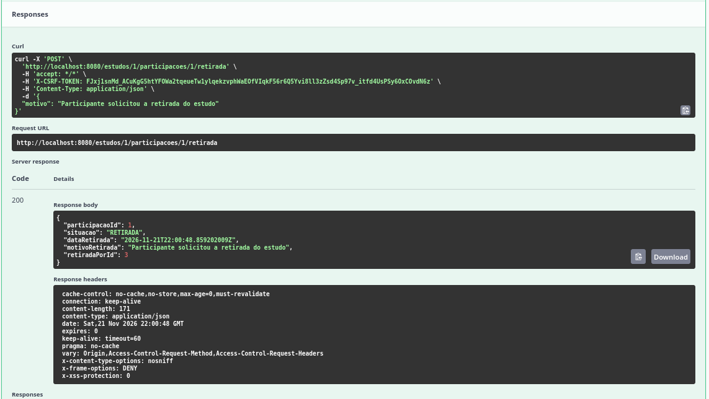
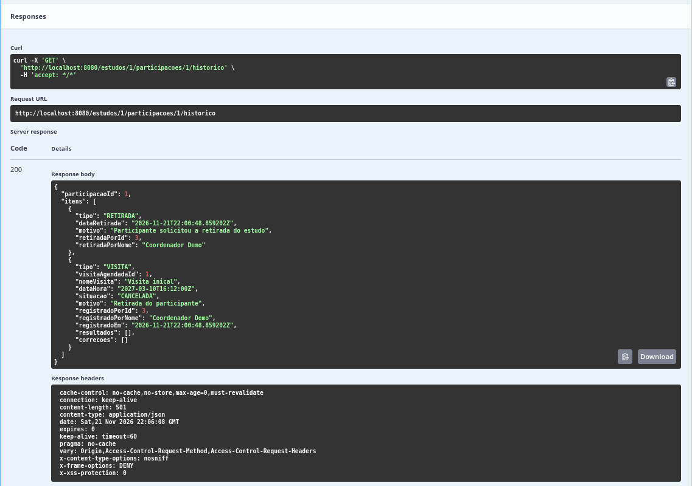
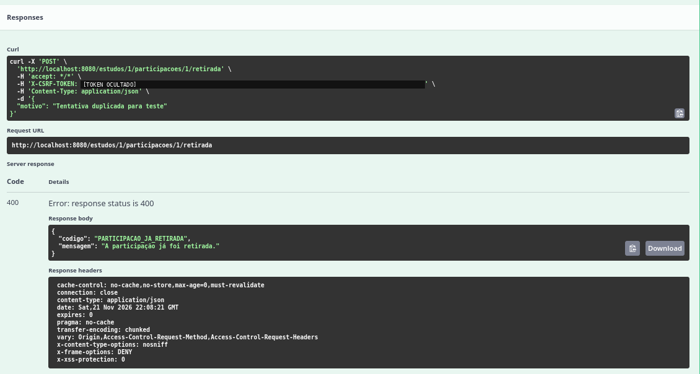
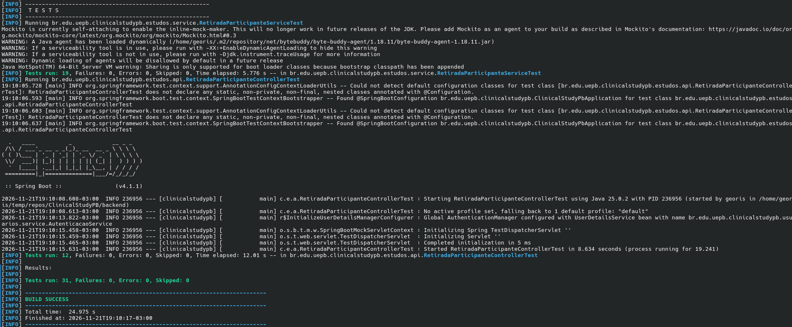

# RF16: retirada do participante

## Objetivo

Comprovar o registro da retirada de um participante pelo coordenador vinculado, o cancelamento das visitas pendentes e a rejeição de uma nova retirada da mesma participação.

## Links

- [Abrir Swagger UI](http://localhost:8080/swagger-ui.html)
- [Consultar contrato OpenAPI](http://localhost:8080/v3/api-docs)
- [Documentação do RF16](../../../../../../docs/api/acompanhamento-de-participantes.md)
- Endpoint testado: [`POST /estudos/{estudoId}/participacoes/{participacaoId}/retirada`](http://localhost:8080/swagger-ui.html)

## Pré-requisitos

- Backend iniciado e banco saudável
- Sessão autenticada como coordenador vinculado ao estudo
- Estudo em `RECRUTAMENTO` ou `EXECUCAO`
- Participação ativa com pelo menos uma visita `AGENDADA`

## Dados de teste

| Dado | Valor |
|---|---|
| Coordenador | `coordenador@clinicalstudypb.test` |
| Estudo | Estudo de Acompanhamento Cardiovascular |
| ID do estudo | 1 |
| Participante | Luiz Inácio |
| Conta do participante | `luizparticipante@gmail.com` |
| ID da participação | 1 |
| Motivo | Participante solicitou a retirada do estudo |

## Cenário 1: registrar retirada

1. Fazer login no Swagger com o coordenador fictício vinculado ao estudo.
2. Obter um novo token CSRF após o login.
3. Executar `POST /estudos/1/participacoes/1/retirada`.
4. Enviar o motivo da retirada no corpo da requisição.

**Resultado esperado:** `200 OK`, situação `RETIRADA` e motivo registrado.

**Resultado observado:** A participação foi retirada com sucesso.

**Evidência:**



[Ver captura da retirada com sucesso](01-rf16-retirada-sucesso.png)

## Cenário 2: confirmar o cancelamento das visitas pendentes

1. Executar `GET /estudos/1/participacoes/1/historico`.

**Resultado esperado:** visitas que estavam `AGENDADA` passam para `CANCELADA`, com o motivo automático “Retirada do participante”. Visitas finalizadas e seus resultados devem permanecer preservados.

**Resultado observado:** A resposta `200 OK` mostra a retirada e a visita antes agendada como `CANCELADA`, com motivo `Retirada do participante`. A captura não mostra visitas já finalizadas nem resultados, portanto não comprova isoladamente sua preservação.

**Evidência:**



[Ver captura das visitas pendentes canceladas](02-rf16-visitas-pendentes-canceladas.png)

**Complemento para reexecução:** verificar uma participação que tenha visita finalizada e resultado registrado antes da retirada. Após a operação, confirmar que ambos foram preservados. A regra também é contemplada em `RetiradaParticipanteServiceTest` (SPR-173), mas a captura Swagger acima comprova apenas o cancelamento da pendência.

## Cenário 3: tentar retirar novamente

1. Executar novamente `POST /estudos/1/participacoes/1/retirada`.
2. Informar outro motivo no corpo da requisição.

**Resultado esperado:** `400 Bad Request`, com o código `PARTICIPACAO_JA_RETIRADA`.

**Resultado observado:** o backend rejeitou a segunda retirada.

**Evidência:**



[Ver captura do erro de retirada duplicada](03-rf16-retirada-erro-ja-retirada.png)

## Testes Spring

- Classes: `RetiradaParticipanteControllerTest` e `RetiradaParticipanteServiceTest`
- Comando executado:

```bash
./mvnw -Dtest=RetiradaParticipanteControllerTest,RetiradaParticipanteServiceTest test
```

- Resultado: 31 testes, 0 falhas e 0 erros
- Evidência:



[Ver captura dos testes Spring](../../spring/rf16-testes-spring.png)