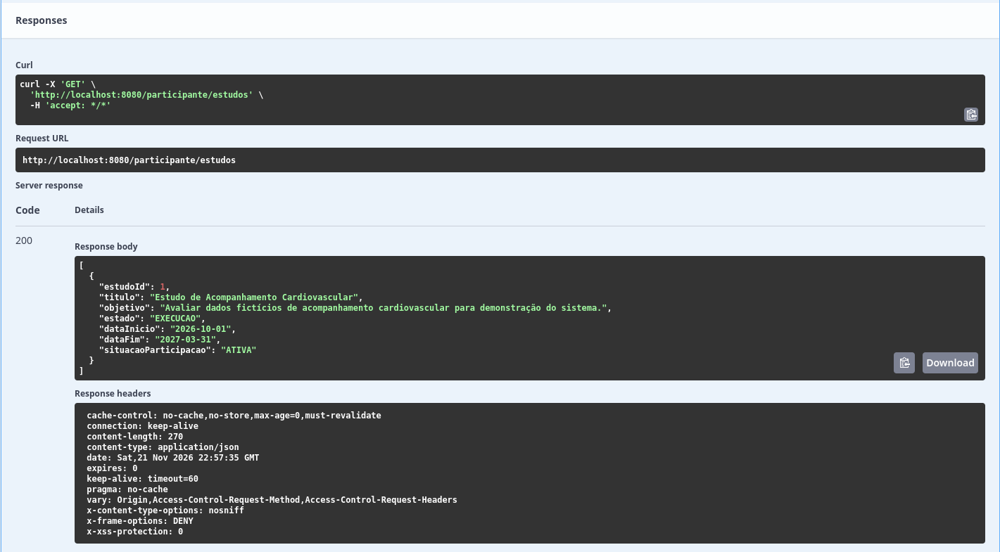
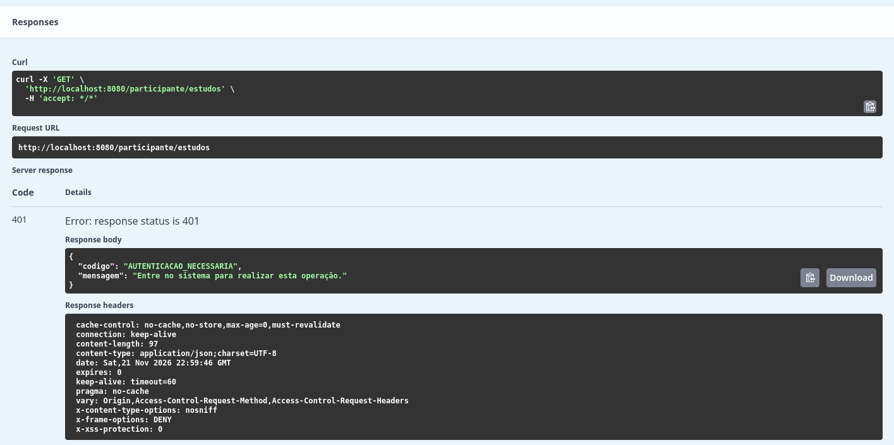
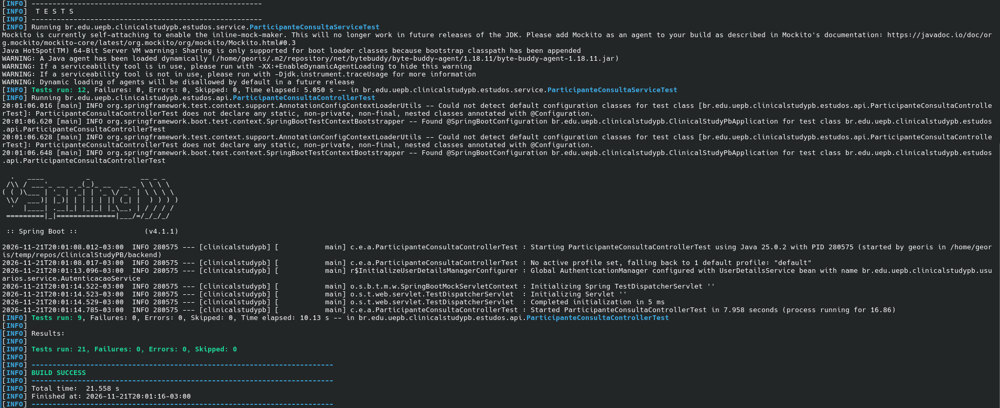

# RF17: consulta dos estudos do participante

## Objetivo

Comprovar que uma pessoa autenticada com perfil `PARTICIPANTE` consulta os estudos aos quais está vinculada e que um perfil diferente não pode acessar essa operação.

## Links

- [Abrir Swagger UI](http://localhost:8080/swagger-ui.html)
- [Consultar contrato OpenAPI](http://localhost:8080/v3/api-docs)
- [Documentação do acompanhamento no repositório](../../../../../docs/api/acompanhamento-de-participantes.md)
- Endpoint testado: [`GET /participante/estudos`](http://localhost:8080/participante/estudos)

> O endpoint exige sessão. Faça login pelo Swagger antes de abri-lo. A resposta é vinculada à conta autenticada, não há ID de participante na URL.

## Pré-requisitos

- PostgreSQL e backend em execução.
- Conta fictícia `participante@clinicalstudypb.test` incluída em pelo menos um estudo.
- Swagger UI aberto em `http://localhost:8080/swagger-ui.html`.

## Dados de teste

| Dado | Valor |
|---|---|
| Conta para o sucesso | `participante@clinicalstudypb.test` |
| Perfil para o sucesso | `PARTICIPANTE` |
| Cenário de erro registrado | Requisição sem sessão autenticada |

Não registrar senha, cookie de sessão ou token CSRF neste arquivo ou nas capturas.

## Cenário 1: consulta bem-sucedida

1. No Swagger, execute [`GET /auth/csrf`](http://localhost:8080/auth/csrf) e copie o valor de `token`.
2. Execute [`POST /auth/login`](http://localhost:8080/auth/login) com o token no cabeçalho `X-CSRF-TOKEN` e a conta fictícia de participante.
3. Confirme que o login respondeu `200`.
4. Execute [`GET /participante/estudos`](http://localhost:8080/participante/estudos).

**Resultado esperado:** `200 OK`, com os estudos vinculados à conta. Cada item pode incluir `estudoId`, `titulo`, `objetivo`, `estado`, `dataInicio`, `dataFim` e `situacaoParticipacao`. Estudos dos quais a pessoa se retirou continuam na lista, identificados como `RETIRADA`.

**Resultado observado:** Estudo vinculado listado com sucesso

**Evidência:**



[Ver captura de sucesso](01-rf17-consulta-estudos-sucesso.png)

Se a resposta for `200 OK` com uma lista vazia (`[]`), a chamada funcionou, mas essa conta não possui participação registrada no banco. Nesse caso, confirme a inclusão da conta no estudo antes de registrar a evidência como consulta de estudos vinculados.

## Cenário 2: acesso sem autenticação

Execute [`GET /participante/estudos`](http://localhost:8080/participante/estudos) sem fazer login ou após encerrar a sessão.

**Resultado esperado:** `401 Unauthorized`, pois a requisição não possui uma sessão autenticada.

**Resultado observado:** `401 Unauthorized`, com o código `AUTENTICACAO_NECESSARIA` e a mensagem para entrar no sistema.

**Evidência:**



[Ver captura da resposta 401](02-rf17-estudos-erro-perfil.png)

> Para testar especificamente um perfil incorreto, faça login como coordenador e espere `403 Forbidden`. Essa captura comprova ausência de autenticação (`401`), não erro de perfil.

## Testes automatizados Spring

As consultas de RF17 e RF18 compartilham estas classes de teste:

- `ParticipanteConsultaControllerTest`
- `ParticipanteConsultaServiceTest`

Execute o comando dentro da pasta `backend`:

```bash
./mvnw -Dtest=ParticipanteConsultaControllerTest,ParticipanteConsultaServiceTest test
```

**Resultado esperado:** testes concluídos sem falhas e `BUILD SUCCESS`.

**Resultado observado:** 21 testes executados, 0 falhas, 0 erros e 0 testes ignorados.

**Evidência da execução Spring:**



[Ver captura dos testes Spring](../../spring/rf17-testes-spring.png)