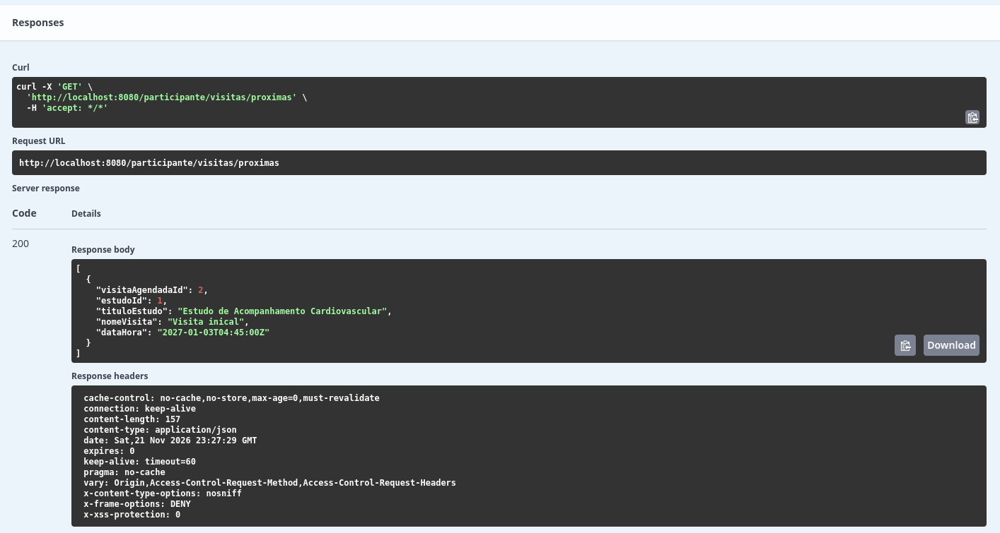
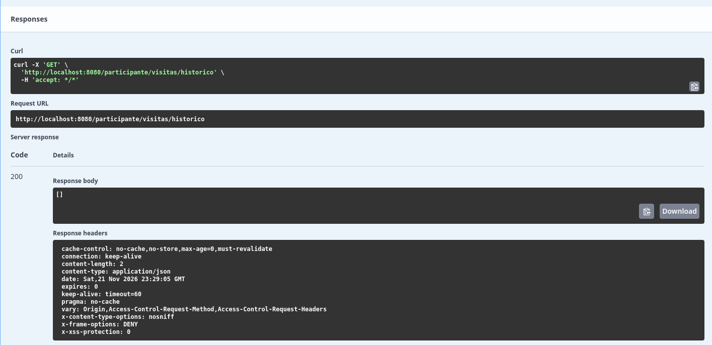
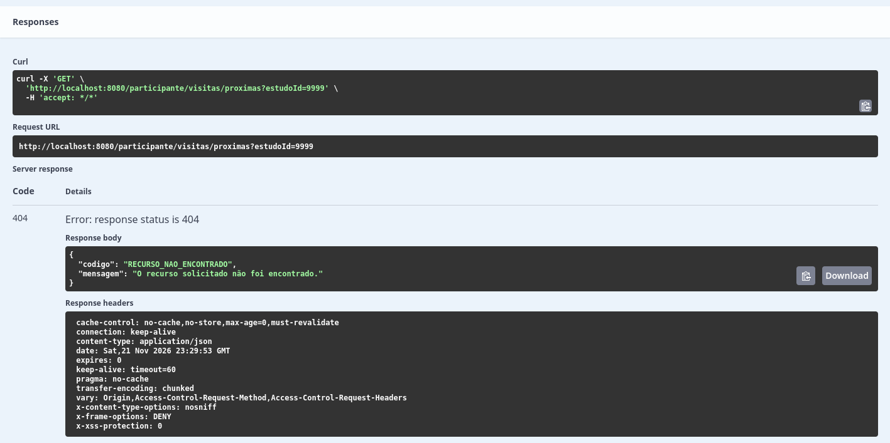
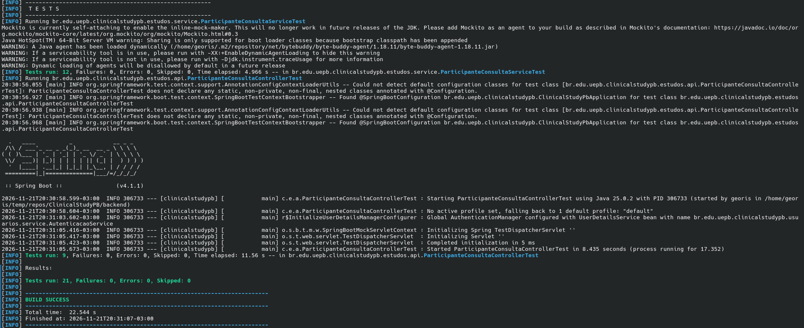

# RF18: consultas de visitas do participante

## Objetivo

Comprovar que uma pessoa com perfil `PARTICIPANTE` consulta suas próximas visitas e o endpoint de histórico, além de rejeitar a consulta a estudo sem vínculo. O bloqueio de perfis diferentes é contemplado nos testes Spring, mas não tem captura Swagger específica neste roteiro.

## Links

- [Abrir Swagger UI](http://localhost:8080/swagger-ui.html)
- [Consultar contrato OpenAPI](http://localhost:8080/v3/api-docs)
- [Documentação do acompanhamento](../../../../../../docs/api/acompanhamento-de-participantes.md)

## Pré-requisitos

- Backend iniciado e banco saudável
- Conta participante vinculada a um estudo
- Pelo menos uma visita futura `AGENDADA` para aparecer em próximas visitas
- Para demonstrar o histórico preenchido: pelo menos uma visita `REALIZADA`, `AUSENTE` ou `CANCELADA` (a captura existente mostra uma lista vazia)

## Dados de teste

| Dado | Valor |
|---|---|
| Conta para os casos de sucesso | `participante@clinicalstudypb.test` |
| Perfil para os casos de sucesso | `PARTICIPANTE` |
| Estudo | Estudo de Acompanhamento Cardiovascular |
| ID do estudo | 1 |

Não registre senhas, cookies de sessão ou tokens CSRF neste arquivo ou nas capturas.

## Login como participante

1. No Swagger, execute `GET /auth/csrf` e copie o valor de `token`.
2. Execute `POST /auth/login`, enviando o token no cabeçalho `X-CSRF-TOKEN`.
3. Use a conta `participante@clinicalstudypb.test` e a senha fictícia configurada para ela.
4. Confirme que o login respondeu `200 OK`.

## Cenário 1: consultar próximas visitas

Execute `GET /participante/visitas/proximas`. Para filtrar pelo estudo, use o parâmetro `estudoId=1`.

**Resultado esperado:** `200 OK`, com as visitas `AGENDADA` de hoje em diante, em ordem crescente de data. Se não houver visitas futuras agendadas, uma lista vazia também é válida.

**Resultado observado:** consulta realizada com sucesso no Swagger.

**Evidência:**



[Ver captura das próximas visitas](01-rf18-proximas-sucesso.png)

## Cenário 2: consultar histórico de comparecimento

Execute `GET /participante/visitas/historico`. Para filtrar pelo estudo, use `estudoId=1`.

**Resultado esperado:** `200 OK`. Quando houver registros, a lista deve conter visitas `REALIZADA`, `AUSENTE` ou `CANCELADA`, da mais recente para a mais antiga, sem expor motivos, resultados ou quem registrou. Sem registros, uma lista vazia é válida.

**Resultado observado:** `200 OK`, com resposta vazia (`[]`). A captura comprova a chamada, mas não a composição do histórico com visitas finalizadas.

**Evidência:**



[Ver captura do histórico](02-rf18-historico-sucesso.png)

## Cenário 3: consulta de estudo sem vínculo

1. Ainda autenticado como participante, executar `GET /participante/visitas/proximas?estudoId=9999`.
2. Informar um ID de estudo inexistente ou não vinculado à conta.

**Resultado esperado:** `404 Not Found`, com `codigo: RECURSO_NAO_ENCONTRADO`.

**Resultado observado:** `404 Not Found`, com código `RECURSO_NAO_ENCONTRADO` para `estudoId=9999`.

**Evidência:**



[Ver captura do erro](03-rf18-consulta-erro-estudo.png)

**Evidência que ainda falta:** executar novamente o cenário 2 com uma participação que possua visitas finalizadas e registrar uma captura contendo pelo menos uma delas. Não marcar esse comportamento específico como comprovado apenas pela imagem da lista vazia. Para verificar `403` com perfil incorreto, executar outro cenário autenticado com um perfil diferente de `PARTICIPANTE`.

## Testes automatizados Spring

- Classes: `ParticipanteConsultaControllerTest` e `ParticipanteConsultaServiceTest`
- Comando executado na pasta `backend`:

```bash
./mvnw -Dtest=ParticipanteConsultaControllerTest,ParticipanteConsultaServiceTest test
```

- Resultado: **21 testes, 0 falhas, 0 erros e 0 ignorados**

**Evidência:**



[Ver captura dos testes Spring](../../spring/rf18-testes-spring.png)