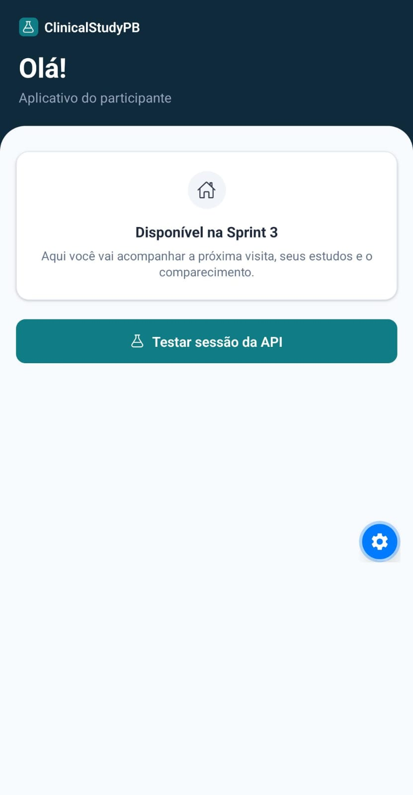
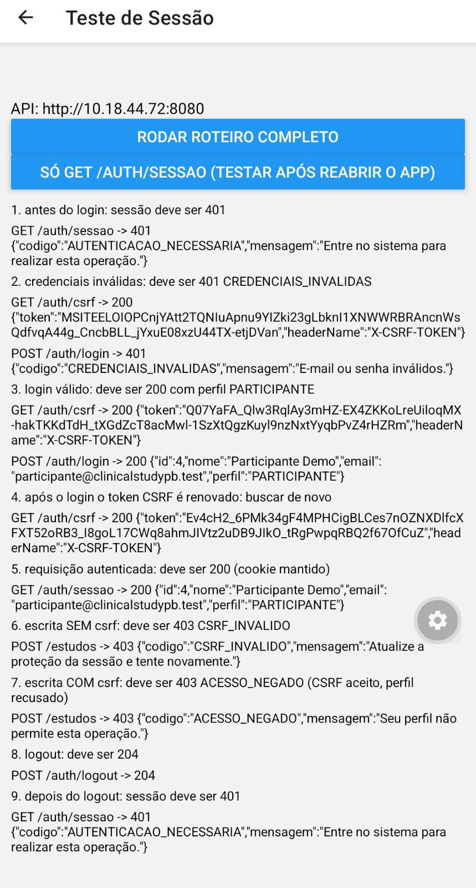
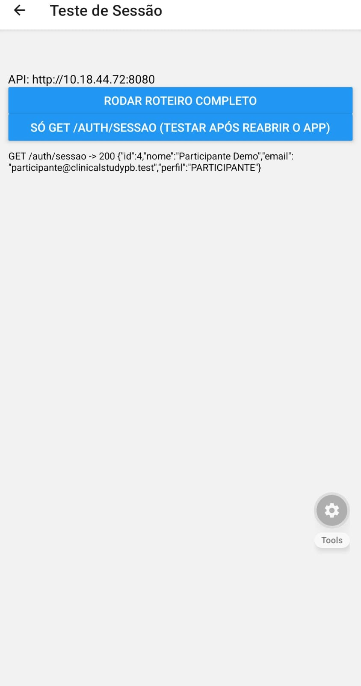

# Validação da sessão no aplicativo mobile (task 3954)

## Decisão

> O aplicativo mobile utilizará a mesma sessão HTTP por cookie do Spring
> Security adotada pela aplicação web (D05), sem introduzir um mecanismo
> alternativo de autenticação baseado em tokens.

A validação demonstrou que o cliente React Native consegue realizar o
login, reutilizar a sessão autenticada nas requisições seguintes, enviar
o token CSRF exigido nas operações de escrita e encerrar a sessão.

## Ambiente de validação

- **Data:** 13/11/2026.
- **Responsável:** Georis
- **Dispositivo:** celular Android físico.
- **Aplicativo de execução:** Expo Go.
- **Projeto mobile:** Expo SDK 58.
- **Backend:** Spring Boot, acessível pela rede local em
  `http://10.18.44.72:8080`.
- **Rota de verificação da sessão:** `GET /auth/sessao`.
- **Emulador Android:** não utilizado nesta validação.
- **Expo Web:** não utilizado; os testes foram executados no
  aplicativo Android.

## Procedimento e resultados

O roteiro foi executado no celular Android físico. Os resultados
observados foram:

| Verificação | Resultado no celular |
|---|---|
| Consulta antes do login (`GET /auth/sessao`) | **Aprovado:** HTTP 401, `AUTENTICACAO_NECESSARIA` |
| Login com credenciais inválidas | **Aprovado:** HTTP 401, `CREDENCIAIS_INVALIDAS` |
| Login válido com perfil `PARTICIPANTE` | **Aprovado:** HTTP 200 |
| Requisição autenticada reutiliza o cookie da sessão | **Aprovado:** `GET /auth/sessao` retornou HTTP 200 após o login |
| Escrita sem token CSRF | **Aprovado:** HTTP 403, `CSRF_INVALIDO` |
| Escrita com token CSRF obtido em `GET /auth/csrf` | **Aprovado quanto ao CSRF:** a resposta foi HTTP 403, `ACESSO_NEGADO`. A proteção CSRF aceitou o token, mas a autorização recusou a operação `/estudos` por falta de permissão do perfil participante |
| Logout | **Aprovado:** `POST /auth/logout` retornou HTTP 204 |
| Consulta após logout | **Aprovado:** `GET /auth/sessao` retornou HTTP 401 |
| Sessão após fechar e reabrir o Expo Go | **Aprovado no cenário testado:** `GET /auth/sessao` retornou HTTP 200 após reabrir o aplicativo |

**Emulador Android:** não testado. O endereço `10.0.2.2`
foi documentado como configuração para testes futuros no emulador, mas
não há evidência de execução desse cenário nesta validação.

### Procedimento de persistência da sessão

Para verificar se o cookie da sessão permanecia disponível após o fechamento do aplicativo, foi realizado um segundo teste, separado do roteiro completo:

1. O roteiro de autenticação foi executado novamente, mantendo o login válido e a consulta autenticada.
2. As etapas de logout e de consulta após logout foram temporariamente desativadas no roteiro, para que a sessão não fosse encerrada ao final da execução.
3. Após a confirmação de HTTP 200 em `GET /auth/sessao`, o Expo Go foi encerrado pelo seletor de aplicativos recentes do Android, sem executar o logout.
4. O aplicativo permaneceu fechado por aproximadamente 10 segundos antes de ser aberto novamente.
5. Foi executada somente a consulta `GET /auth/sessao`, sem realizar um novo login.
6. A API retornou HTTP 200 e os dados do participante autenticado.

O resultado indica que, no cenário testado, o cookie `JSESSIONID` permaneceu disponível após o fechamento e a reabertura do Expo Go.

## Fluxo que o aplicativo deve seguir

1. Executar `GET /auth/csrf` e guardar `token` e `headerName` em
   memória.
2. Enviar `POST /auth/login` com as credenciais e o cabeçalho CSRF
   informado pela API.
3. Após o login bem-sucedido, executar novamente `GET /auth/csrf`, pois
   o login renova a sessão e o token CSRF.
4. Enviar o token CSRF no cabeçalho indicado por `headerName` em toda
   requisição `POST`, `PUT`, `PATCH` e `DELETE`, inclusive em
   `POST /auth/logout`.
5. Ao receber HTTP 401 em uma requisição protegida, encaminhar o
   usuário ao fluxo de login e informar que a sessão expirou ou não
   está autenticada.
6. Após o login, consultar `GET /auth/sessao` e conferir o perfil. Se
   não for `PARTICIPANTE`, encerrar a sessão e exibir a mensagem:
   **"Este aplicativo é exclusivo para participantes".**

O cookie de sessão deve ser gerenciado pela pilha de rede do React
Native, utilizando `credentials: 'include'`. O token CSRF deve ser
enviado separadamente no cabeçalho retornado pela API; ele não substitui
o cookie de sessão.

## Endereços para execução

- **Emulador Android:** `http://10.0.2.2:8080`.
- **Celular físico:** utilizar o IP do computador que executa o
  backend, desde que computador e celular estejam na mesma rede Wi-Fi.
  No teste realizado, foi utilizado `http://10.18.44.72:8080`.
- **Expo Web:** não utilizado nesta validação, pois o cenário
  pretendido era o comportamento da pilha de rede nativa do Android e
  a configuração de CORS do backend é específica para a origem web
  autorizada.

O endereço IP utilizado no teste é da rede local e pode mudar. Não deve
ser tratado como endereço fixo de produção.

## Alterações no backend

**Nenhuma.** A validação utilizou os endpoints e o contrato de
autenticação já existentes. Não foi necessária alteração no backend para
que o aplicativo React Native utilizasse a sessão por cookie e a
proteção CSRF.

## Evidências

### 1. Acesso à tela temporária de teste da API

  

  <em>Figura 1 – Acesso à tela temporária de teste da sessão da API.</em>

### 2. Execução do roteiro completo de autenticação

  

  <em>Figura 2 – Execução do roteiro completo de autenticação, CSRF e logout.</em>

### 3. Persistência da sessão após reabrir o aplicativo

  

  <em>Figura 3 – Persistência da sessão após fechar e reabrir o Expo Go.</em>

