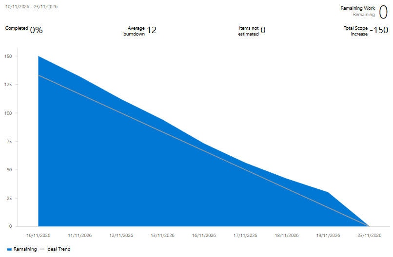

# Review Sprint 3

| Informação | Definição |
|---|---|
| Projeto | ClinicalStudyPB — Engenharia de Software II, UEPB, 2026.2 |
| Product Owner da Sprint | Suelle Ferreira Maciel |
| Período planejado | 10/11/2026 a 23/11/2026 |
| Situação | Concluída em 23/11/2026, apresentada na Review de 24/11/2026 |
| Release | Release 2 |

## Resumo da Sprint

A Sprint 3 teve como objetivo concluir os requisitos RF12 a RF18, que tratam do acompanhamento dos participantes incluídos nos estudos e da área do participante no aplicativo mobile.

Na web e no backend, a sprint cobriu:

- o agendamento de visitas;
- o registro de realização, ausência e cancelamento;
- os resultados fictícios das atividades previstas;
- o histórico de visitas e avaliações;
- a retirada do participante.

No aplicativo mobile, a sprint entregou o login restrito ao perfil participante e as consultas de estudos, próximas visitas e histórico de comparecimento.

A sprint foi organizada a partir de um cronograma com prazo para cada task e com as dependências entre backend, web e mobile explícitas. Isso permitiu que web e mobile avançassem com serviços simulados enquanto os endpoints eram construídos, e passassem para a API real assim que cada endpoint ficou pronto.

## O que foi entregue

### Backend

- Modelo de dados e migrações do acompanhamento: visitas agendadas, resultados, correções e retirada.
- Contrato da API de acompanhamento e documentação OpenAPI.
- Listagem das participações do estudo, com situação Ativo ou Retirado.
- Agendamento e reagendamento de visitas (RF12).
- Registro de realização, ausência e cancelamento, com correção justificada (RF13), e bloqueio do encerramento do estudo quando há visita agendada (RF07).
- Registro, edição e consulta dos resultados fictícios por atividade prevista (RF14).
- Histórico da participação, com visitas, resultados, correções e retirada (RF15).
- Retirada irreversível do participante, com motivo obrigatório (RF16).
- Consultas do participante: estudos, próximas visitas e histórico de comparecimento (RF17 e RF18).
- Sessão por cookie validada no aplicativo.

### Web

- Lista de participantes incluídos, com ações por perfil.
- Agendamento e reagendamento de visitas.
- Registro de realização, ausência e cancelamento, e correção de visitas.
- Tela de resultados das atividades previstas.
- Tela de histórico do participante.
- Retirada do participante, pela lista e pelo histórico.
- Acesso do pesquisador responsável somente para consulta.
- Guia de execução web atualizado e evidências da Sprint 3.

### Mobile

- Login e logout integrados à API.
- Acesso restrito ao perfil participante: os demais perfis recebem um aviso e são direcionados ao sistema web.
- Sessão recuperada ao abrir o app e verificada novamente ao voltar do segundo plano.
- Aba Estudos, com participação ativa ou retirada (RF17).
- Aba Visitas, com próximas visitas e histórico de comparecimento (RF18).
- Testes de componentes e fluxo E2E com Maestro (login, navegação pelas abas e logout).

### Documentação

- Diagramas de sequência do recrutamento, das visitas, dos resultados e da retirada.
- Evidências da web, do mobile e do backend (Spring, Swagger e Postman) em `releases/release2/evidencias/`.
- Tabela de testes da Release 2, cobrindo backend, web e mobile.
- Planning e Review da Sprint 3.

## Validação e qualidade

- **Backend:**
  - **586 testes** automatizados aprovados, sem falhas nem erros (`./mvnw verify`).
  - Cobertura de **97,7% das linhas** e **98,1% nas classes de serviço**, acima da meta de 80% (JaCoCo).
  - 24 cenários no Swagger e coleção do Postman executada com **211 testes e 0 falhas**, do RF12 ao RF18.
- **Web:** 642 testes aprovados em 42 arquivos, com **99,4%** de cobertura de linhas, e 3 cenários E2E com Playwright aprovados.
- **Mobile:** 39 testes aprovados e o fluxo E2E do Maestro executado com sucesso.

O detalhamento por teste e os links para as evidências estão na [tabela de testes da Release 2](../../evidencias/tabela-de-testes.md).

## Melhorias incorporadas durante a Sprint

Além do escopo planejado, a equipe incorporou ajustes que reforçaram a segurança, a consistência e a experiência de uso:

- **Cancelamento automático na retirada:** as visitas agendadas são canceladas com o motivo "Retirada do participante". As visitas realizadas e seus resultados são preservados.
- **Controle de operações simultâneas:** o backend bloqueia o estudo antes de agendar, registrar, corrigir e retirar, evitando conflitos entre operações ao mesmo tempo.
- **Rotas GET de visita e de resultados:** a necessidade surgiu durante a sprint, para que a tela de resultados funcionasse com a API real.
- **Web protegida contra rotas inexistentes:** as chaves de `recursosAcompanhamento` e o redirecionamento do erro 403 evitaram que a web chamasse rotas que o backend ainda não oferecia.
- **Sessão no aplicativo:** além da recuperação e da nova verificação, as requisições têm tempo limite, para o login não travar.
- **Ambiente com Docker:** a web executada pelo `docker-compose` passou a usar a API real em todos os fluxos.
- **Ícone da marca na página web:** o ícone padrão do Vite foi trocado pelo frasco verde usado no cabeçalho do site.

## Escopo combinado

- **Auditoria (D12):** ficou fora do escopo, por acordo com a professora.
- **Tela de detalhe do estudo e solicitação de retirada pelo app (RF20):** pertencem à Sprint 4.

## Pendências registradas no fechamento

Nenhuma pendência foi registrada nesta sprint.

## Recomendações para a Sprint 4

Pontos identificados durante a Sprint 3 que ficaram para a próxima:

- **Data de inclusão e próxima visita no app:** o backend precisa incluir `dataInclusao` na resposta de `/participante/estudos`. A próxima visita pode ser calculada no app com `/participante/visitas/proximas`.
- **Botões sem ação na aba Visitas:** "Confirmar presença" e "Pedir reagendamento" pertencem ao RF19 e ainda não têm ação.
- **Dados de demonstração:** uma migração com participação e visitas para a conta de participante de teste evitaria repetir o recrutamento a cada teste do app.
- **Testes repetidos no mobile:** unificar `authContext` com `authRestricao` e `login` com `loginRestricao`.
- **Botão "Agendar visitas" na web:** renomear para "Visitas", já que ali também se registra e corrige.
- **Teste instável na web:** o teste de sessão expirada em `autenticacao.test.tsx` às vezes falha, principalmente com a cobertura ligada.
- **Testes do mobile no GitHub Actions:** o pipeline ainda não executa os testes do mobile, que hoje rodam localmente.

## Fechamento da Sprint

A Sprint 3 foi encerrada em 23/11/2026. O Azure DevOps registrou 0 horas de trabalho restante, indicando a conclusão do esforço planejado de 150 horas.

## Burndown da Sprint

*O gráfico registra a evolução do trabalho restante no Azure DevOps.*

### Legenda

- **Eixo X (linha do tempo):** período de execução da Sprint 3, de 10/11 a 23/11/2026.
- **Eixo Y (volume de trabalho):** quantidade de trabalho restante, medida em horas.
- **Área azul (Remaining Work):** representa o volume real de trabalho pendente ao longo da Sprint.
- **Linha ideal (Ideal Trend):** representa a redução esperada do trabalho durante o período.
- **Indicadores de resumo:**
  - **Completed 0% / Remaining Work 0:** como nas sprints anteriores, o Completed pode aparecer como 0% mesmo com o trabalho restante zerado, porque as horas foram decrementadas manualmente nas tasks.
  - **Average Burndown 12:** média de horas reduzidas por dia de trabalho, segundo o Azure.
  - **Total Scope Increase -150:** indicador de variação de escopo do Azure. Esse valor não representa, por si só, aumento ou remoção de funcionalidades.

### Avaliação

1. **Comportamento geral:** o trabalho restante caiu de forma contínua e regular, de 150 horas em 10/11 para cerca de 30 horas em 19/11, acompanhando a linha ideal pouco acima dela durante toda a Sprint. O gráfico mostra apenas dias úteis: o feriado de 20/11 e o fim de semana não aparecem.
2. **Reta final:** as cerca de 30 horas restantes foram concluídas entre 19/11 e 23/11, com os testes de API, a E2E web e as evidências.
3. **Comparação com as sprints anteriores:** o fluxo de entrega foi mais regular do que nas Sprints 1 e 2, com menos concentração de trabalho na reta final.
4. **Fator principal:** o cronograma definido no início da Sprint, com prazo por task e dependências explícitas, permitiu que cada integrante soubesse quando poderia começar e até quando precisava terminar. Foi uma abordagem nova para a equipe e melhorou o fluxo de desenvolvimento.